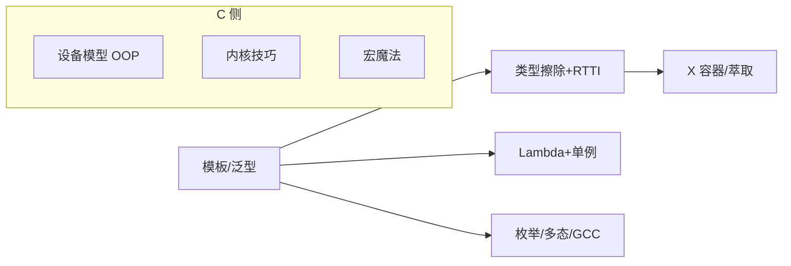

# C / C++ 高级特性与用法（教学版）

> 定位：**纯教学**。每个特性用**标准 C / C++ 原生写法**的最小示例讲清"是什么、怎么用"，不引入第三方别名、不套宏包装，不标注工程出处。拿到笔记只看代码就能懂，需要的话再回工程自己对照。

## 目录导航

### C++（`cpp/`）

| 主题 | 文档 |
| --- | --- |
| 模板：函数/类/非类型参数/CRTP/特化/`if constexpr`/完美转发 | [[模板与泛型编程]] |
| 类型擦除（std::function）+ 轻量 RTTI + `static_assert` | [[类型擦除与轻量 RTTI]] |
| Lambda、回调、单例、`=delete`/`=default`/`explicit` | [[Lambda 回调与单例模式]] |
| `enum class`、constexpr、多态、`using`、前向声明、GCC 扩展、`extern "C"` | [[枚举constexpr多态与GCC扩展]] |
| 容器与类型萃取：array/span/optional/function/type_traits | [[ETL容器与萃取]] |

### C（`c/`）

| 主题                                                                                       | 文档                |
| ---------------------------------------------------------------------------------------- | ----------------- |
| 面向对象 C + 设备模型：函数指针表、container_of、ERR_PTR、宏代码生成                                           | [[面向对象C与设备模型]]    |
| 实时内核技巧：位图+CTZ、`__attribute__((constructor/weak/naked))`、`_Generic`、优先级继承                 | [[嵌入式内核]] |
| 宏魔法与编译期：do-while(0)、`##__VA_ARGS__`、`#error`、`_Static_assert`、`__LINE__` 协程、`__atomic_*` | [[C语言的宏魔法]]       |
| 基础技巧：指定初始化器、数组长度宏、查表、断言宏、`extern "C"`                                                    | [[C 语言高级用法]]      |

