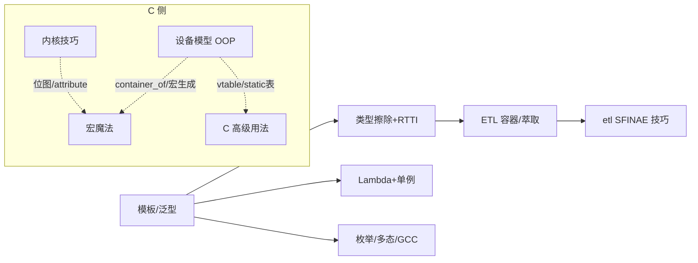

# 📚 C / C++ 高级特性与用法（教学版）

> [!INFO] 笔记概览
> - **核心命题**：本目录的总入口——每个高级特性用**标准 C / C++ 原生写法**的最小示例讲清"是什么、怎么用"，不引第三方别名、不套宏包装、不标工程出处，只看代码就能懂。
> - **内容范围**：C++ 侧（模板 / 类型擦除 / Lambda / 枚举多态 / ETL 容器萃取 / SFINAE）+ C 侧（设备模型 OOP / 内核技巧 / 宏魔法 / 基础技巧）
> - **推荐路径**：先用下方导航表定位主题 → C++ 从「模板」起步 → C 从「设备模型」起步 → 用文末学习地图串联全目录
> - **代码约定**：各笔记遵循自身标准（C11 / C++17）；MCU C 代码统一 **Allman 大括号、4 空格缩进、控制语句强制花括号**。

---

## 🧭 定位

> [!NOTE] 纯教学
> 每个特性用**标准 C / C++ 原生写法**的最小示例讲清"是什么、怎么用"，不引入第三方别名、不套宏包装，不标注工程出处。拿到笔记只看代码就能懂，需要的话再回工程自己对照。

---

## 🧩 C++（`cpp/`）

| 主题 | 文档 |
| :--- | :--- |
| 模板：函数 / 类 / 非类型参数 / CRTP / 特化 / `if constexpr` / 完美转发 | [[模板与泛型编程]] |
| 类型擦除（std::function）+ 轻量 RTTI + `static_assert` | [[类型擦除与轻量 RTTI]] |
| Lambda、回调、单例、`=delete` / `=default` / `explicit` | [[Lambda 回调与单例模式]] |
| `enum class`、constexpr、多态、`using`、前向声明、GCC 扩展、`extern "C"` | [[枚举constexpr多态与GCC扩展]] |
| 容器与类型萃取：array / span / optional / function / type_traits | [[ETL容器与萃取]] |
| ETL 类型萃取与 SFINAE 技巧：placement new / decay_t / is_same_v / enable_if_t | [[etl]] |

---

## 🔧 C（`c/`）

| 主题 | 文档 |
| :--- | :--- |
| 面向对象 C + 设备模型：函数指针表、container_of、ERR_PTR、宏代码生成 | [[面向对象C与设备模型]] |
| 实时内核技巧：位图 + CTZ、`__attribute__((constructor/weak/naked))`、`_Generic`、优先级继承 | [[嵌入式内核]] |
| 宏魔法与编译期：do-while(0)、`##__VA_ARGS__`、`#error`、`_Static_assert`、`__LINE__` 协程、`__atomic_*` | [[C语言的宏魔法]] |
| 基础技巧：指定初始化器、数组长度宏、查表、断言宏、`extern "C"` | [[C语言高级用法]] |

---

## 🗺️ 学习地图

> [!TIP] 怎么读这张图
> C++ 侧以「模板」为根，向下派生类型擦除、Lambda、枚举多态，再汇聚到 ETL 容器与 SFINAE 技巧；C 侧四篇相互引用（设备模型 ↔ 宏魔法 ↔ 内核技巧 ↔ 基础技巧），`container_of`、vtable、`##` 代码生成是它们的公共纽带。

---

## 🔗 思考与延伸索引

- [[模板与泛型编程]] — C++ 侧的根，泛型与编译期分派起点
- [[ETL容器与萃取]] / [[etl]] — 定容容器、类型萃取与 SFINAE 落地
- [[面向对象C与设备模型]] — C 侧的根，vtable / container_of / ERR_PTR
- [[C语言的宏魔法]] — 贯穿 C/C++ 的编译期技巧（`##`、`_Static_assert`）

---

## 📚 参考资料

1. **ISO/IEC 14882 (C++) / 9899 (C)** — 标准原文（模板、constexpr、指定初始化器、`_Static_assert`）.
2. **cppreference.com** — C / C++ 特性权威速查.
3. **ETL (Embedded Template Library)** 官方文档 — 定容容器与 type_traits.
4. 项目内部笔记：本目录 `cpp/` 与 `c/` 全部文档。
