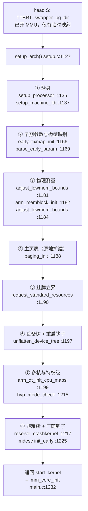
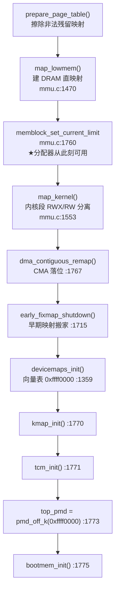
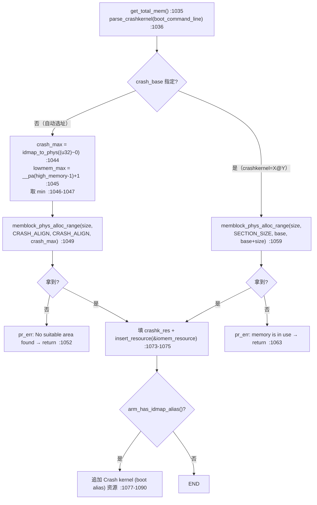

# 🏗️ 32 位 ARM `setup_arch()` 架构初始化全景

> [!INFO] 笔记概览
> - **定位**：`setup_arch()` 是**从裸机汇编跨入通用 C 子系统**的枢纽——执行前内核靠 `head.S` 搭的临时映射勉强存活，执行后物理边界定型、直映射页表建满、硬件拓扑理清，才具备把世界交给 `mm_core_init()` 与 `sched_init()` 的资格。
> - **内容范围**：运行约束 · 31 步真实执行序 · 768MB 生死线推导 · 阶段 1 板级匹配 · 阶段 2 早期参数与微型映射 · 阶段 3 物理测量与主页表（`paging_init`）· 阶段 4–6 设备树/多核/crashkernel · 权责边界 · 可观测抓手。
> - **推荐路径**：先 §1 运行约束 → §2 31 步执行序建立总览 → §3 768MB 生死线（核心算术）→ §4–§6 三大硬核阶段 → §7–§9 其余阶段 → §10 权责边界 → 再用 §12 抓手实测落地。

> 本文所有结论均对照本仓库源码逐行核实，格式为 `文件:行号`。

相关笔记：[[KERNEL_READING_ORDER]]

---

## 🧭 1. 运行环境：为什么这段代码"一步走错就变砖"

调用点 `init/main.c:1175`：`setup_arch(&command_line);` —— 位于 `start_kernel()` 内相当靠前的位置（`pr_notice(linux_banner)` 之后、`sched_init()` 之前）。

| 约束 | 具体状态 | 后果 |
| --- | --- | --- |
| **无 Slab / 无伙伴系统** | `kmem_cache_init()` 要到 `mm/mm_init.c:2672` 才被调用，晚整个 `setup_arch` | `kmalloc()` 一律不可用；分配物理页只能用 `early_alloc()`（即 memblock） |
| **memblock 自身也还没完全可用** | `memblock_set_current_limit()` 迟至 `arch/arm/mm/mmu.c:1760` 才设 | `paging_init()` 前半段连 memblock 分配都不能用，只能碰**预先存在**的 `bm_pte` 静态页 |
| **单核** | 次核尚未唤醒 | `smp_build_mpidr_hash()` 只是算参数，真正用它的代码跑在 `head.S` 的次核入口 |
| **临时映射存活范围极小** | `head.S` 只保证了内核镜像 + 第一个 DRAM bank 的映射 | 解引用未映射地址 = 立即 Data Abort，且此时**连处理 Abort 所需的向量表都还没映射**（向量表在 `devicemaps_init()` 才建）→ 死循环 |
| **MMU 已开、但权限模型粗** | 全程 Section（1MB）粒度 | 见下方 [[#6. 阶段 3：物理测量与主页表]] 中 `map_kernel()` 一节 |

> [!TIP] 本仓库里已经在读这个文件
> `arch/arm/kernel/setup.c` 中已有手写中文注释：`:774`（`cpu_init()` — 初始化异常向量对应的 stack）、`:782`（`for_each_machine_desc`）、`:790`（`arm_add_memory` 对齐）、`:653`（MPIDR 哈希压缩）。笔记与这些标注位置一致。

---

## 📜 2. 真实执行序（31 步，含常见文档漏掉的十余步）

下面是 `arch/arm/kernel/setup.c:1127-1227` 的**逐行**展开。加粗项是常见科普文档里缺失的步骤。



| # | 调用 | 行号 | 常见文档 | 备注 |
| --- | --- | --- | --- | --- |
| 0 | `atags_vaddr = FDT_VIRT_BASE(__atags_pointer)` | `:1132-1133` | 漏 | 把 bootloader 传下来的 DTB **物理**地址折成早期**虚拟**地址 |
| 1 | `setup_processor()` | `:1135` | ✔ | |
| 2 | `setup_machine_fdt()` | `:1137` | ✔ | |
| 3 | `memblock_reserve(__atags_pointer, fdt_totalsize())` | `:1139-1140` | ✔ | 只在 DT 匹配成功时保留 |
| 4 | `setup_machine_tags()`（ATAGS 兜底） | `:1143` | ✔ | |
| 5 | `dump_machine_table()`（失败分支，**永不返回**） | `:1150` | 漏 | 见 `:777-789`，末尾 `while (true)` 死循环 |
| 6 | `machine_desc` / `machine_name` / `dump_stack_set_arch_desc` 赋值 | `:1153-1155` | 部分 | |
| 7 | `reboot_mode = mdesc->reboot_mode` | `:1157-1158` | ✔ | |
| 8 | **`setup_initial_init_mm(_text, _etext, _edata, _end)`** | `:1160` | **漏** | 给 `init_mm` 填内核镜像边界，后续 `exit_mm`/core dump 依赖它 |
| 9 | **`strscpy(cmd_line, boot_command_line)` + `*cmdline_p`** | `:1163-1164` | 漏 | `setup_arch()` 唯一的"输出参数" |
| 10 | `early_fixmap_init()` | `:1166` | ✔ | |
| 11 | `early_ioremap_init()` | `:1167` | ✔ | |
| 12 | `parse_early_param()` | `:1169` | ✔ | 注意通用层在 `init/main.c:1204` **又调了一次** |
| 13 | **`early_mm_init(mdesc)`** | `:1172` | **漏** | 内含 `build_mem_type_table()`，必须在算边界之前 |
| 14 | **`setup_dma_zone(mdesc)`** | `:1174` | **漏** | 定 `arm_dma_limit` |
| 15 | **`xen_early_init()` / `arm_efi_init()`** | `:1175-1176` | **漏** | ARM32 上二者通常是空桩 |
| 16 | `adjust_lowmem_bounds()` | `:1181` | ✔ | |
| 17 | `arm_memblock_init(mdesc)` | `:1182` | ✔ | |
| 18 | `adjust_lowmem_bounds()`（二次修正） | `:1184` | ✔ | 上一行注释 `:1183`：`Memory may have been removed so recalculate the bounds.` |
| 19 | **`early_ioremap_reset()`** | `:1186` | **漏** | ⚠ 位置关键：在 `paging_init()` **之前**收回早期映射，之后设备访问全走 fixmap 重建（见下） |
| 20 | `paging_init(mdesc)` | `:1188` | ✔ | 全文最难一步 |
| 21 | **`kasan_init()`** | `:1189` | **漏** | 必须在主页表建好之后 |
| 22 | `request_standard_resources(mdesc)` | `:1190` | ✔ | |
| 23 | `register_restart_handler(&arm_restart_nb)` | `:1192-1195` | ✔ 但**有条件** | 包在 `if (mdesc->restart)` 内，**非无条件** |
| 24 | `unflatten_device_tree()` | `:1197` | ✔ | |
| 25 | `arm_dt_init_cpu_maps()` / `psci_dt_init()` | `:1199-1200` | 漏 `psci_dt_init` | PSCI 固件接口探测 |
| 26 | `smp_init_cpus()` + `smp_build_mpidr_hash()` | `:1209-1210` | ✔ 但**有条件** | `#ifdef CONFIG_SMP` + `if (is_smp())` |
| 27 | `hyp_mode_check()` | `:1214-1215` | ✘ **条件写反** | 仅 `if (!is_smp())` 时执行 |
| 28 | `reserve_crashkernel()` | `:1217` | ✔ | |
| 29 | **`vgacon_register_screen()`** | `:1219-1223` | 漏 | `CONFIG_VT` + `CONFIG_VGA_CONSOLE` |
| 30 | `mdesc->init_early()` | `:1225-1226` | ✔ | |

---

## 🧮 3. 核心算术：768MB 生死线

### 3.1 `arm_lowmem_limit` 的运行时推导

`arm_lowmem_limit` **不是编译期常数**，由 `adjust_lowmem_bounds()` 运行时计算（`arch/arm/mm/mmu.c:1178`）：

```c
vmalloc_limit = (u64)VMALLOC_END - vmalloc_size - VMALLOC_OFFSET -
                PAGE_OFFSET + PHYS_OFFSET;
```

> `arch/arm/mm/mmu.c:1191-1192`

代入本仓库常量：

| 量 | 值 | 出处 |
| --- | --- | --- |
| `VMALLOC_END` | `0xff800000`（硬编码） | `arch/arm/include/asm/pgtable.h:51` |
| `PAGE_OFFSET` | `UL(CONFIG_PAGE_OFFSET)` —— **随 `VMSPLIT_*` 配置而变**，默认 `0xc0000000` | `arch/arm/include/asm/memory.h:34`；`arch/arm/Kconfig:1030-1036` |
| `vmalloc_size` 默认 | `240 * SZ_1M` | `arch/arm/mm/mmu.c:1146` |
| `VMALLOC_OFFSET` | `8*1024*1024`（8MB 保护带） | `arch/arm/include/asm/pgtable.h:49` |

默认 3G/1G 切分下（`PAGE_OFFSET = 0xc0000000`）：

$$
\begin{aligned}
\text{direct-map 窗口} &= \texttt{VMALLOC\_END} - \texttt{PAGE\_OFFSET} = \texttt{0xff800000} - \texttt{0xc0000000} = \texttt{0x3f800000} = 1016\ \text{MB}\\
\text{lowmem 容量} &= 1016 - 240 - 8 = \boxed{768\ \text{MB}}\\
\text{arm\_lowmem\_limit} &= \text{PHYS\_OFFSET} + 768\ \text{MB}
\end{aligned}
$$

> [!IMPORTANT] 768MB 只对默认布局成立
> 因为 `PAGE_OFFSET` 可配，同一个 `VMALLOC_END = 0xff800000` 会得出完全不同的生死线（下表按 `VMALLOC_END - PAGE_OFFSET - 240MB - 8MB` 计算）：

| `VMSPLIT` 选项 | `PAGE_OFFSET` | 内核虚拟空间 | lowmem 容量上限 |
| --- | --- | --- | --- |
| `VMSPLIT_1G` | `0x40000000` | 3064 MB | 2816 MB |
| `VMSPLIT_2G` | `0x80000000` | 2040 MB | 1792 MB |
| `VMSPLIT_3G_OPT` | `0xB0000000` | 1272 MB | 1024 MB |
| **默认（3G/1G）** | `0xC0000000` | **1016 MB** | **768 MB** |

> [!CAUTION] 注意：生死线是 768MB，且随 VMSPLIT / vmalloc= 移动，切勿按 784MB 硬记
> 正确推导是 `0xff800000 − 768MB(3G/1G 下)…` 即 **1016 − 240 − 8 = 768MB**。这是因为 `VMALLOC_END` 顶端留了 8MB（所以不是 1024MB），且还要再扣掉 `VMALLOC_OFFSET` 的 **8MB 保护带**。任何"1024 − 240 = 784"的口算是漏掉了这 8MB 保护带的误算。最稳妥的口径是**记住公式，别记数字**：换 `VMSPLIT` 或加 `vmalloc=` 都会移动这条线。这也是 ARM32 上"大内存板子要么上 LPAE、要么把 `PAGE_OFFSET` 往下调、要么接受 HIGHMEM 映射开销"的根因。

> [!NOTE] `vmalloc_size` 可调
> `vmalloc=` 参数由 `early_vmalloc()` 解析，注册在 `arch/arm/mm/mmu.c:1174`（`early_param`）。改大 vmalloc 会**压低** lowmem 上限。nommu 配置下 `VMALLOC_END = 0xffffffff`（`asm/pgtable-nommu.h:63`），整套逻辑不适用。

### 3.2 边界计算里两个容易忽略的细节

1. **首个 bank 起始必须 PMD 对齐**，否则内核把开头一段标成 `NOMAP`（`mmu.c:1198-1206` `memblock_mark_nomap`）。源码注释解释原因（`:1227-1232`）：映射 bank 0 的开头时**还没有任何空闲内存可分配**，所以 bank 0 起点必须段对齐。

2. **`memblock_limit` 还会把可用量再压低一截**（`mmu.c:1234-1239`，向下取整到 PMD `:1248-1254`）。第一个非 PMD 对齐的页会成为分配上限，也就是说"能分配的"往往小于"能映射的"。

**产出**：

- `arm_lowmem_limit`（`mmu.c:1244`）—— 物理地址，**高于此线的 DRAM 归 `ZONE_HIGHMEM`**。
- `high_memory = __va(arm_lowmem_limit - 1) + 1`（`mmu.c:1246`）—— 虚拟侧界标，`mem_high()`/`pfn_to_page` 合法性判断依赖它。

---

## 🔍 4. 阶段 1：验明正身与板级匹配

### 4.1 `setup_processor()` — `arch/arm/kernel/setup.c:731`

```
midr = read_cpuid_id()                        :733   ← CP15 MIDR
list = lookup_processor(midr)                 :734
```

`lookup_processor()`（`:717`）在 **链接器构建的 `proc_info_list` 表**（来自 `arch/arm/mm/proc-*.S`，见注释 `:713-716`）中匹配 Implementer/Variant/Part/Architecture。匹配失败的处理非常暴力：

> [!WARNING] `setup.c:721-726`
> `pr_err("CPU%u: configuration botched (ID %08x), CPU halted")` 之后是 `while (1)` **死循环**，且注释明确写 *"can't use cpu_relax() here as it may require MMU setup"*。

匹配成功后填充：

| 动作 | 行号 | 说明 |
| --- | --- | --- |
| `cpu_name = list->cpu_name` | `:736` | |
| `__cpu_architecture = __get_cpu_architecture()` | `:737` | 决定 ARMv5/6/7/8 分支 |
| `init_proc_vtable(list->proc)` | `:739` | **现代做法**：填充 `struct processor` 虚表（取代旧版直接指针赋值） |
| `cpu_tlb = *list->tlb` | `:741` | 仅 `MULTI_TLB` |
| `cpu_user = *list->user` | `:744` | 仅 `MULTI_USER` |
| `cpu_cache = *list->cache` | `:747` | 仅 `MULTI_CACHE` |
| `pr_info("CPU: ... revision %d (ARMv%s), cr=%08lx")` | `:750-752` | 串口上第一行 CPU 信息 |
| `init_utsname()->machine` / `elf_platform` | `:754-757` | `uname -m` 的来源 |
| `elf_hwcap = list->elf_hwcap` + `cpuid_init_hwcaps()` | `:758-760` | 用户态 `AT_HWCAP` |
| `patch_aeabi_idiv()` | `:761` | 硬/软除法的 ABI 补丁 |
| 无 `CONFIG_ARM_THUMB` 时清 `HWCAP_THUMB\|HWCAP_IDIVT` | `:763-765` | |
| `init_default_cache_policy(list->__cpu_mm_mmu_flags)` | `:767` | `CONFIG_MMU`，接 `cachepolicy=` |
| `erratum_a15_798181_init()` / `elf_hwcap_fixup()` / `cacheid_init()` | `:769-773` | |
| `cpu_init()` | `:774` | 建异常向量对应的栈与 TLS |

### 4.2 Machine descriptor：这套老机制在本树仍然活着

`struct machine_desc` 定义在 `arch/arm/include/asm/mach/arch.h:24-60`。表由 `MACHINE_START`（`arch.h:78`）/ `DT_MACHINE_START`（`arch.h:88`）把实例塞进 `.arch.info.init` 段，链接脚本收拢：

```ld
.init.arch.info : {
    __arch_info_begin = .;
    KEEP(*(.arch.info.init))
    __arch_info_end = .;
}
```

> `arch/arm/kernel/vmlinux.lds.S:100-104`；另有 `vmlinux.lds.S:178` 的 `ASSERT((__arch_info_end - __arch_info_begin), "no machine record defined")`——**一个板级描述符都没有就链接失败**。

`setup_arch()` 实际读取的字段（其余字段由别的阶段用）：

| 字段 | 声明 | 被 `setup_arch` 读取处 |
| --- | --- | --- |
| `name` | `arch.h:26` | `setup.c:1154` `machine_name` |
| `dt_compat` | `arch.h:28` | `devtree.c:181` 匹配 |
| `dma_zone_size` | `arch.h:34` | 经 `setup_dma_zone()`，`mm/init.c:103-106` |
| `video_start`/`video_end` | `arch.h:37-38` | `setup.c:938-940` |
| `reserve_lp0/1/2` | `arch.h:40-42` | `setup.c:948-952` |
| `reboot_mode` | `arch.h:43` | `setup.c:1157-1158` |
| `smp` / `smp_init` | `arch.h:47-48` | `setup.c:1206-1207` / `:1203` |
| `map_io` | `arch.h:53` | **经 `paging_init`→`devicemaps_init`**，`mmu.c:1437-1438` |
| `init_early` | `arch.h:54` | `setup.c:1225-1226` |
| `init_irq` / `init_time` | `arch.h:55-56` | **不在 `setup_arch`**，在 `arch/arm/kernel/irq.c:133` 与 `time.c:90` |
| `init_machine` / `init_late` | `arch.h:57-58` | **不在 `setup_arch`**，走 initcall：`setup.c:975-976` / `:987-988` |
| `restart` | `arch.h:59` | `setup.c:1192-1193` |
| `reserve` | `arch.h:52` | `mm/init.c:190-191`（`arm_memblock_init`） |

> [!NOTE] 已删除字段
> `phys_io`、`io_pg_offst`、`nr_irqs`、`nr_dram_bases`、`nr_dram_sizes`、`dram_bank` 在本树 `arch/arm/` 下**全仓库零命中**。内存布局改由 DT + `arm_add_memory()`（`setup.c:791`）提供。老文档若还在讲 `MAP_BASE`/`PHYS_IO` 就过期了。

### 4.3 `setup_machine_fdt()` — `arch/arm/kernel/devtree.c:192`

1. `arch.h` 表的兜底项内嵌于此：`DT_MACHINE_START(GENERIC_DT, "Generic DT based system")`（`devtree.c:196-199`），`:201` 取址赋给 `mdesc_best`。
2. `of_flat_dt_match_machine(mdesc_best, arch_get_next_mach)`（`devtree.c:206`）遍历表的 `dt_compat[]` 与 DTB 根节点 `compatible` 比对；`arch_get_next_mach()` 在 `devtree.c:172-183`。
3. **匹配不到就落到 `GENERIC_DT`**；匹配到则 `__machine_arch_type = mdesc->nr`（`devtree.c:235`）。

> [!INFO] 本树的实际状态
> `arch/arm/mach-imx/` 里 `DT_MACHINE_START` **依然大量存在**（`mach-imx6ul.c:53`、`mach-imx6q.c:265`、`mach-imx7d.c:132` …），也就是说 i.MX 平台走的是**真实 mdesc**，而非 GENERIC_DT。所以本树里 `mdesc->init_early` 这条路径是有意义的通用逻辑，不是死代码。

### 4.4 ATAGS 兜底仍被编译进来

`setup_machine_tags()` 定义在 `arch/arm/kernel/atags_parse.c:177`，由 `CONFIG_ATAGS` 控制编译；`arch/arm/Kconfig:1391-1393` 显示 **`default y`**。关掉它时 `atags.h:9` 的桩函数会直接打印 `no ATAGS support: can't continue` 并死循环。

由于 `DT_MACHINE_START` 生成的描述符 `.nr = ~0`，用 ATAGS 的机器 ID 去查表必然查不到 → `setup.c:1144-1151` 报错 → `dump_machine_table()` 挂死。这就是**纯 DT 内核被 u-boot 以 ATAGS 方式引导时的经典死法**。

---

## ⚙️ 5. 阶段 2：早期参数与微型映射

### 5.1 `early_fixmap_init()` — `arch/arm/mm/mmu.c:368`

```c
pmd = fixmap_pmd(FIXADDR_TOP);
pmd_populate_kernel(&init_mm, pmd, bm_pte);   /* :380 */
pte_offset_fixmap = pte_offset_early_fixmap;  /* :382 */
```

> [!IMPORTANT] 为什么这一小段值得读
> `bm_pte` 是**编译期就存在的静态页表页**。此时 memblock 还没设 current limit、任何分配都可能踩到未映射内存，所以早期 fixmap **不允许触发分配**——只能把一个已经躺在 `.bss` 里的 PTE 页挂上去。`:376-377` 的 `BUILD_BUG_ON` 也在强制"早期 fixmap 区间必须落在同一个 PMD 内"，因为一张 `bm_pte` 装不下跨 PMD 的范围。

`early_ioremap_init()` 在 `arch/arm/mm/ioremap.c:517`，用固定槽位 + 忙/闲位图提供成对的临时映射（`set_fixmap` 走 `mmu.c:390` `__set_fixmap`）。

### 5.2 `parse_early_param()` — 注册在 ARM 侧的 `early_param`

| 参数 | 处理函数 | 注册位置 |
| --- | --- | --- |
| `mem=` | `early_mem` | `arch/arm/kernel/setup.c:884` |
| `vmalloc=` | `early_vmalloc` | `arch/arm/mm/mmu.c:1174` |
| `cachepolicy=` | `early_cachepolicy` | `arch/arm/mm/mmu.c:134`（nommu 版 `:205`） |
| `nocache=` | `early_nocache` | `arch/arm/mm/mmu.c:173` |
| `nowb=` | `early_nowrite` | `arch/arm/mm/mmu.c:182` |
| `ecc=` | `early_ecc` | `arch/arm/mm/mmu.c:192` |
| `coherent_pool=` | `early_coherent_pool` | `arch/arm/mm/dma-mapping.c:195` |
| `earlyprintk=` | `setup_early_printk` | `arch/arm/kernel/early_printk.c:47` |

`earlycon` 属通用层（`drivers/tty/serial/earlycon.c`）。注意 `parse_early_param()` 会被调用**两次**：本处 `setup.c:1169`，以及 `init/main.c:1204`。

### 5.3 `early_mm_init()` — `mmu.c:1778`，`setup.c:1172` 调用

```c
build_mem_type_table();      /* mmu.c:1780 → 定义在 mmu.c:435 */
early_paging_init(mdesc);    /* mmu.c:1781 → LPAE 版 :1654 / 空桩版 :1728 */
```

`build_mem_type_table()` 根据 CPU 架构与 `cachepolicy=` 生成 `mem_types[]`（`MT_DEVICE`/`MT_MEMORY_RW`/`MT_HIGH_VECTORS`… 的属性位），**必须在 `paging_init` 之前完成**，否则后面所有 `create_mapping()` 都拿不到正确的 PTE 属性。这是"为什么 `early_mm_init` 排在算边界前面"的答案。

`setup_dma_zone()`（`arch/arm/mm/init.c:98`）在 `CONFIG_ZONE_DMA` 下由 `mdesc->dma_zone_size` 定 `arm_dma_limit = PHYS_OFFSET + size - 1`（`:103`），未给则放宽到 `0xffffffff`（`:105`）。

---

## 🏗️ 6. 阶段 3：物理测量与主页表

### 6.1 `arm_memblock_init()` — `arch/arm/mm/init.c:180`

严格按序：

| 步 | 动作 | 行号 |
| --- | --- | --- |
| 1 | `memblock_reserve(__pa(KERNEL_START), KERNEL_END - KERNEL_START)` 登记内核镜像 | `:183` |
| 2 | `reserve_initrd_mem()` 登记 initrd | `:185` |
| 3 | **`arm_mm_memblock_reserve()` 登记页表本身** | `:187` |
| 4 | `mdesc->reserve()` 板级自定义保留 | `:190-191` |
| 5 | `early_init_fdt_scan_reserved_mem()` 解析 DT `reserved-memory` 节点 | `:193` |
| 6 | `dma_contiguous_reserve(arm_dma_limit)` 预留 CMA | `:196` |
| 7 | `arm_memblock_steal_permitted = false` 关闭"偷内存"权限 | `:198` |
| 8 | `memblock_dump_all()` 打印 | `:199` |

> [!NOTE] 第 3 步是常见文档漏掉的关键
> `arm_mm_memblock_reserve()`（`arch/arm/mm/mmu.c:1335`）执行 `memblock_reserve(__pa(swapper_pg_dir), SWAPPER_PG_DIR_SIZE)`（`:1341`）。因为 `swapper_pg_dir` 位于内核 BSS，**若这里不登记，`paging_init()` 分配的页表会和已有页表重叠**。`SWAPPER_PG_DIR_SIZE` 在 LPAE 下含 PMD 表：`mmu.c:1324-1330`。

`arm_memblock_steal()`（`init.c:147-162`）是"分配后立即 `memblock_remove`"的偷取原语，`:151` 的 `BUG_ON` 配合第 7 步：一旦越过 `arm_memblock_init`，任何偷内存行为直接 panic。

### 6.2 `paging_init()` — `arch/arm/mm/mmu.c:1748`（本树 11 个子步骤）

> [!WARNING] 注意：ARM32 的直映射是「同一张表原地扩建」，不存在"页表切换"
> `swapper_pg_dir` 从 `head.S` 一开始就被加载进 TTBR1，`paging_init()` 全程复用这张表，只是在上面**原地扩建**：`prepare_page_table()` 先擦掉不该留的段，`map_lowmem()`/`map_kernel()` 再把完整的直映射填回去，CPU 全程不换表。证据链：
> - `arch/arm/kernel/head.S:48` — `.equ swapper_pg_dir, KERNEL_RAM_VADDR - PG_DIR_SIZE`
> - `arch/arm/kernel/head.S:139` — `bl __create_page_tables`（汇编直接把表项写进 `swapper_pg_dir`）
> - `arch/arm/kernel/head.S:167` — `mov r8, r4 @ set TTBR1 to swapper_pg_dir`
>
> 只有 `CONFIG_ARM_LPAE` + 物理地址高于 4G 的特殊场景（`early_paging_init()`，`arch/arm/mm/mmu.c:1622`）才存在真正的页表重建与跳转。**对比 x86-16 位/64 位早期"临时页表 → 最终页表"的两段式，ARM32 是一段式原地生长。**



> [!NOTE] 7.3.0 的 `paging_init()` 已不再包含 zero page 的 `early_alloc(PAGE_SIZE)` / `flush_dcache_page()` 两步，改由 `mm_core_init()` 的 `init_zero_page_pfn()`（`mm/mm_init.c:2646`）完成。

#### `prepare_page_table()`（`mmu.c:1273`，函数体到 `:1322`）：先拆后建

把 `MODULES`～`PAGE_OFFSET`（`:1305-1306`）以及"第一个 lowmem block 末尾 ～ `VMALLOC_START`"（`:1319-1321`）之间的 PMD 全清掉，**但保留第一个 DRAM bank 与内核映射**——否则清完当场就不认识自己了。

#### `map_lowmem()`（`mmu.c:1470`）：六种 kernel 落位情形

`for_each_mem_range` 遍历 DRAM，`end` 被 `arm_lowmem_limit` 夹住（`:1481-1482`），然后按"内核镜像是否落在该 range 内"分六种情形处理（源码 ASCII 图 `:1486-1508`，代码 `:1510-1544`）：Case 6（内核嵌在 range 中间）会拆成两段映射（`:1517-1530`），Case 5（内核覆盖整个 range）直接 `break`（`:1511-1512`）。

#### `map_kernel()`：段粒度带来的"暂时不安全"

`map_kernel()`（`mmu.c:1553-1612`）在 `__pa(__init_end)` 处向上取整到段边界（`:1580`），把内核切成 **RWX 段**（`:1597-1601`，`MT_MEMORY_RWX`）与 **RW 段**（`:1607-1611`，`MT_MEMORY_RW`）。

> [!WARNING] 源码原话（`mmu.c:1570-1574`）
> *"we are dealing with section sized mappings here so all of this will be bumped to the closest section boundary. This means that **some of the non-executable part of the kernel memory is actually mapped as executable**. This will only persist until we turn on proper memory management later on and we remap the whole kernel with page granularity."*
>
> 即：内核文本段的 WX 窗口**在 `setup_arch` 期间是已知且被接受的**，真正的 W^X 收紧发生在后续 `vmalloc_init()`/只读化（`mm/mm_init.c:2682`）之后。

#### `early_fixmap_shutdown()`（`mmu.c:1715-1742`）：搬家而非删除

`:1720` 把 `pte_offset_fixmap` 换成 `pte_offset_late_fixmap`，`:1721-1722` 清掉早期 PMD 并 flush；随后 `:1724-1741` 遍历所有永久 fix 槽位，**只对 `L_PTE_MT_DEV_SHARED` 的设备映射重新 `create_mapping()`**（`:1731-1734`）。这解释了 `early_ioremap_reset()` 为什么能安全地排在 `paging_init` 之前。

#### `devicemaps_init()`（`mmu.c:1359-1457`）—— 最危险的一步

> [!DANGER] `mmu.c:1352-1357`
> *"Since we clear out the page tables for all mappings above VMALLOC_START, except early fixmap, we might remove debug device mappings. This means **earlycon can be used to debug this function**. Any other function or debugging method which may touch any device _will_ crash the kernel."*

建图顺序：

| 步 | 内容 | 行号 |
| --- | --- | --- |
| 1 | `vectors = early_alloc(PAGE_SIZE * 2)` 分配向量页 + `early_trap_init(vectors)` | `:1368`、`:1370` |
| 2 | 清 `VMALLOC_START` → `FIXADDR_TOP & PMD_MASK` 之间的 PMD，**保留 early fixmap 那一页 PMD** | `:1372-1376` |
| 3 | DTB 只读映射：`FDT_FIXED_BASE` + `MT_MEMORY_RO` | `:1378-1385` |
| 4 | cache 清洗区 `FLUSH_BASE` / `FLUSH_BASE_MINICACHE`（老核） | `:1390-1403` |
| 5 | **高端异常向量表 `0xffff0000`**；`CONFIG_KUSER_HELPERS` 时 `MT_HIGH_VECTORS` 否则 `MT_LOW_VECTORS` | `:1410-1418` |
| 6 | 非 high-vectors 时同时在 `0x00000000` 建别名 | `:1420-1425` |
| 7 | `0xffff1000` 内核只读页 | `:1427-1432` |
| 8 | `mdesc->map_io()`，无则 `debug_ll_io_init()` | `:1437-1440` |
| 9 | `fill_pmd_gaps()`（定义 `mmu.c:1070`）填洞 | `:1441` |
| 10 | `pci_reserve_io()` 在 vmalloc 区保留 IO 空间 | `:1444` |
| 11 | `local_flush_tlb_all()` + `flush_cache_all()` | `:1452-1453` |
| 12 | `early_abt_enable()` **打开异步 abort** | `:1456` |

> [!TIP] 第 12 步的深意
> `early_abt_enable()`（`:1456`）此前内核一直屏蔽 SError。注释 `:1446-1450` 说明：刷 TLB/cache 保证写缓冲一致，**"After this point, we can start to touch devices again"**——只有向量表就位、能真正处理异常了，才敢放开异步 abort。

#### 收尾

`kmap_init()`（`mmu.c:1459-1468`）分配 `pkmap_page_table`（`CONFIG_HIGHMEM`）与 fixmap 的 PTE 表；`top_pmd = pmd_off_k(0xffff0000)`（`:1773`）记下向量表 PMD 供后续 kuser helper 使用；`early_alloc(PAGE_SIZE)` 拿到 **zero page**（7.3.0 中此步已不在 `paging_init`，改由 `mm_core_init()` 的 `init_zero_page_pfn()` 完成，见 `mm/mm_init.c:2646`）——它是 `pte_mkdirty`/缺页填零的实体，也是本树里第一块"分配自空闲池"的页；`bootmem_init()`（`init.c:202`）在 7.3.0 里只做 `memblock_allow_resize`→`find_limits`→`early_memtest`；建 mem_map 已不在此——改由 `mm_core_init_early()`（`mm/mm_init.c:2627`）调 `free_area_init()`（定义在 `mm/mm_init.c:1761`，于 `:2631` 调用），后者在 `mm/mm_init.c:1768` 调 `arch_zone_limits_init()`（实现见 `arch/arm/mm/init.c:110`）按 `ZONE_DMA`/`ZONE_NORMAL`/`ZONE_HIGHMEM` 建好 mem_map。

### 6.3 `request_standard_resources()` — `arch/arm/kernel/setup.c:886`

把 `System RAM`、`Kernel code`、`Kernel data`、`Kernel bss` 逐级 `insert_resource()` 进 `iomem_resource`，于是可在 `/proc/iomem` 看到；`mdesc->video_start` 非零时追加 `video RAM`（`:938-940`），`reserve_lp0/1/2` 追加保留区（`:948-952`）。

---

## 🌳 7. 阶段 4：设备树反扁平化与重启挂钩

`unflatten_device_tree()`（`setup.c:1197`）把扁平 DTB 字节流解成 `struct device_node` 树。

> [!NOTE] 顺序要求的真实前提：永久映射 + 可用分配器
> 常见的粗浅说法是"因为解包需要动态内存"——但此时 **slab/kmalloc 仍不可用**（`kmem_cache_init()` 在 `mm/mm_init.c:2672`），与"无动态内存"的说法自相矛盾。真正的约束有两条：
> 1. **分配器**：`unflatten` 用的是 memblock/`early_alloc`，而 memblock 直到 `mmu.c:1760` 设完 current limit 才真正可用（源码注释 `mmu.c:1763-1766` 原话：*"After this point early_alloc(), i.e. the memblock allocator, can be used"*）；
> 2. **映射**：`paging_init` 之前 DTB 只能经 `FDT_VIRT_BASE()` 或 fixmap 的 `FDT_FIXED_BASE`（`mmu.c:1378-1385`）临时访问，而解出来的指针树要**终身可见**。
>
> 所以顺序要求来自"永久映射 + 可用分配器"，与 slab 无关。

重启挂钩：

```c
static void (*__arm_pm_restart)(enum reboot_mode, const char *cmd);   /* setup.c:1113 */
static int arm_restart(...)  { __arm_pm_restart(action, data); ... }  /* setup.c:1115-1120 */
static struct notifier_block arm_restart_nb = { .priority = 128 };    /* setup.c:1122-1125 */
```

> [!WARNING] 注意：重启回调是有条件挂载的
> `register_restart_handler(&arm_restart_nb)` 包在 `if (mdesc->restart)` 内（`setup.c:1192-1195`）。现代平台多用 DT `reboot-mode` / PSCI，此路径可以为空——不要把它描述成无条件挂载。priority 128 让板级重启优先于通用 `reboot` notifier。

---

## 🔗 8. 阶段 5：多核拓扑与特权级

### 8.1 `arm_dt_init_cpu_maps()` — `arch/arm/kernel/devtree.c:65`

| 动作 | 行号 |
| --- | --- |
| 读引导核 MPIDR（仅 SMP） | `:76` |
| 临时映射表初始化为 `MPIDR_INVALID` | `:78` |
| `of_find_node_by_path("/cpus")`，没有就直接返回 | `:80-83` |
| `for_each_of_cpu_node` + `of_get_cpu_hwid()` | `:85-86` |
| 校验 `reg` 不越过 `MPIDR_HWID_BITMASK`（高 8 位必须为 0） | `:94-97` |
| 重复 MPIDR 检测 → `WARN` 并放弃整张表 | `:106-111` |
| 匹配引导核 → 强制其逻辑号为 0，其余从 1 起顺序编号 | `:122-124` |
| `enable-method` 解析（`psci` / `spin-table`） | `:39` |
| 回退到 `/cpus` 节点级 `enable-method` | `:144` |

### 8.2 `smp_build_mpidr_hash()` — `arch/arm/kernel/setup.c:655`

> [!IMPORTANT] 调用条件
> 只在 `#ifdef CONFIG_SMP` 且 `is_smp()` 为真时执行（`setup.c:1201-1211`）。单核平台**不会走到**。

算法：

1. `mask |= cpu_logical_map(i) ^ cpu_logical_map(0)`（`:663-664`）——**预先筛掉从不翻转的比特**，即对全平台无区分度的位。
2. 每个 affinity level 用 `fls()`/`ffs()` 找最高/最低置位（`:670-680`），得到该级实际需要的位数 `bits[i]`。
3. 算出三级移位量（`:691-694`）并压缩成 `mpidr_hash.bits`（`:696`），把稀疏的 24 位 MPIDR 空间压成尽量小的连续索引。
4. 桶数超过 `4 × num_possible_cpus()` 时警告"Large number of MPIDR hash buckets detected"（`:703-708`）。
5. **`sync_cache_w(&mpidr_hash)`（`:709`）**——这一步最容易看不懂：次核启动时 **MMU/缓存尚未开启**，它从 `head.S` 的汇编里直接读这块内存。若不把 D-cache 写回物理内存，次核读到的就是垃圾。注释 `:649-653` 也强调这是"collision free hash"。

结果被 `cpu_logical_map()`/`__cpu_up` 路径与汇编消费，把"查 MPIDR 对应哪个逻辑 CPU"降为一次移位+掩码。

### 8.3 `hyp_mode_check()` — `arch/arm/kernel/setup.c:1096`

> [!DANGER] 注意：该检查仅对非 SMP 触发
> `setup.c:1214-1215`：**`if (!is_smp()) hyp_mode_check();`** 只有**非 SMP** 才在这里检查。多核平台的一致性核查发生在次核上线路径，不在 `setup_arch` 里——不要把它的生效范围当成所有核。

函数体（`CONFIG_ARM_VIRT_EXT` 才有效，`:1098`）：

- `sync_boot_mode()`（`:1099`）记录当前模式；
- `is_hyp_mode_available()` → `pr_info("CPU: All CPU(s) started in HYP mode.")` + `Virtualization extensions available.`（`:1101-1103`）→ KVM 可用；
- `is_hyp_mode_mismatched()` → `pr_warn("...started in wrong/inconsistent modes...")` + `This may indicate a broken bootloader or firmware.`（`:1104-1107`）；
- 否则 `All CPU(s) started in SVC mode.`（`:1108-1109`）→ 传统非虚拟化启动。

---

## 🛡️ 9. 阶段 6：crashkernel 与厂商早期钩子

### 9.1 `reserve_crashkernel()` — `arch/arm/kernel/setup.c:1029`

整个函数被 `CONFIG_CRASH_RESERVE` 包住，关闭时退化为空桩（`:1093`）。



> [!NOTE] "128MB 对齐"只对自动选址成立
> `CRASH_ALIGN = (128 << 20)`（`setup.c:1012`）仅用于 `:1049-1050` 的自动选址路径；用户显式给 `crashkernel=X@Y` 时对齐单位是 **`SECTION_SIZE`**（`:1059`）。
>
> 自动选址的上界 `min(idmap_to_phys(~0), __pa(high_memory-1)+1)`（`:1044-1047`）把崩溃核约束在**低段可恒等映射 + lowmem 内**，比"必须在 Lowmem 范围"这个笼统说法更精确。
>
> `arm_has_idmap_alias()`（`:1077`）分支是为了给 kexec 工具同时公布别名地址（`:1082-1089`）。

### 9.2 `mdesc->init_early()` — `setup.c:1225-1226`

`setup_arch()` 的**最后一步**，把控制权交给 SoC 原厂做芯片级极早期修正。字段声明 `arch.h:54`。

> [!INFO] 现代平台的实际情况
> 该钩子主要被老平台使用；很多新 SoC 的 `DT_MACHINE_START` 只填 `map_io`/`init_irq`/`init_machine`/`init_late`/`dt_compat`，`init_early` 为空——此时这两行就是**纯空操作**，芯片早期工作被下推到 `.map_io`（`mmu.c:1437-1438`）与 `IRQCHIP_DECLARE`/`OF_EARLYCON_DECLARE` 的自动声明机制里。不必一看到"移交厂商钩子"就以为一定有事发生。

---

## 🔀 10. 权责边界：`setup_arch` → `mm_core_init` → initcall

> [!NOTE] 关于函数名：本树（7.3）里没有 `mm_init()`
> 历史上 `setup_arch()` 之后接的是 `mm_init()`，但那是**旧版命名**。在 7.3 本仓库中该函数已更名 `mm_core_init()`：`grep mm_init init/main.c` 已零命中，正确名见 `init/main.c:1232` → 实现 `mm/mm_init.c:2643`。阅读旧资料、对照老内核时，头脑里应把这张表映射到当前命名，避免按名索骥扑空。

| 阶段 | 核心主体 | 调用点 | 内存环境 | 本质工作 | 产物 |
| --- | --- | --- | --- | --- | --- |
| **拓荒打地基** | **`setup_arch()`** | `init/main.c:1175` | 仅 memblock，且前半程连 memblock 都不能分配 | 测物理边界、原地扩建直映射、硬件验身、DT 解包、多核拓扑 | `arm_lowmem_limit`、`high_memory`、`swapper_pg_dir`（扩建完成）、`of_root` 节点树、`iomem_resource`、`mpidr_hash`、`mem_map` |
| **建制通水电** | **`mm_core_init()`** | `init/main.c:1232`<br/>`mm/mm_init.c:2643` | memblock 交权给伙伴系统 | `arch_mm_preinit`→`build_all_zonelists`→`memblock_free_all`→`mem_init`→`kmem_cache_init`→`vmalloc_init` | 伙伴系统链表、`kmalloc()`/`kfree()` 生效、slab、vmalloc 树 |
| **精装搬家具** | **initcall + `mdesc->init_machine()`** | `setup.c:975-976` | 完整动态内存与并发 | DT 节点实例化为 platform_device，驱动 probe | 驱动生效、设备节点、`rest_init()`→PID 1 |

`mm_core_init()` 内部与内存交接直接相关的顺序（`mm/mm_init.c:2643-2693`）：

| 行号 | 调用 | 意义 |
| --- | --- | --- |
| `:2645` | `arch_mm_preinit()` | 架构侧钩子（`arch/arm/mm/init.c:223`） |
| `:2650` | `build_all_zonelists()` | 分配域回退顺序 |
| `:2668` | `kho_memory_init()` | 注释要求"memblock 仍活跃但尽量贴近伙伴系统初始化" |
| `:2670` | **`memblock_free_all()`** | **memblock 把未保留页交还伙伴系统** |
| `:2671` | `mem_init()` | `printk` 内存统计，伙伴系统正式接管 |
| `:2672` | `kmem_cache_init()` | **`kmalloc` 从此可用** |
| `:2680` | `pgtable_cache_init()` | 页表缓存 |
| `:2682` | `vmalloc_init()` | vmalloc 树；内核只读化/W^X 收紧在此后完成 |

> [!SUCCESS] 边界结论
> `setup_arch()` 与 `mm_core_init()` 的分界线，就是 **`memblock_free_all()`（`mm_init.c:2670`）**。在此之前的每一次"分配"都是 memblock 的 `early_alloc`，且**永不返回**（页表一旦分配就用到系统关机）；在此之后才出现真正意义上的可回收内存。

---

## 📖 11. 常见口径与本树实际对照

这一节把容易记岔的说法与本仓库源码的实际行为对照清楚，方便速查：

| 常见口径 | 本树实际 | 证据 |
| --- | --- | --- |
| "`paging_init` 切换到主内核页表" | 全程复用 `head.S` 已加载的 `swapper_pg_dir`，原地扩建 | `head.S:48,167`；`mmu.c:1748` 无 `cpu_switch_mm` |
| "Lowmem ≈ 784MB" | 768MB（1016 − 240 − 8），且还会被 PMD 对齐再压低 | `mmu.c:1191`、`pgtable.h:49,51`、`mmu.c:1146` |
| "`hyp_mode_check()` 检查各核特权模式" | 只在 `!is_smp()` 时执行 | `setup.c:1214-1215` |
| "unflatten 需要动态内存（slab）" | slab 未建立；真实约束是 memblock 可用 + 永久映射 | `mmu.c:1763-1766`、`mm_init.c:2672` |
| "crashkernel 按 128MB 对齐" | 仅自动选址分支；显式地址用 `SECTION_SIZE` | `setup.c:1049` vs `:1059` |
| "无条件注册重启回调" | `if (mdesc->restart)` 才注册 | `setup.c:1192-1195` |

---

## 🔭 12. 可观测抓手

1. **串口日志顺序**即执行顺序：`Linux version` → `CPU: ARMv7 ...`（`setup.c:750`）→ `Machine: ...` → `Memory:`/`memblock_dump_all()`（`init.c:206`）→ `CPU: All CPU(s) started in SVC mode.`（`setup.c:1109`）→ `Reserving N MB of memory at M MB for crashkernel`（`setup.c:1067`）。
2. **`earlycon` 是 `devicemaps_init()` 期间唯一安全的调试手段**（`mmu.c:1352-1357` 明文规定）。
3. `memblock_dump_all()`（`init.c:206`）打印全部 memory/reserved region，是理解 `arm_memblock_init()` 效果最直接的手段。
4. `/proc/iomem` 来自 `request_standard_resources()`（`setup.c:886`）与 crashkernel 的 `insert_resource`（`:1075`）。
5. `mpidr_hash` 参数可通过 `pr_debug`（`setup.c:665`、`:697-702`）打开查看压缩结果。
6. `arm_lowmem_limit` 用 `pr_debug("lowmem limit is %08llx")`（`mmu.c:1761`）确认。

### 附：本笔记事实核查范围

- 核实对象：`arch/arm/kernel/setup.c`、`arch/arm/mm/{mmu,init,ioremap}.c`、`arch/arm/kernel/{devtree,atags_parse}.c`、`arch/arm/include/asm/{mach/arch.h,pgtable.h}`、`arch/arm/kernel/{head.S,vmlinux.lds.S}`、`init/main.c`、`mm/mm_init.c`、`arch/arm/Kconfig`。
- 内核版本：Makefile VER 7.3.0-rc6（mainline，树 HEAD `7b63ef2d5`，2026-10-07）。
- **本文刻意不做 imx6ull 板级特化**，`arch/arm/mach-imx/` 细节仅在说明 `DT_MACHINE_START` 仍存活时顺带提及。

---

## 🔗 思考与延伸索引

- [[KERNEL_READING_ORDER]] — 上游 doc：阶段 1"启动流程"为何最适合作为第一条阅读线
- [[ARM Kernel head.S 内核启动 学习笔记]] — 从汇编视角看 `head.S` 如何先建临时映射、装 TTBR1，再让位给 `setup_arch()`
- [[ARM zImage head.S 启动 学习笔记]] — bootloader→内核入口的宏观前置流程
- [[kernel 中断系统（ARM32）学习笔记]] — `devicemaps_init()` 建的 `0xffff0000` 高端向量表与异常分发的关系
- [[init.main.c]] — `start_kernel()` 内 `setup_arch()` 前后的整体时序与 PID 演化
- [[常用寄存器]] — CP15 相关寄存器（MIDR/MPIDR/TTBR1）参考

---

## 📚 参考资料

1. **Linux Kernel 源码（本仓库 7.3.0-rc6 / mainline）** — `arch/arm/kernel/setup.c`（31 步执行序与全部阶段钩子）.
2. **Linux Kernel 源码（本仓库）** — `arch/arm/mm/mmu.c`（`paging_init`、`adjust_lowmem_bounds`、`devicemaps_init`、`early_paging_init` 指针）.
3. **Linux Kernel 源码（本仓库）** — `init/main.c` 与 `mm/mm_init.c`（`setup_arch` 调用点、`mm_core_init` 更名与内存交接顺序）.
4. **Linux Kernel 源码（本仓库）** — `arch/arm/kernel/head.S`（`swapper_pg_dir` 定义、`__create_page_tables`、TTBR1 装载）。
5. **Linux Kernel 文档** — `Documentation/arm/memory.rst`（ARM32 内存布局 / 常量说明，对应 `PAGE_OFFSET`、`VMALLOC_END` 等）。
6. **Linux Kernel 文档** — `Documentation/arm/`

（注：本文为源码精读笔记，事实来源以本仓库逐行核实为准，格式 `文件:行号` 高频内联。）
