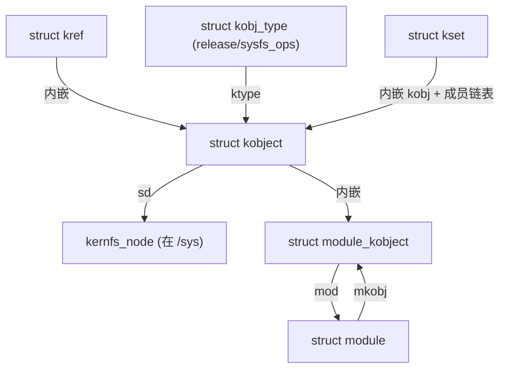

# ⚛️ `kobject` / `module_kobject` 结构精读

> [!INFO] 笔记概览
> - **定位**：`struct kobject` 是设备模型的**原子**（自带 `kref` + 状态位 + sysfs 表现）；`struct module_kobject` 则是"**模块**这一设备模型对象的 kobject 包装"。两者机制同源。
> - **内容范围**：`kobject` / `kref` / `kobj_type` / `attribute`+`kobj_attribute` / `kset`+`kset_uevent_ops`；`module_kobject` / `module_attribute` / `module_version_attribute` / `module_param_attrs`。
> - 概念全景（↔sysfs↔kernfs）见 [[kobject-sysfs-kernfs映射分层]]；本文是**字段级**精读。
> - **引用格式**：`文件:行号`（本仓库 Linux 7.3.0-rc6）。

相关笔记：[[kobject-sysfs-kernfs映射分层]] · [[struct device 精读]] · [[struct module 精读]]

---

## ⚛️ 1. `struct kobject`：模型原子

```c
/* include/linux/kobject.h:64 */
struct kobject {
    const char *name;              // 目录/文件名
    struct list_head entry;        // 挂进所属 kset 的成员链表
    struct kobject *parent;        // 父对象（决定 sysfs 落点 + PM 层级）
    struct kset *kset;             // 所属 kset（分组；无 parent 时可升格为 parent）
    const struct kobj_type *ktype; // 类型：release / sysfs_ops / default_groups …
    struct kernfs_node *sd;        // ↔ sysfs 目录节点（模型 → 视图）
    struct kref kref;              // 引用计数
    // 生命周期记账位：
    unsigned int state_initialized:1;
    unsigned int state_in_sysfs:1;
    unsigned int state_add_uevent_sent:1;
    unsigned int state_remove_uevent_sent:1;
    unsigned int uevent_suppress:1;
#ifdef CONFIG_DEBUG_KOBJECT_RELEASE
    struct delayed_work release;   // 延迟释放（调试用，放大 release 竞态）
#endif
};
```

| 分组 | 字段 | 要点 |
| --- | --- | --- |
| 身份 | `name` | 由 `kobject_set_name()` 写入；`kobject_name()` 读取 |
| 组织 | `entry`/`parent`/`kset` | 成员链表 + 父 + 分组；目录落点看 `parent`（`kset` 可升格） |
| 行为 | `ktype` | **唯一接缝**：归零时调 `ktype->release` |
| 视图 | `sd` | 指向 `kernfs_node`（真实长在 `/sys` 里的节点） |
| 计数 | `kref` | `kobject_get`/`kobject_put` |
| 记账 | `state_*` / `uevent_suppress` | 初始化、在 sysfs、uevent 已发、抑制 uevent |

---

## 🔢 2. `struct kref`

```c
/* include/linux/kref.h:19 */
struct kref { refcount_t refcount; };
```

`kobject` 的计数就靠它。归零时触发 `kobject_release` → `kobject_cleanup` → 调 `ktype->release`。

---

## 🏷️ 3. `struct kobj_type`：kobject 的"类型方法表"

```c
/* include/linux/kobject.h:117 */
struct kobj_type {
    void (*release)(struct kobject *kobj);                     // 必备：归零释放
    const struct sysfs_ops *sysfs_ops;                         // 属性读写路由
    const struct attribute_group **default_groups;             // 默认属性组
    const struct kobj_ns_type_operations *(*child_ns_type)(const struct kobject *);
    const struct ns_common *(*namespace)(const struct kobject *);
    void (*get_ownership)(const struct kobject *, kuid_t *, kgid_t *);
};
```

> [!IMPORTANT] `release` 是"裸 vs 嵌入"的分水岭
> 裸 kobject：`release` 直接 `kfree(kobj)`；嵌入 kobject（如 `struct device`）：`release` 用 `container_of` 找回外层并整体释放。详见 [[kobject-sysfs-kernfs映射分层]] §3。

---

## 🧾 4. `attribute` 与 `kobj_attribute`

```c
/* include/linux/sysfs.h:30 */
struct attribute { const char *name; umode_t mode; /* lockdep 相关 */ };

/* include/linux/kobject.h:140 */
struct kobj_attribute {
    struct attribute attr;
    ssize_t (*show)(struct kobject *, struct kobj_attribute *, char *);
    ssize_t (*store)(struct kobject *, struct kobj_attribute *, const char *, size_t);
    /* 新版有 show_const/store_const 变体（CONFIG_CFI 下用 _Generic 择一） */
};
```

> [!NOTE] 文件不是"抽屉"，是"活窗口"
> `/sys` 里的属性文件，`cat` 触发 `.show`、`echo` 触发 `.store`（由 `kobj_sysfs_ops` 路由）。宏 `__KOBJ_ATTR_RW/_RO/_WO` 生成这些属性（`kobject.h:194-213`）。

---

## 🗂️ 5. `kset` 与 `kset_uevent_ops`

```c
/* include/linux/kobject.h:236 */
struct kset {
    struct list_head list;      // 成员 kobject 链表
    spinlock_t list_lock;
    struct kobject kobj;        // kset 自身也内嵌一个 kobject（递归）
    const struct kset_uevent_ops *uevent_ops;
} __randomize_layout;

/* kobject.h:134 */
struct kset_uevent_ops {
    int  (* const filter)(const struct kobject *kobj);          // 是否过滤该 uevent
    const char *(* const name)(const struct kobject *kobj);
    int  (* const uevent)(const struct kobject *kobj, struct kobj_uevent_env *env);  // 追加环境变量
};
```

---

## 📦 6. `struct module_kobject`：模块的 kobject 包装

```c
/* include/linux/module.h:46 */
struct module_kobject {
    struct kobject kobj;                    // 内嵌模型原子 → /sys/module/<name>
    struct module *mod;                     // 回指所属模块
    struct kobject *drivers_dir;            // /sys/module/<name>/drivers
    struct module_param_attrs *mp;          // 模块参数属性（由 kp 生成）
    struct completion *kobj_completion;     // 构建完成的同步
} __randomize_layout;
```

| 字段 | 作用 | 用户态落点 |
| --- | --- | --- |
| `kobj` | 模块的 sysfs 节点 | `/sys/module/<name>/` |
| `mod` | 回指 `struct module` | — |
| `drivers_dir` | 本模块注册的驱动链接目录 | `/sys/module/<name>/drivers/` |
| `mp` | 参数属性容器（柔性数组） | `/sys/module/<name>/parameters/` |
| `kobj_completion` | 属性建完的完成量 | — |

> [!NOTE] `mkobj` 是 `struct module` 内嵌的 `struct module_kobject`（`module.h:416`）
> `mod->mkobj.kobj` 就是 `/sys/module/<name>` 目录，`holders`/`sections`/`notes` 等都挂在它下面（见 [[struct module 精读]] §10）。

---

## 🧷 7. `module_attribute` 与版本/参数属性

```c
/* include/linux/module.h:54 */
struct module_attribute {
    struct attribute attr;
    ssize_t (*show)(const struct module_attribute *, struct module_kobject *, char *);
    ssize_t (*store)(const struct module_attribute *, struct module_kobject *, const char *, size_t);
    void (*setup)(struct module *, const char *);   // 加载时建立
    int  (*test)(struct module *);                  // 是否创建
    void (*free)(struct module *);                  // 释放
};

/* module.h:65 */
struct module_version_attribute {
    struct module_attribute mattr;
    const char *module_name;
    const char *version;
};
```

- **`module_attribute`**：`/sys/module/<name>/` 下那些文件的回调（如 `refcnt`/`taint`/`uevent` 等 `modinfo_attrs`）。
- **`module_version_attribute`**：`MODULE_VERSION` 生成的 `.../version` 文件。
- **`module_param_attrs`（`mp`）**：由前面 [[struct module 精读]] §7.5 的 `kernel_param` 数组包装而来，每个 `param_attribute` 内部回指一个 `kernel_param`，构成 `parameters/` 目录。

---

## 🕸️ 8. 关系图



---

## 🔗 9. 相关笔记

- [[kobject-sysfs-kernfs映射分层]] — 三层全景、目录生成规则、命名空间、`/sys` vs `/dev`
- [[struct device 精读]] — 内嵌 `kobject` 的最大用户
- [[struct module 精读]] — `mkobj`/`holders`/`parameters` 的宿主

---

## 📚 10. 参考资料

1. **Linux Kernel 源码（本仓库 7.3.0-rc6）** — `include/linux/kobject.h`（`kobject` `:64`、`kobj_type` `:117`、`kobj_attribute` `:140`、`kset` `:236`、`kset_uevent_ops` `:134`）、`include/linux/kref.h`（`:19`）、`include/linux/sysfs.h`（`struct attribute` `:30`）.
2. **同上** — `include/linux/module.h`（`module_kobject` `:46`、`module_attribute` `:54`、`module_version_attribute` `:65`）.

（注：本文为源码精读笔记，事实来源以本仓库逐行核实为准。）
