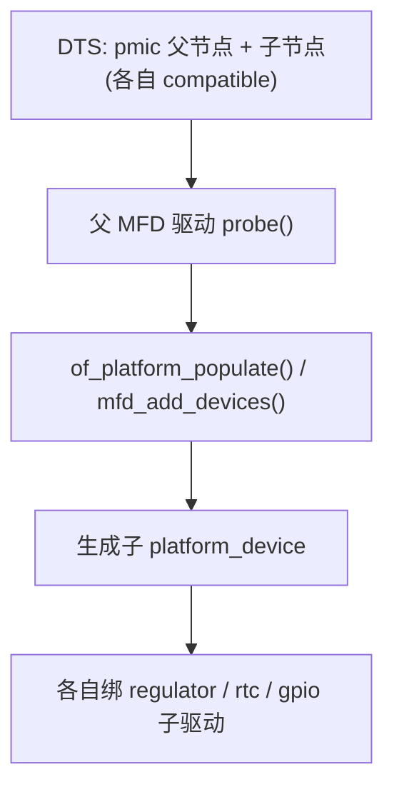

# 🧱 platform 记录层：`resource` → `platform_device` → `mfd_cell`

> [!INFO] 笔记概览
> - **定位**：platform 是设备模型里的**登记 / 配对 / 生命周期层**——"有设备、有驱动、怎么配、怎么上下电"，**与 `/dev` 文件 I/O 层（`file_operations`）是两码事**。
> - **内容范围**：`platform_device`（`name`/`id`）· `platform_device_id`（匹配键 + 私有数据）· `struct resource`（资源树、`flags`/`desc`、`sibling`）· `pdev_archdata`（架构钩子）· MFD（`mfd_cell`、一芯多驱动、`simple-mfd`）。
> - **引用格式**：`文件:行号`（源码树见 §版本基线，Linux 7.3.0-rc6）。

相关笔记：[[kobject-sysfs-kernfs映射分层]] · [[struct module 精读]]

---

## 🧭 1. 一句话定位：platform 只是"记录层"

platform 是一条**虚拟总线**（伪总线），专门收留"没有真正可枚举总线"（不像 PCI 能自动扫描）的片上外设。它只做**登记 + 配对 + 生命周期**，不含任何 `fops`：

| 层 | 代表 | 负责 |
| --- | --- | --- |
| 设备模型 / 登记层 | `platform_device` / `platform_driver` / `bus_type` | 设备登记、资源、配对、bind、`probe`、PM、sysfs |
| 文件 I/O 层 | `cdev` + `file_operations`（或 tty/IIO/input 等子系统） | 用户态 `open/read/write` 怎么落到驱动 |

> [!IMPORTANT] 设备模型层 ≠ 文件 I/O 层
> 需要 `/dev/xxx` 的驱动，是在 `probe()` 里**另外** `cdev_init`/`cdev_add`/`device_create` 建字符设备的；platform 层本身**不碰** `fops`。很多 platform 驱动甚至根本不建 `/dev`（如 GPIO 控制器、时钟、regulator）。

---

## 🏷️ 2. `struct platform_device`

```c
/* include/linux/platform_device.h */
struct platform_device {
    const char *name;            // 设备类型名
    int        id;               // 实例编号（≠ 设备号！）
    bool       id_auto;
    struct device dev;           // 内嵌设备模型对象
    u32        num_resources;
    struct resource *resource;   // 资源数组（MMIO/IRQ…）
    const struct platform_device_id *id_entry;
    ...
    struct mfd_cell *mfd_cell;      // 若是 MFD 生成的子设备，回指它的"出生模板"（见 §6）
    struct pdev_archdata archdata;  // 架构私有扩展槽
};
```

### 2.1 `name` + `id`：拼出唯一的设备名（只影响 sysfs 目录名）

`name`/`id` 最终被用来给 `dev` 的 kobject 起名（`/sys/devices/platform/<xxx>` 那个目录名），逻辑在 `drivers/base/platform.c:785`：

```c
switch (pdev->id) {
default:                    // id >= 0
    dev_set_name(dev, "%s.%d", pdev->name, pdev->id);   // 例 serial.0
    break;
case PLATFORM_DEVID_NONE:   // id == -1
    dev_set_name(dev, "%s", pdev->name);                // serial（无后缀）
    break;
case PLATFORM_DEVID_AUTO:   // id == -2
    pdev->id = ida_alloc(&platform_devid_ida, ...);     // 内核自动分配唯一号
    dev_set_name(dev, "%s.%d.auto", pdev->name, pdev->id);
    break;
}
```

> [!IMPORTANT] `platform_device.id` 不是"设备号"
> - `platform_device.id` = **同名设备的实例编号**，只拼 `dev.kobj` 名、**不参与驱动匹配**（modalias 只取 `name` → `"platform:%s"`）。
> - 真正的"设备号"是 `dev_t`，在 **`struct device.devt`** 里，只有要暴露 `/dev` 节点的设备才设置；大量 platform 设备的 `devt == 0`。

| 常量 | 值 | 含义 |
| --- | --- | --- |
| `PLATFORM_DEVID_NONE` | `-1` | 唯一实例，不加后缀 |
| `PLATFORM_DEVID_AUTO` | `-2` | 由内核 ida 自动分配不重复号 |

---

## 🔑 3. `struct platform_device_id`：匹配键 + 私有数据

```c
/* include/linux/platform_device.h */
struct platform_device_id {
    char name[PLATFORM_NAME_SIZE];   // 匹配键：与 platform_device.name 比对
    kernel_ulong_t driver_data;      // 匹配成功后回传给驱动的型号/参数
};
```

它是驱动 `id_table[]` 里的**一行**（以全 0 收尾），是 platform 在**没有 DT/ACPI 时的 name 匹配清单**。两者不是"两个 id"，而是"**匹配依据 + 匹配后附带的参数**"。

驱动里取回：

```c
const struct platform_device_id *id = platform_get_device_id(pdev);
switch (id->driver_data) { case VARIANT_A: ...; case VARIANT_B: ...; }
```

> [!NOTE] 与 of/acpi 匹配表对称
> `platform_match()` 依次试 `of_match_table` → `acpi_match_table` → `id_table`(name) → 驱动名==设备名。三套表形态一致：**{匹配键, 私有数据}**（`of_device_id.data` / `acpi_device_id.driver_data` / `platform_device_id.driver_data`）。

---

## 🗺️ 4. `struct resource`：资源是一棵树

```c
/* include/linux/ioport.h */
struct resource {
    resource_size_t start;
    resource_size_t end;
    const char *name;
    unsigned long flags;
    unsigned long desc;
    struct resource *parent, *sibling, *child;
};
```

### 4.1 `parent` / `child` / `sibling`：孩子+兄弟 的 n 叉树

所有资源组成一棵**资源树**（根为 `iomem_resource` / `ioport_resource`）：

- `parent`：**包含我的**那个资源（我是它的子区间）；
- `child`：我**包含的第一个**子资源；
- `sibling`：**和我同 parent 的下一个**资源（兄弟）。

```
iomem_resource (根)
 ├─ A (PCI host 的 MEM 窗口)   child=B
 │    ├─ B (某网卡 BAR0)       sibling=C
 │    └─ C (某显卡 BAR)
 └─ (A 的 sibling) 另一段顶层内存区
```

这套结构让内核用 `request_resource` / `insert_resource` / `allocate_resource` 做**区间冲突检测与分配**（重叠即报错）。

### 4.2 `start` / `end`：闭区间 `[start,end]`，含义由 `flags` 定

长度 = `end - start + 1`。**不一定是内存地址**：

| flags | start/end 的含义 |
| --- | --- |
| `IORESOURCE_MEM` | **物理内存地址**（MMIO 寄存器区） |
| `IORESOURCE_IO` | x86 I/O **端口**地址 |
| `IORESOURCE_IRQ` | **中断号**（`end` 通常 == `start`） |
| `IORESOURCE_DMA` | DMA 通道号 |
| `IORESOURCE_BUS` | 总线号 |

驱动用法（呼应 ioremap）：`platform_get_resource(pdev, IORESOURCE_MEM, 0)` → 取第 0 个 MMIO 区间 → `devm_ioremap_resource()` 把 `[start,end]` 物理地址映射成内核虚拟地址。

### 4.3 `desc`：`flags` 大类内的"子类型"

枚举在 `include/linux/ioport.h:136`：

```c
enum {
    IORES_DESC_NONE = 0,          // 默认，无特殊细分
    IORES_DESC_CRASH_KERNEL,      // crash kernel 保留区
    IORES_DESC_ACPI_TABLES,       // 这段内存其实是 ACPI 表
    IORES_DESC_ACPI_NV_STORAGE,   // ACPI 非易失存储
    IORES_DESC_PERSISTENT_MEMORY, // 持久内存 pmem
    IORES_DESC_DEVICE_PRIVATE_MEMORY,
    IORES_DESC_RESERVED,          // 保留区
    IORES_DESC_SOFT_RESERVED,
    IORES_DESC_CXL,
};
```

用途：同样是 `IORESOURCE_MEM`，内核需知道"这是普通 RAM / ACPI 表 / 持久内存 / 保留区"，才能正确处理（例如别把 ACPI 表当普通内存分出去）。`IORES_DESC_NONE` = "就是普通的"。

---

## 🪝 5. `struct pdev_archdata`：架构私有扩展槽

```c
struct pdev_archdata {
#ifdef CONFIG_ARCH_OMAP
    struct omap_device *od;
#endif
};
```

`platform_device` 末尾的 `archdata`（注释 `/* arch specific additions */`）是给具体 **CPU 架构 / SoC** 预留的挂钩：

- 当前整棵树里**只有 OMAP**（TI 的 ARM SoC）往里放东西——`omap_device` 管该 SoC 设备的时钟、电源、硬件模块依赖；
- **非 OMAP 平台**：`CONFIG_ARCH_OMAP` 未开，结构体编译为空，**不占空间**。

> [!NOTE] 同一套路：通用核心 + 架构钩子
> `struct device.archdata`（`dev_archdata`，用得更广：DMA 后端、NUMA、ACPI/OF 私有数据）、`struct module.arch` 都是同款"预留槽"。门槛是**架构**（`CONFIG_ARCH_*`），与功能裁剪（`CONFIG_*`）不同。

---

## 🧩 6. MFD：一芯多驱动（`mfd_cell`）

**MFD = Multi-Function Device**：一颗芯片集成多个功能（PMIC 里同时有 regulator / RTC / GPIO / 看门狗…），每个功能本应交由对应子系统驱动去管。

> [!IMPORTANT] MFD 不是"描述硬件"，是内核里的"拆分 + 复用"层
> DT 只描述硬件层级，**没有也不该有 "mfd"**；"这颗芯片要多功能拆分"是**驱动侧的决策**。父 MFD 驱动管芯片**公共部分**（共享 regmap、级联 IRQ、上电），再 spawn 出 N 个 **子 `platform_device`**，各自走普通 platform 流程绑子驱动。

### 6.1 `struct mfd_cell`

```c
/* include/linux/mfd/core.h:66 */
struct mfd_cell {
    const char *name;            // 子设备名（对应 platform_device.name）
    int         id;              // 实例号（对应 platform_device.id）
    const void *platform_data;
    size_t      pdata_size;
    const struct resource *resources;   // 从父设备切出来的资源
    int         num_resources;
    const char *of_compatible;   // 子设备 DT compatible
    const struct mfd_cell_acpi_match *acpi_match;
    const struct software_node *swnode;
    ...
};
```

`struct device.mfd_cell` 是**子设备回指它的"出生模板"**，子驱动借此取回资源与私有数据：

```c
const struct mfd_cell *cell = mfd_get_cell(pdev);  // pdev->dev.mfd_cell
struct my_priv *pdata = cell->platform_data;
```

### 6.2 两条路径

| 情况 | 父驱动 | 子设备怎么来 | 作者管理多少 |
| --- | --- | --- | --- |
| 子设备**独立**（无共享状态） | 无 / 极简 | DT `"simple-mfd"` / `"simple-bus"` **自动展开** | 几乎零 |
| 有**共享硬件**（PMIC） | `drivers/mfd/` 下真实驱动 | 父 `probe()` 里 `devm_of_platform_populate()` / `mfd_add_devices()` | 只管**共享资源**，一行展开 |

> [!WARNING] `mfd_cell` 并非每个 MFD 子设备都有
> 纯 DT 系统里大量 MFD 驱动只调一句 `devm_of_platform_populate(&pdev->dev)`，**根本不构造 `mfd_cell[]`**，故子设备 `dev.mfd_cell == NULL`。只有用 `mfd_cell[]` 显式描述（要额外传 `platform_data`、或板文件时代）时才非空。

### 6.3 完整链路



---

## 🔗 8. 相关笔记

- [[kobject-sysfs-kernfs映射分层]] — 设备模型地基：kobject/sysfs/kernfs
- [[struct module 精读]] — 模块子系统：`struct module` 全字段（含 `holders`/`refcnt` 与驱动加载的关系）

---

## 📚 9. 参考资料

1. **Linux Kernel 源码（本仓库 7.3.0-rc6）** — `include/linux/platform_device.h`（`platform_device` / `platform_device_id` / `pdev_archdata` / `PLATFORM_DEVID_*`）.
2. **同上** — `drivers/base/platform.c`（`dev_set_name` 命名 `:785`、modalias `platform:%s`）、`include/linux/ioport.h`（`struct resource`、`enum` desc `:136`）.
3. **同上** — `include/linux/mfd/core.h`（`struct mfd_cell` `:66`）、`drivers/base/platform.c`、`drivers/mfd/*`.

（注：本文为源码精读笔记，事实来源以本仓库逐行核实为准。）
