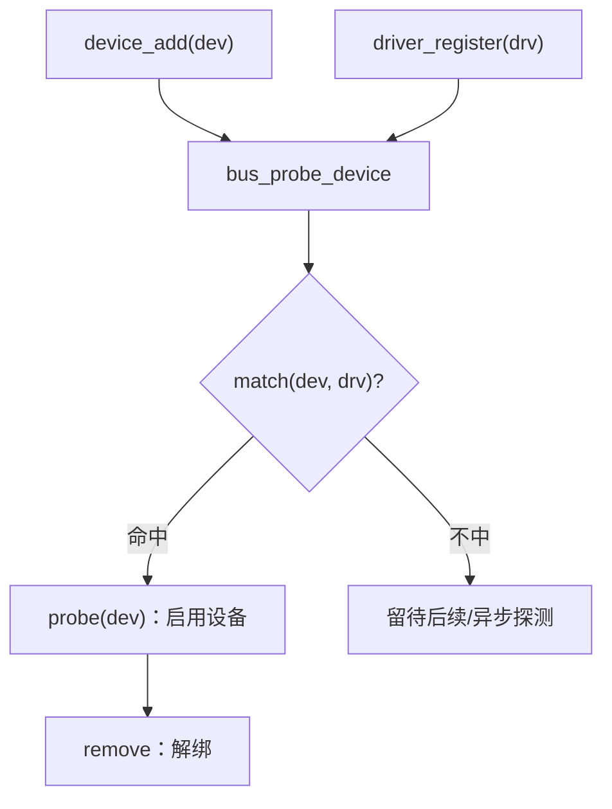
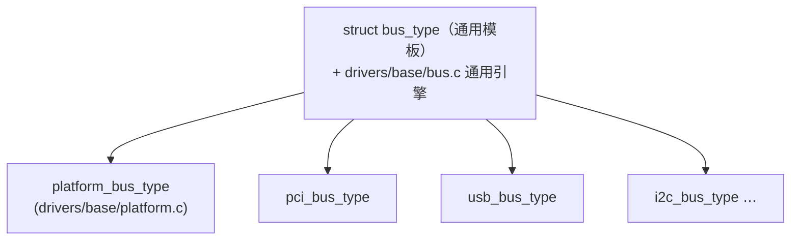

# 🚌 `struct bus_type` 精读

> [!INFO] 笔记概览
> - **定位**：`bus_type` 是设备模型的**通用模板 + 撮合引擎**——"一类设备 + 一类驱动 + 配对规则 + 通用生命周期回调"。platform/pci/usb/i2c 都是它的**平级实例**，不是上下层。
> - **内容范围**：`struct bus_type` 字段 · match→probe 撮合流程 · "模板 vs 实例"(platform 不是 bus 的子系统) · IRQ 亲和性(`smp_affinity`/`irq_get_affinity`) · `/sys/bus/` 与伪总线。
> - **引用格式**：`文件:行号`（本仓库 Linux 7.3.0-rc6）。

相关笔记：[[struct device 精读]] · [[platform-resource-mfd 结构精读]] · [[struct class 与设备自动发现]] · [[file_operations 与字符设备结构精读]]

---

## 🧩 1. `struct bus_type`：设备+驱动的撮合模板

```c
/* include/linux/device/bus.h:84 */
struct bus_type {
	const char *name;
	const char *dev_name;
	const struct attribute_group *const *bus_groups;
	const struct attribute_group *const *dev_groups;
	const struct attribute_group *const *drv_groups;

	int (*match)(struct device *dev, const struct device_driver *drv); // :91 配对规则
	int (*uevent)(const struct device *dev, struct kobj_uevent_env *env);
	int (*probe)(struct device *dev);        // :93
	void (*sync_state)(struct device *dev);
	void (*remove)(struct device *dev);       // :95
	void (*shutdown)(struct device *dev);
	const struct cpumask *(*irq_get_affinity)(struct device *dev, unsigned int irq_vec); // :97
	int (*online)(struct device *dev);        // :100
	int (*offline)(struct device *dev);       // :101
	int (*suspend)(struct device *dev, pm_message_t state);
	int (*resume)(struct device *dev);
	int (*num_vf)(struct device *dev);
	int (*dma_configure)(struct device *dev);
	void (*dma_cleanup)(struct device *dev);
	const struct dev_pm_ops *pm;
	bool driver_override;
	bool need_parent_lock;
};
```

一条 bus 同时管三类东西：

- **一类设备**（`device_add` 注册进来）
- **一类驱动**（`driver_register` 注册进来）
- **撮合规则与通用行为**（`match` + `probe/remove/pm/irq_get_affinity/online/offline/dma_configure…`）

---

## 🔗 2. 撮合流程：match → probe



- `match` 就是**配对规则**：platform 用 `platform_match`（比 `name`/`id` 或 `of_match_table`，见 [[platform-resource-mfd 结构精读]]）、PCI 用 `pci_device_id` 表、USB 用 `usb_device_id` 表。
- 配上就 `probe`，驱动开始干活；`remove/shutdown/suspend/resume/online/offline` 是生命周期的其它阶段。

---

## 🧱 3. 关键认知：platform 是**实例**，不是 bus 的**子层**

常见误区是把 bus 想成"platform 的上层 / platform 是 bus 的子系统"——这是**分层**视角，**反了**。正确是**模板 vs 实例**：



- `drivers/base/bus.c` 提供**通用引擎**（`bus_register`/`device_add`/`driver_register`/match→probe 循环）；
- `drivers/base/platform.c` 只**填这张模板**：`struct bus_type platform_bus_type = { .match = platform_match, … }`，再注册进引擎；
- platform **不另起炉灶**，而是把 `platform_device` **内嵌** `struct device`、`platform_driver` **内嵌** `struct device_driver`，让通用引擎驱动内嵌那部分（呼应 [[struct device 精读]] 的"内嵌"套路）。

> [!IMPORTANT] 兄弟，不是父子
> `platform_bus_type` / `pci_bus_type` / `usb_bus_type` 全是 `bus_type` 的**平级实例**。bus 是"交通工具概念"，platform 是"其中一辆车"——不是车上面还压着一层"交通工具"。

---

## ⚡ 4. IRQ 亲和性（`irq_get_affinity` / `smp_affinity`）

`bus_type` 上的 `irq_get_affinity`(`:97`) 返回 `const struct cpumask *`——**这条中断允许被哪些 CPU 处理的"掩码"**。

### 中断号 vs 亲和性（两个维度）

| | 中断号(`irq`/virq) | 亲和性(`smp_affinity`) |
| --- | --- | --- |
| 回答 | 哪条中断 / 哪个设备 | 这条中断交给**哪些 CPU** 处理 |
| 形态 | 一个整数（IRQ 25） | `cpumask` 位图（如 CPU 1/2/3） |
| 单核(UP) | 照样有 | 无意义（只有一个 CPU） |

### 为什么放 bus 上

中断投递受**总线/中断控制器拓扑**约束，只有总线知情：PCI 的 MSI-X、platform 的中断线能力各不相同。内核据此做**多队列托管中断的亲和性分配**和 **CPU 下线时的中断迁移**。

```bash
cat /proc/irq/25/smp_affinity         # 十六进制掩码
echo 2 > /proc/irq/25/smp_affinity    # 钉到 CPU 1（bit1）
```

- **`irq_get_affinity`** = 总线给的**合法目标集**（拓扑允许投递的 CPU）；
- **`smp_affinity`** = 当前实际集（合法集内由内核/irqbalance 挑出来的子集）；
- **`online`/`offline`**(`:100-101`) = CPU/设备下线时，把中断在掩码内迁到存活 CPU——与亲和性同属**热插拔/资源再平衡**机制（知道中断能去哪，才能安全下线）。

---

## 🗂️ 5. `/sys/bus/` 观测 + 伪总线

```bash
ls /sys/bus/            # 每个目录 = 一条 bus_type
ls /sys/bus/platform/{devices,drivers}
```

`/sys/bus/` 里**混着物理总线和伪总线**：`pci/usb/i2c/spi` 是物理线路；`cpu/memory/node/gpio/regulator/workqueue/clocksource` 是**软件伪总线**——内核把 `bus_type` 这套"设备+驱动分组撮合"机制**复用**到没有硬件的纯软件分组。这坐实了 bus 的本质是**撮合平台**，不是物理线路。

---

## 🔗 6. 相关笔记

- [[struct device 精读]] — `dev->irq`、内嵌关系、`devt`
- [[platform-resource-mfd 结构精读]] — `platform_match`、`platform_device`
- [[struct class 与设备自动发现]] — class/uevent/udev 自动建 `/dev` 节点
- [[file_operations 与字符设备结构精读]] — cdev/kobj_map（`dev_t → cdev`）

---

## 📚 7. 参考资料

1. **Linux Kernel 源码（本仓库 7.3.0-rc6）** — `include/linux/device/bus.h`（`struct bus_type` `:84`、回调文档 `:44-70`、`irq_get_affinity` `:97`、`online/offline` `:100-101`）.
2. **同上** — `drivers/base/bus.c`（通用引擎）、`drivers/base/platform.c`（`platform_bus_type` 实例）.

（注：本文为源码精读笔记，事实来源以本仓库逐行核实为准。）
