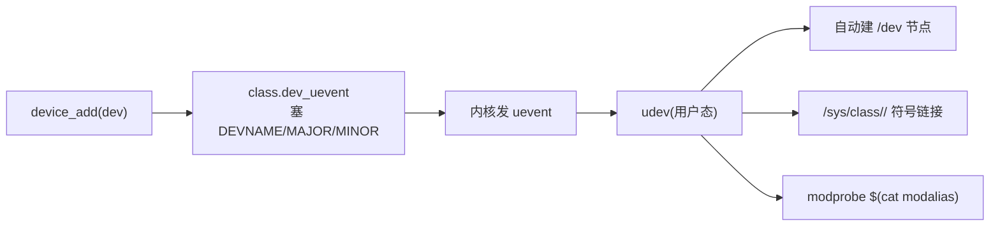

# 🗂️ `struct class` 与设备自动发现

> [!INFO] 笔记概览
> - **定位**：`struct class` 是**按功能给设备分组的视图层**（`/sys/class/<name>/`），并配合 uevent + udev **自动创建 `/dev` 节点**。它本身**不 probe、不加载模块**。
> - **内容范围**：`struct class` · 内部实现 `subsys_private` · `class_interface` · `/sys/class` 真实观测（软链接/按功能归类）· **三种"自动"机制** · 与 `cdev` 的区别 · `modalias`。
> - **引用格式**：`文件:行号`（本仓库 Linux 7.3.0-rc6）。

相关笔记：[[struct device 精读]] · [[struct bus_type 精读]] · [[file_operations 与字符设备结构精读]] · [[运行时电源管理 runtime PM]]

---

## 🧩 1. `struct class`：功能分组视图

```c
/* include/linux/device/class.h:50 */
struct class {
	const char *name;
	const struct attribute_group *const *class_groups;
	const struct attribute_group *const *dev_groups;
	int (*dev_uevent)(const struct device *dev, struct kobj_uevent_env *env); // :56
	char *(*devnode)(const struct device *dev, umode_t *mode);                // :57
	void (*class_release)(const struct class *class);
	void (*dev_release)(struct device *dev);
	int (*shutdown_pre)(struct device *dev);
	const struct kobj_ns_type_operations *ns_type;
	const struct ns_common *(*namespace)(const struct device *dev);
	void (*get_ownership)(const struct device *dev, kuid_t *, kgid_t *);
	const struct dev_pm_ops *pm;   // → 见 [[运行时电源管理 runtime PM]]
};
```

- class 按**功能**组织设备（`net`、`tty`、`input`、`graphics`…），用户态看 `/sys/class/<name>/`。
- `dev_uevent`(`:56`)：设备加入时往 uevent 里塞 `DEVNAME`/`MAJOR`/`MINOR`；
- `devnode`(`:57`)：告诉用户态这个 `/dev` 节点该叫什么路径。

---

## 🧬 2. 内部实现：class 建在 `subsys_private` 上

公开的 `struct class` 只是**门面**；`class_register` 时，驱动核心给它包一个**私有壳 `struct subsys_private`**（`drivers/base/base.h:43`，与 `bus_type` 共用）：

```c
struct subsys_private {
	struct kset subsys;          // ★ 就是 /sys/class/<name> 目录本身
	struct kset *devices_kset;   // devices/ 子目录
	struct list_head interfaces; // class_interface 列表
	struct mutex mutex;
	struct klist klist_devices;  // ★ 成员设备链表（class_dev_iter 走它）
	struct klist klist_drivers;
	struct blocking_notifier_head bus_notifier;
	...
};
```

- **`subsys` kset = `/sys/class/<name>`**：`class_register` 里 `kobject_set_name(&cp->subsys.kobj, cls->name)` + `cp->subsys.kobj.kset = class_kset`（父=`/sys/class`）+ `kset_register(&cp->subsys)`（`class.c:206-214`）直接生成该目录；`class_groups` 属性也挂它上面（`class.c:218`）。
- **为什么 `class_dev_iter` 里有 `struct subsys_private *sp`**：`class_dev_iter_init`（`class.c:320`）先 `class_to_subsys(class)` 拿私壳（**引用计数 +1**），再 `klist_iter_init_node(&sp->klist_devices, &iter->ki, …)`（`:335`）沿成员链表遍历；`class_dev_iter_exit` 用 `subsys_put(iter->sp)`（`:382`）归还引用——**遍历期间类不能被注销**。所以 `sp` 一身二职：链表句柄 + 保活引用。
- **`class_to_subsys` 靠 `container_of` 取回私壳**（`class.c:42`）：用类的 kobject 反查，`container_of(kobj, struct subsys_private, subsys.kobj)`——和 `kobj_lookup → container_of(kobj, struct cdev, kobj)` 同一套路（`subsys_private` 内嵌 `kset`→内嵌 kobject）。
- `base.h:40-41` 注释原话："**驱动核心之外不许碰这些字段**"——`subsys_private` 是私有表示。

> 相关：`struct class`（公开门面）↔ `subsys_private`（内核私壳）↔ `subsys` kset（`/sys/class/<name>` 目录），正是 [[kobject-sysfs-kernfs映射分层]] 的映射。

---

## 🔔 3. `class_interface`：加入/离开 class 的自动回调

```c
/* class.h:215 */
struct class_interface {
	struct list_head node;
	const struct class *class;
	int (*add_dev)(struct device *dev);      // 有设备加入该 class 时触发
	void (*remove_dev)(struct device *dev);  // 设备离开时触发
};
```

子系统用它做**二次自动处理**（tty/input 等：每当有设备加入 class 就自动建子系统专属节点）。

---

## 🔗 4. `/dev` 节点与 `/sys/class` 是怎么"自动"出来的



- `/dev` 是 **devtmpfs**（或 udev 管的 tmpfs），节点由 **udev** 依据 uevent 自动创建——这就是"class 自动挂载"的真相。
- `class.devnode` 决定节点路径名。

### 真实观测：`/sys/class/block/` 全是软链接

```
loop0    -> ../../devices/virtual/block/loop0                 ← 虚拟设备
nvme0n1  -> ../../devices/pci0000:00/.../nvme/nvme0/nvme0n1    ← PCIe SSD
```

- **class 里的条目是指向 `/sys/devices/...` 真实设备的符号链接**——由 `device_add` → `device_add_class_symlinks`（`core.c:3491`）建：
  - `sysfs_create_link(&sp->subsys.kobj, &dev->kobj, dev_name(dev))` → 正向：`/sys/class/block/loop0 →` 设备真身；
  - `sysfs_create_link(&dev->kobj, &sp->subsys.kobj, "subsystem")`（`core.c:3508`）→ 反向：设备目录里建 `subsystem → /sys/class/block`；
  - 同时 `klist_add_tail(&dev->p->knode_class, &sp->klist_devices)`（`core.c:3793`）把设备挂进 class 成员链表（§2 的 `class_dev_iter` 走它）。
- **loop（虚拟）和 nvme（PCI）物理位置天差地别，却并排躺在 `block` 类**——class 只看**功能**、不管**连接方式**。这就是"class 按功能投影、bus 按连接投影"的铁证。
- **cd 进 class 条目 = 落到 `/sys/devices/...` 真实位置**（真实属性 size、`queue/` 等都在那边）；class 里那个只是个指针/快捷方式。
- **视图布局差异**：class 直接把设备链放 `/sys/class/<name>/<dev>`；bus 放 `/sys/bus/<bus>/devices/<dev>`（多一层 `devices/`）。

---

## 🆚 5. 三种"自动"机制别混

| 机制 | 触发 | 做什么 | 代码/出处 |
| --- | --- | --- | --- |
| ① 字符设备模块自动加载 | `open()` 未加载驱动的 `/dev` 节点 | `request_module("char-major-…")` 拉起驱动模块 | `base_probe` `fs/char_dev.c:663`、`chrdev_init:671` |
| ② 设备模型自动探测 | `device_add`/`driver_register` | bus `match → probe` 绑定硬件 | [[struct bus_type 精读]] §2 |
| ③ class + uevent + udev | 设备加入 class | 自动建 `/dev` 节点 + `/sys/class` 链接 | 本篇 §4 |

> [!NOTE] ① 的后端就是 `kobj_map` 的 `base_probe`
> 见 [[file_operations 与字符设备结构精读]] §5：`kobj_lookup` 没找到具体 cdev 时命中覆盖全范围的 catch-all `base_probe`，转而 `request_module`。

---

## 🆚 6. 和 `cdev` 的区别

- **`cdev`** = 文件 I/O 层：`dev_t → fops`，是 `/dev` 节点的**后端**；它**不自动**，由驱动 `cdev_add` 主动注册。
- **class / 三种"自动"** = 把"驱动和设备先搞出来、让 `/dev` 节点出现"的**前端**，大多发生在 `cdev` 存在**之前**。
- 一个真实设备通常**两者都有**：`struct device` 挂某个 class（→ `/sys/class`、→ udev 建 `/dev`）+ 一个 `cdev`（→ 该节点的 fops）。

---

## 🏷️ 7. `modalias`：udev 用来 modprobe 的钥匙

```bash
cat /sys/devices/.../modalias          # 如 platform:xxx / pci:v0000… / usb:…
grep -E '^(pci|platform|usb)' /lib/modules/$(uname -r)/modules.alias
udevadm info -q all -n /dev/xxx        # 看 uevent / DEVNAME
```

设备加入时 uevent 带 `MODALIAS`，udev 据此 `modprobe` 对应驱动模块——这是**设备模型侧的自动加载**，与①的 `char-major-*` 是两套并行的自动加载通道。

---

## 🔗 8. 相关笔记

- [[struct device 精读]] — `struct device` 是 class 的成员（`dev->class`）
- [[struct bus_type 精读]] — bus match→probe（机制②）、`irq_get_affinity`
- [[file_operations 与字符设备结构精读]] — cdev + `base_probe` 自动加载（机制①③的后端）
- [[运行时电源管理 runtime PM]] — `dev_pm_ops`、`dev_pm_info`、`/sys/.../power/`
- [[kobject-sysfs-kernfs映射分层]] — class↔`/sys/class` 的地基映射

---

## 📚 9. 参考资料

1. **Linux Kernel 源码（本仓库 7.3.0-rc6）** — `include/linux/device/class.h`（`struct class` `:50`、`dev_uevent/devnode` `:56-57`、`class_interface` `:215`）.
2. **同上** — `drivers/base/base.h`（`struct subsys_private` `:43`）、`drivers/base/class.c`（`class_to_subsys` `:42`、`class_dev_iter_*` `:320-383`、`class_register` `:206-218`）、`drivers/base/core.c`（`device_add_class_symlinks` `:3491`、`sysfs_create_link` `:3508`、`klist_add_tail` `:3793`）.
3. **同上** — `fs/char_dev.c`（`base_probe` `:663`、`chrdev_init` `:671`）.

（注：本文为源码精读笔记，事实来源以本仓库逐行核实为准。）
