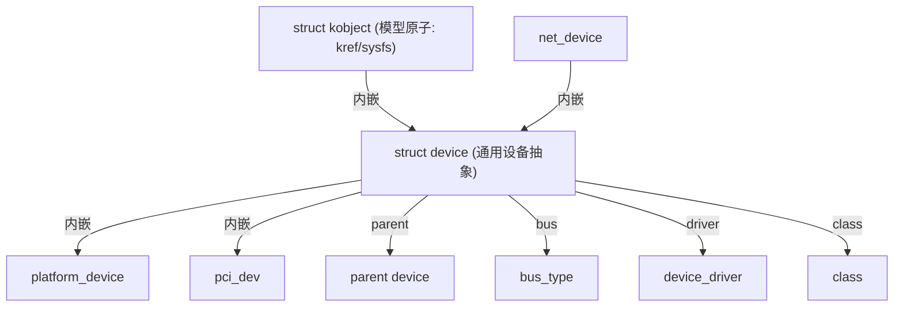

# 🔌 `struct device` 精读：设备的通用抽象

> [!INFO] 笔记概览
> - **定位**：`struct device` 是 Linux 设备模型里**一切设备的通用抽象**——总线上、类里、以及各种具体设备（`platform_device`/`pci_dev`/`net_device`…）都**内嵌**一个 `struct device`。它承载"设备模型 + 总线/驱动归属 + 电源 + DMA + 固件节点(OF/ACPI)"这五件事。
> - **内容范围**：字段分组（模型地基 / 总线驱动 / 数据挂载 / 链接电源 / DMA-IOMMU / 固件节点 / 身份 / 架构钩子）· 关键区分 · 与 `platform_device` / `struct module` 的关系。
> - **引用格式**：`文件:行号`（本仓库 Linux 7.3.0-rc6，`include/linux/device.h:705-801`）。

相关笔记：[[kobject-sysfs-kernfs映射分层]] · [[platform-resource-mfd 结构精读]] · [[struct module 精读]]

---

## 🧭 1. 定位：万物皆 `device`

设备模型有"原子"（`kobject`），但业务上真正通用的是 `struct device`——`platform_device`、`pci_dev`、`net_device`、`i2c_client`… 都以它为**共同底座**（内嵌 `struct device dev;`）。

> [!IMPORTANT] 一切最终都落到 kobject
> `device_add()` 会把内嵌的 `kobj` 挂进 sysfs（`/sys/devices/...`），并广播 `KOBJ_ADD` uevent——这正是 [[kobject-sysfs-kernfs映射分层]] 讲的那套。`device` 只是"kobject + 设备语义"。

---

## 🧩 2. 字段分组

### 2.1 模型地基

| 字段 | 行 | 含义 |
| --- | --- | --- |
| `struct kobject kobj` | `:706` | 内嵌模型原子：进 sysfs、计数、生命周期 |
| `struct device *parent` | `:707` | **父设备**（设备树的上层；决定 sysfs 层级与 PM 依赖） |
| `struct device_private *p` | `:709` | 设备核心私有数据（`klist_children`、`knode_*` 等） |
| `const char *init_name` | `:711` | 初始名（`dev_set_name` 后拷进 `kobj.name`） |
| `const struct device_type *type` | `:712` | 设备类型（带 `groups`/`uevent`/`release` 等回调） |
| `const struct class *class` | `:789` | 所属**类**（`/sys/class/<name>` 视图的来源） |

### 2.2 总线 / 驱动归属

| 字段 | 行 | 含义 |
| --- | --- | --- |
| `const struct bus_type *bus` | `:714` | 所在总线（匹配与 probe 的场地） |
| `struct device_driver *driver` | `:715` | 当前绑定到本设备的驱动 |
| `driver_override{name,lock}` | `:721-725` | 强制/覆盖匹配某驱动名（`/sys/.../driver_override`） |
| `struct mutex mutex` | `:726` | **串行化对本设备驱动的调用**（probe/remove 等） |

> [!NOTE] `bus` + `driver` + `parent` 就是绑定三要素
> `device_add` → 总线 `match()` → 命中则 `really_probe()` 调驱动 `probe`（见 [[platform-resource-mfd 结构精读]] §1）。

### 2.3 数据挂载（两个"用户槽"）

| 字段 | 行 | 谁用 |
| --- | --- | --- |
| `void *platform_data` | `:717` | **板级/平台**专用数据，设备核心不碰 |
| `void *driver_data` | `:719` | **驱动私有**数据，`dev_set_drvdata`/`dev_get_drvdata` |

> [!WARNING] 别混：`platform_data` vs `driver_data`
> 前者由"造设备的平台代码"塞入、驱动读取；后者是"驱动自己"用来挂私有结构的。两者都是 `void *`，但**生命周期与归属方不同**。

### 2.4 链接与电源管理

| 字段 | 行 | 含义 |
| --- | --- | --- |
| `struct dev_links_info links` | `:730` | 设备间依赖链接（supplier/consumer） |
| `struct dev_pm_info power` | `:731` | 运行时 PM 状态 |
| `struct dev_pm_domain *pm_domain` | `:732` | 电源域 |
| `struct em_perf_domain *em_pd` | `:735` | 性能域（`CONFIG_ENERGY_MODEL`，即 OPP/EM 软链接） |

### 2.5 DMA 与 IOMMU

| 字段 | 行 | 含义 |
| --- | --- | --- |
| `const struct dma_map_ops *dma_ops` | `:743` | DMA 映射后端（`CONFIG_ARCH_HAS_DMA_OPS`） |
| `u64 *dma_mask` | `:745` | 设备可寻址的 DMA 地址掩码 |
| `u64 coherent_dma_mask` | `:746` | 一致性映射用的掩码（`alloc_coherent`） |
| `u64 bus_dma_limit` | `:751` | 上游 DMA 约束 |
| `const struct bus_dma_region *dma_range_map` | `:752` | DMA 地址范围映射 |
| `struct device_dma_parameters *dma_parms` | `:754` | 段大小/边界等参数 |
| `struct list_head dma_pools` | `:756` | DMA 池 |
| `struct dma_coherent_mem *dma_mem` | `:759` | 一致性内存覆盖（`CONFIG_DMA_DECLARE_COHERENT`） |
| `struct cma *cma_area` | `:763` | CMA 连续内存区（`CONFIG_DMA_CMA`） |
| `struct io_tlb_mem *dma_io_tlb_mem` | `:767` | **SWIOTLB** 预留中转缓存（`CONFIG_SWIOTLB`） |
| `dma_io_tlb_pools`/`_lock`/`dma_uses_io_tlb` | `:770-772` | 动态 SWIOTLB（`CONFIG_SWIOTLB_DYNAMIC`） |
| `struct iommu_group *iommu_group` | `:793` | 所属 IOMMU 组（`DMA → IOMMU → 物理内存`） |
| `struct dev_iommu *iommu` | `:794` | IOMMU 运行时数据（fault/参数等） |

### 2.6 固件节点（OF / ACPI 统一）

| 字段 | 行 | 含义 |
| --- | --- | --- |
| `struct device_node *of_node` | `:777` | 关联的 **DT 节点**（设备树专用） |
| `struct fwnode_handle *fwnode` | `:778` | 固件节点的**统一抽象**（DT/ACPI/软件节点通吃） |

> [!TIP] `of_node` vs `fwnode`
> `of_node` 只对 DT 有效；`fwnode` 是上层统一接口——驱动应优先用 `device_property_*` / `fwnode_*`，以便同时支持 OF 和 ACPI。

### 2.7 身份 / 编号 / 架构钩子 / 其它

| 字段 | 行 | 含义 |
| --- | --- | --- |
| `dev_t devt` | `:783` | **设备号**（主/次），建 sysfs `dev` 文件、给 udev 造 `/dev` 节点用 |
| `u32 id` | `:784` | 设备实例号 |
| `struct dev_archdata archdata` | `:775` | **架构私有**（DMA 后端/OF/ACPI 等，同 `pdev_archdata`/`module.arch` 套路） |
| `struct dev_pin_info *pins` | `:739` | pinctrl 信息（`CONFIG_PINCTRL`） |
| `struct dev_msi_info msi` | `:741` | MSI 中断信息 |
| `int numa_node` | `:781` | NUMA 节点（`CONFIG_NUMA`） |
| `devres_lock`/`devres_head` | `:786-787` | devres（`devm_*` 资源托管） |
| `const struct attribute_group **groups` | `:790` | 附加 sysfs 属性组 |
| `void (*release)(struct device *)` | `:792` | 释放回调（kobject 归零时调） |
| `struct device_physical_location *physical_location` | `:796` | 物理位置（面板/插槽等） |
| `enum device_removable removable` | `:798` | 是否可移除 |
| `DECLARE_BITMAP(flags, DEV_FLAG_COUNT)` | `:800` | 状态位（`dev_ready_to_probe()`/`dev_can_match()`/`dev_offline()`…） |

---

## 🎯 3. 关键区分（易混点）

| 常见混淆 | 实际 |
| --- | --- |
| `device.id` vs `device.devt` | `id` 是**实例号**；`devt` 才是**设备号**（主/次）。`platform_device.id` 另有一套"拼名字"用途 |
| `platform_data` vs `driver_data` | 前者平台塞、后者驱动自己塞 |
| `of_node` vs `fwnode` | 前者 DT 专用，后者统一抽象（OF/ACPI） |
| `bus` vs `class` | 总线管"匹配/probe"，类管"用户态视图/权限/uevent" |
| `mfd_cell` 在 `device`？ | **不在**——它在 `struct platform_device`（`platform_device.h:44`） |

---

## 🔗 4. 与相邻结构的关系

- **`platform_device`**：内嵌 `struct device dev`，另加 `name`/`id`/`resource`/`mfd_cell`/`archdata`（见 [[platform-resource-mfd 结构精读]]）。
- **`struct module`**：设备驱动通常来自模块，绑定后驱动核心 `try_module_get(drv->owner)` 撑住模块引用——这就是 [[struct module 精读]] §5 里 `holders`/`refcnt` 变化的来源。
- **`kobject`/`sysfs`**：`device_add` 把 `dev.kobj` 挂进 `/sys/devices`，并广播 uevent（见 [[kobject-sysfs-kernfs映射分层]]）。

---

## 📚 6. 参考资料

1. **Linux Kernel 源码（本仓库 7.3.0-rc6）** — `include/linux/device.h`（`struct device` `:705-801`、`DEV_FLAG_*` 访问器 `:803-836`、`struct device_link` `:852`）.
2. **同上** — `drivers/base/core.c`（`device_add`、`kobject_uevent`）、`include/linux/platform_device.h`（`mfd_cell` 字段 `:44`）.

（注：本文为源码精读笔记，事实来源以本仓库逐行核实为准。）
