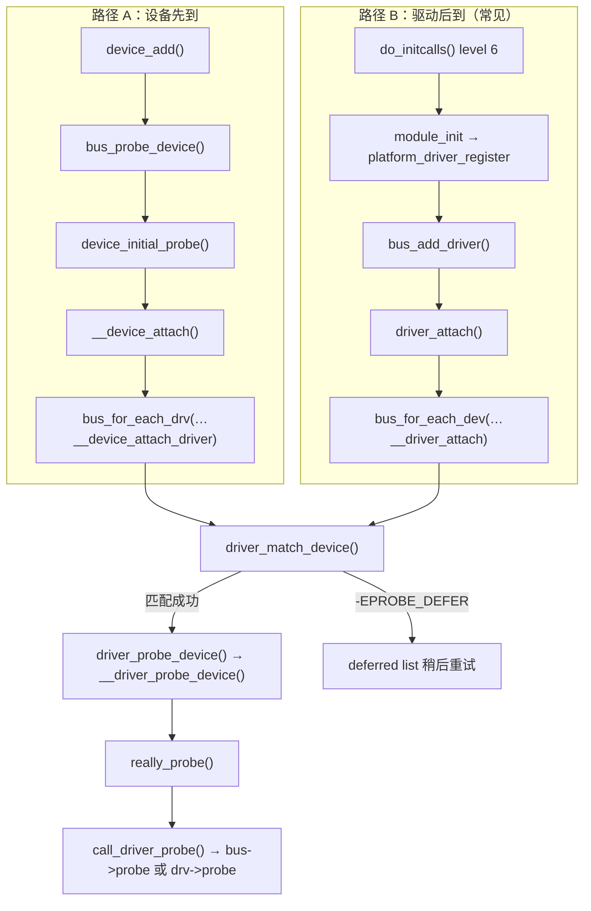
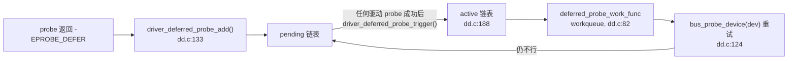
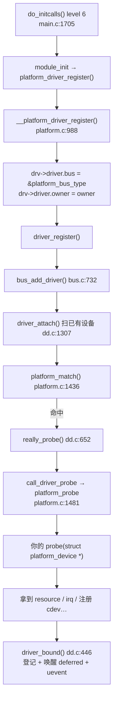

# 🔧 驱动侧结构 + probe 时序

> [!INFO] 笔记概览
> - **定位**：补齐 [[struct bus_type 精读]] 之外的**另一半**——bus 只提供 `match` 回调，**驱动侧**才提供 `probe/remove/shutdown`、匹配表（`id_table`/`of_match_table`）。本篇讲清 `struct device_driver` / `struct platform_driver` 全字段、**驱动何时被调用（initcall 分级）**、**两条注册路径如何汇合到同一个 `really_probe()`**、deferred probe、解绑，以及两个易被忽略的不变式。
> - **内容范围**：initcall 分级 · `device_driver`/`platform_driver`/`driver_private` · 匹配表 · **probe 时序** · `WRITE_ONCE` 锁纪律 · `driver_bound` · deferred probe · `test_remove`/`devres_head` · 解绑 · 驱动侧 sysfs。
> - **引用格式**：`文件:行号`（本仓库 Linux 7.3.0-rc6，行号按当前源码）。

相关笔记：[[struct bus_type 精读]] · [[struct device 精读]] · [[struct class 与设备自动发现]] · [[file_operations 与字符设备结构精读]] · [[struct module 精读]] · [[运行时电源管理 runtime PM]]

---

## ⏰ 0. 驱动什么时候被调用：initcall 分级

内建驱动的 `module_init(fn)` **不是**被谁显式调用，而是被塞进一张**链接期排好的表**，启动时由 `init/main.c` 遍历。

```c
#define __initcall(fn)        device_initcall(fn)        // init.h:311
#define device_initcall(fn)   __define_initcall(fn, 6)   // init.h:306
#define __define_initcall(fn, id) ___define_initcall(fn, id, .initcall##id)  // init.h:277
```

### 8 个级别（`init.h:293-309`）

| 级别 | 宏 | 谁用 |
| --- | --- | --- |
| 0 | `pure_initcall` | 纯初始化变量 |
| 1 | `core_initcall` | 核心子系统 |
| 2 | `postcore_initcall` | 依赖核心的 |
| 3 | `arch_initcall` | 架构相关 |
| 4 | `subsys_initcall` | **子系统/总线**（`platform_bus_type` 在这级） |
| 5 | `fs_initcall` | 文件系统 |
| 6 | **`device_initcall`** | **← `module_init` 落在这里（设备驱动）** |
| 7 | `late_initcall` | 收尾 |
| — | `early_initcall` | 单独跑，**在 SMP 起来之前**（`main.c:1761`） |

### 启动时的遍历（`init/main.c`）

```
kernel_init_freeable()                        main.c:1982   ← PID 1，还没 exec 用户 init
├─ do_pre_smp_initcalls()   main.c:1761       ← early_initcall（SMP 前单独跑）
├─ smp_init()               main.c:1985       ← 副核上线
├─ do_basic_setup()         main.c:1993
│   └─ do_initcalls()       main.c:1705       ← ★ 按 level 0→7 逐个调
│        └─ initcall_levels[] main.c:1660-1670
│             从 __initcall0_start 遍历到 __initcall_end
├─ wait_for_initramfs / prepare_namespace
└─ kernel_init → free_initmem() main.c:1892   ← init 段在这里释放
```

### 三个关键点

1. **段的内容在链接期填好**：`module_init(fn)` 生成函数指针放进 `.initcall6.init` 段；链接脚本 `vmlinux.lds.h` 把 `__initcall0..7` **按序紧挨排**，`initcall_levels[]` 才有区间可遍历。`main.c` 只负责"拿表逐个 call"。
2. **level 6 是"刚好"，不是"太晚"**：总线（level 4）、DT/ACPI 设备（level 3-4）已在更低级别就绪 → 驱动注册时 `driver_attach` 一扫即中，**当场 probe**（路径 B）。若驱动用更低级，设备可能还没 populate。
3. **内建 vs 模块**：内建走 `.initcall6.init` → `do_initcalls()`；**可加载模块的 `module_init` 不是 initcall**，而是 `init_module` 系统调用入口（`kernel/module/main.c` `do_init_module`），probe 时机 = `insmod` 那一刻。

> [!IMPORTANT] `free_initmem()` 与 `__platform_driver_probe`
> `free_initmem()`（`main.c:1892`）之后 `__init` 段被释放。这正是 `__platform_driver_probe()`（`platform.c:1042`）能把 probe 放 `__init` 段、跑完把 `.probe` 改成 `platform_probe_fail`（`platform.c:1078`）的原因——**probe 代码已不在内存，禁止二次 probe**，也正因此它"incompatible with deferred probing"。
> 另外 `main.c:1885` 的 `async_synchronize_full()` 是必需的：先等所有 async init 跑完才能释放。

---

## 📐 1. `struct device_driver`：驱动侧通用骨架

```c
/* include/linux/device/driver.h:100 */
struct device_driver {
	const char		*name;
	const struct bus_type	*bus;                 // ← 挂在哪条 bus 上
	struct module		*owner;               // ← 所属模块（防卸载）
	const char		*mod_name;
	bool suppress_bind_attrs;                     // 关掉 sysfs bind/unbind
	enum probe_type probe_type;                   // 同步/异步 probe
	const struct of_device_id	*of_match_table;   // ← DT 匹配表
	const struct acpi_device_id	*acpi_match_table; // ← ACPI 匹配表
	int (*probe) (struct device *dev);            // ★ 配对成功后启用
	void (*sync_state)(struct device *dev);
	int (*remove) (struct device *dev);           // ★ 解绑
	void (*shutdown) (struct device *dev);        // ★ 关机
	int (*suspend) (struct device *dev, pm_message_t state);
	int (*resume) (struct device *dev);
	const struct attribute_group *const *groups;      // 驱动级属性
	const struct attribute_group *const *dev_groups;  // 绑定后加到设备上
	const struct dev_pm_ops *pm;
	void (*coredump) (struct device *dev);
	struct driver_private *p;                     // ← 私壳（见 §3）
	void (*post_unbind_rust)(struct device *dev);
};
```

---

## 🧩 2. `struct platform_driver`：bus 特化壳

```c
/* include/linux/platform_device.h:284 */
struct platform_driver {
	int (*probe)(struct platform_device *);        // ← 驱动真正写的 probe
	void (*remove)(struct platform_device *);
	void (*shutdown)(struct platform_device *);
	int (*suspend)(struct platform_device *, pm_message_t state);
	int (*resume)(struct platform_device *);
	struct device_driver driver;                   // ★ 内嵌通用骨架
	const struct platform_device_id *id_table;     // ← platform 匹配表
	bool prevent_deferred_probe;
	bool driver_managed_dma;
};

#define to_platform_driver(drv) container_of((drv), struct platform_driver, driver)
```

> [!IMPORTANT] 又是"内嵌 + `container_of`"
> `platform_driver` **内嵌** `device_driver`，所以能直接喂给通用 `driver_register()`；拿到 `device_driver` 后再用 `to_platform_driver()` 取回外层。与 `platform_device` 内嵌 `device`、`gendisk` 内嵌 device 完全同一套路。

---

## 🗄️ 3. `struct driver_private`：驱动侧的"私壳"

和 `subsys_private`（bus/class 私壳）、`device_private`（设备私壳）**三足鼎立**：

```c
/* include/linux/device/driver.h:142（源码注释展开） */
struct driver_private {
	struct kobject kobj;              // → /sys/bus/<bus>/drivers/<name> 目录
	struct klist klist_devices;       // 该驱动绑定的所有设备
	struct klist_node knode_bus;      // 挂进 bus 的 sp->klist_drivers
	struct module_kobject *mkobj;     // → /sys/module/<name>/drivers/<name>
	struct device_driver *driver;     // 回指公开结构
};
```

---

## 🎯 4. 三套匹配表

| 表 | 字段来源 | 用途 |
| --- | --- | --- |
| `platform_device_id` | `platform_driver.id_table` | platform 设备名匹配（`platform:<name>`） |
| `of_device_id` | `device_driver.of_match_table` | **DT（设备树）**：按 `compatible` 串匹配，现代 ARM 主流 |
| `acpi_device_id` | `device_driver.acpi_match_table` | **ACPI**：x86 主流，按 `_HID`/`_CID` |

> `platform_match`（`platform.c:1436`）按顺序试：`driver_override` → **OF** → **ACPI** → **id_table** → **驱动名字**（`platform.c:1442-1460`）。

---

## ⏱️ 5. probe 时序：**两条入口，一个汇合点**

无论设备先注册还是驱动先注册，最终都汇合到 **`really_probe()`**：



### 5.1 路径 A：设备先到（`device_add`）

`device_add()` 尾部（`core.c:3776`）→ `bus_probe_device()`（`bus.c:612`）→ `device_initial_probe()`（`dd.c:1145`）→ `__device_attach()`（`dd.c:1068`）→ `bus_for_each_drv(...)`：**拿设备去遍历所有驱动**。

### 5.2 路径 B：驱动后到（`driver_register`）

`driver_register()` → `bus_add_driver()`（`bus.c:732`）：

```c
priv->kobj.kset = sp->drivers_kset;                    // → /sys/bus/<bus>/drivers/<name>
klist_add_tail(&priv->knode_bus, &sp->klist_drivers);  // bus.c:761 挂进驱动链表
if (sp->drivers_autoprobe) {
	error = driver_attach(drv);                    // bus.c:762-763 ★ 对已存在设备补做配对
}
```
→ `driver_attach()`（`dd.c:1307`）：`bus_for_each_dev(drv->bus, …, __driver_attach)`——**拿驱动去遍历所有已注册设备**。

> 这就是"**`driver_register` 如何对已存在设备补做 match→probe**"的答案：`bus.c:762-763`。

### 5.3 `really_probe()` 逐步（`dd.c:652`）

| 步 | 代码 | 做什么 |
| --- | --- | --- |
| 0 | `:658` | `defer_all_probes`（休眠/冬眠中）→ 强制 `-EPROBE_DEFER` |
| 1 | `:668` | `device_links_check_suppliers(dev)` — 供应商未就绪 → `-EPROBE_DEFER` |
| 2 | `:674` | `devres_head` 非空 → `-EBUSY`（见 §7） |
| 3 | `:681` | `device_set_driver(dev, drv)` — **建立 `dev->driver` 绑定**（见 §5.4） |
| 4 | `:684` | `pinctrl_bind_pins(dev)` |
| 5 | `:688` | `dev->bus->dma_configure(dev)` |
| 6 | `:694` | `driver_sysfs_add(dev)` — 建 **`driver` 软链**（两条，见 §9） |
| 7 | `:700` | `pm_domain->activate(dev)` — 上电（见 [[运行时电源管理 runtime PM]] §5） |
| 8 | `:706` | **`call_driver_probe()`** ← 真正调驱动 probe |
| 9 | `:725` | `device_add_groups(dev, drv->dev_groups)` — **probe 成功后才加**（见 §9） |
| 10 | `:731` | 建 `state_synced` 属性（若有 `sync_state`） |
| 失败 | `:707-722` | 任何一步失败 → `probe_failed` 清理；错误取反成正数返回 |

**`call_driver_probe()`（`dd.c:621`）——bus 优先：**

```c
if (dev->bus->probe)  ret = dev->bus->probe(dev);   // ★ bus 的 probe 是"适配器"
else if (drv->probe)  ret = drv->probe(dev);
```

> `platform_bus_type.probe = platform_probe`（`platform.c:1481`）先做 `to_platform_device()` 转换、`of_clk_set_defaults`、`dev_pm_domain_attach`，**再**调 `pdrv->probe(dev)`。

**瀑布式回滚**：失败标签**逆序排列** + GCC fall-through，越晚失败撤的层数越多，所有路径最终汇到最底层的 `device_unbind_cleanup`：

```
dev_sysfs_state_synced_failed:
dev_groups_failed:      device_remove(dev);
probe_failed:           driver_sysfs_remove(dev);
sysfs_failed:           bus_notify(DRIVER_NOT_BOUND); dma_cleanup;
pinctrl_bind_failed:    device_links_no_driver(dev); device_unbind_cleanup(dev);
done:                   return ret;
```

### 5.4 `device_set_driver()` 与 `WRITE_ONCE`（`dev->driver` 的锁纪律）

```c
/* drivers/base/base.h:204 */
static inline void device_set_driver(struct device *dev, const struct device_driver *drv)
{
	/* 大多数读发生在持 device_lock 时，或只在已绑定设备上跑。
	 * 但读 uevent 文件时不加锁（不能阻塞任意长时间），
	 * 故用 WRITE_ONCE 防撕裂，让读侧能安全用 READ_ONCE。 */
	WRITE_ONCE(dev->driver, (struct device_driver *)drv);
}
```

**`dev->driver` 的三种读法**：

| 读处 | 加锁? | 原因 |
| --- | --- | --- |
| 绝大多数 bus/driver 代码 | **持 `device_lock(dev)`** | 常规互斥 |
| 已绑定设备上的代码 | 不加 | 绑定期间 `drv` 不变 |
| **`dev_driver_string()`（所有 `dev_*` 打印）** | **不加锁** | 见下 |

**为什么打印路径不加锁**：`dev_driver_string()`（`core.c:2468`）被 `dev_printk.h` 里每个打印宏调用。`device_lock` 是**可睡眠的 mutex**，而打印可能发生在**中断/原子上下文/持自旋锁时**；且一个慢 probe 持锁几秒会让 `dmesg` 卡几秒。

**无锁读的两个风险 + 解法**：

| 风险 | 解法 |
| --- | --- |
| **tearing（撕裂）**：指针写被拆成多次，读到"半新半旧"垃圾指针 | `WRITE_ONCE` 配对 `READ_ONCE` |
| **读到 NULL**（解绑时置 NULL） | `core.c:2477` 三元兜底：`drv ? drv->name : dev_bus_name(dev)` |

`WRITE_ONCE` 的底层（`include/asm-generic/rwonce.h:53-56`）：

```c
#define __WRITE_ONCE(x, val)	do { *(volatile typeof(x) *)&(x) = (val); } while (0)
```

**全部魔法就是"把地址强转成 `volatile` 指针再访问"**。`volatile` 禁掉编译器 5 件事：**删除 / 合并 / 拆分（← 防撕裂就是这条）/ 缓存 / 重排**。

第二层 `__no_sanitize_or_inline`（`compiler_types.h:287-337`，含 `__no_kasan_*`/`__no_kcsan`/`__no_kmsan_checks`，兜底 `__always_inline`）防 **sanitizer 插桩**——因为 sanitizer 会把一次内存访问**换成函数调用**（`__asan_load8` 之类），彻底破坏 volatile 的单次访问语义。

> [!WARNING] `volatile` 给不了什么
> **CPU 级原子性**要 `atomic_t`/`cmpxchg`；**多 CPU 内存顺序**要 `smp_store_release`/`barrier()`。`volatile` 只约束**编译器**。（`rwonce.h:40-41`：用 `__READ_ONCE` 不要原子性，"this may result in tears!"）

> FIXME 那个 cast：`dev->driver` 声明为非 const 而参数是 const，故需去 const；理想上应声明成 `const struct device_driver *`。

### 5.5 `driver_bound()`：probe 的终章（`dd.c:446`）

```c
static void driver_bound(struct device *dev)
{
	if (device_is_bound(dev)) {                 // :448 ★ 幂等闸门
		dev_warn(dev, "%s: device already bound\n", __func__);
		return;
	}
	klist_add_tail(&dev->p->knode_driver,
		       &dev->driver->p->klist_devices);  // :456 ★ 登记进驱动的设备链表
	device_links_driver_bound(dev);                  // :457 供应商就绪，放行消费者
	device_pm_check_callbacks(dev);                  // :459 确认 PM 回调有无

	driver_deferred_probe_del(dev);                  // :465 从 deferred 链表摘掉自己
	driver_deferred_probe_trigger();                 // :466 ★ 唤醒"在等我"的设备

	bus_notify(dev, BUS_NOTIFY_BOUND_DRIVER);        // :468 通知总线 notifier 链
	kobject_uevent(&dev->kobj, KOBJ_BIND);           // :469 ★ 发 uevent（udev 据此建 /dev）
}
```

- **"限制" = 幂等保护**：`device_is_bound()` 检查是否已登记在驱动的 `klist_devices` 里。`really_probe` 可能被重复进入（`test_remove` 的 `goto re_probe`、并发 bind、deferred 重试），而登记和 uevent**只能做一次**。
- **`:465-466` 是 deferred 闭环**："我 probe 成功了 → 立刻唤醒所有因等待我而 deferred 的设备"。没有这两行，依赖链永远卡住。
- `probe_count` 的递减（`atomic_dec` + `wake_up_all`，`dd.c:917`）不在这，在 `__driver_probe_device` 尾部，服务 `wait_for_device_probe()`。

---

## 🔁 6. deferred probe（`-EPROBE_DEFER`）

**为什么需要**：驱动 probe 顺序有时说不清。例：SDHCI 驱动需要 i2c GPIO 控制器先起来，但内核没有依赖信息，SDHCI 可能先被 probe。

**机制**（`dd.c:36-371`）：



| 要点 | 说明 |
| --- | --- |
| 两条链表 | `pending` / `active`（`dd.c:56-57`），`deferred_probe_mutex` 保护 |
| 触发时机 | 任何驱动 probe 成功后 `driver_deferred_probe_trigger()`（`dd.c:176`） |
| 执行体 | `deferred_probe_work`（`system_dfl_wq`），逐个 `bus_probe_device` 重试 |
| 兜底 | `deferred_probe_initcall`（`late_initcall`，`dd.c:340-371`）；超时后强制放弃 |
| 看现场 | `cat /sys/kernel/debug/devices_deferred` — 卡住的设备 + 原因（`dd.c:342`） |
| 一次性变体 | `__platform_driver_probe()`（`platform.c:1042`）**不支持** deferred |

---

## 🧪 7. 两个易漏的不变式

### 7.1 `devres_head` 必须为空（`dd.c:674`）

```c
if (!list_empty(&dev->devres_head)) {
	dev_crit(dev, "Resources present before probing\n");
	ret = -EBUSY;
	goto done;
}
```

- `devres_head` 是 **devm_\* 托管资源链表**的头（`device.h:786-787`），**不是设备链表、跟 platform 数组无关**；一次 probe 通常挂几十个节点。
- 规则：probe 前这条链表**必须为空**（devres 是 probe 里才注册的）。非空 = 上一轮解绑没清干净 = **内核 bug**。
- 配对的清空在 `device_unbind_cleanup()` → `devres_release_all()`（`devres.c:558`），`release_nodes`（`devres.c:540`）用 `list_for_each_entry_safe_reverse` **逆序释放**（后申请先释放）。
- **它是"兜底的兜底"**：手写 `kzalloc`/`ioremap` **不进这条链表**，这个检查看不见、也没有自动兜底（这正是要用 devm 的原因）；它兜的是 **devm 机制自身没失灵**。

### 7.2 `test_remove`：`CONFIG_DEBUG_TEST_DRIVER_REMOVE`

```c
bool test_remove = IS_ENABLED(CONFIG_DEBUG_TEST_DRIVER_REMOVE) &&
		   !drv->suppress_bind_attrs;      // dd.c:654
...
if (test_remove) {
	test_remove = false;              // ★ 只做一次，否则死循环
	device_remove(dev);
	driver_sysfs_remove(dev);
	if (dev->bus && dev->bus->dma_cleanup) dev->bus->dma_cleanup(dev);
	device_unbind_cleanup(dev);
	goto re_probe;                    // 回到 :680 再 probe 一次
}
```

Kconfig 原话（`drivers/base/Kconfig:162`）：**"calling probe, remove, probe"**。

- **为什么**：大量驱动的 `remove()` 是坏的，但正常流程几乎不跑它（不热插拔、不 rmmod）。这个开关让**每次 probe 都强制跑一遍 `remove()`**，开机即暴露。
- 这四步和正常解绑 `__device_release_driver()` 是**同一套序列**，测的是真实 unbind 路径。
- `!drv->suppress_bind_attrs` 豁免一次性驱动（probe 在 `__init` 段，已释放）。
- 默认 **N**，标 **UNSTABLE**（"may render your system unusable"）。

---

## 🔌 8. 解绑：`__device_release_driver`

```c
/* dd.c:1318 */
drv = dev->driver;
if (drv) {
	pm_runtime_get_sync(dev);
	while (device_links_busy(dev)) { … device_links_unbind_consumers(dev); … }
	driver_sysfs_remove(dev);            // 摘 driver 软链
	bus_notify(dev, BUS_NOTIFY_UNBIND_DRIVER);
	pm_runtime_put_sync(dev);
	device_remove(dev);                  // → bus->remove 或 drv->remove（dd.c:610）
	if (dev->bus && dev->bus->dma_cleanup) dev->bus->dma_cleanup(dev);
	device_unbind_cleanup(dev);          // → devres_release_all + 解绑
	device_links_driver_cleanup(dev);
	kobject_uevent(&dev->kobj, KOBJ_UNBIND);
}
```
触发途径：`driver_unregister()`、`device_del()`、以及 **`echo <dev> > /sys/bus/<bus>/drivers/<drv>/unbind`**（`bus.c:264-270`）。

---

## 🗂️ 9. 驱动侧 sysfs 落点（本机真实）

```bash
$ ls /sys/bus/platform/drivers | head -6
ac  acpi-battery  acpi-button  acpi-ec  acpi-fan  acpi-ged

$ ls -l /sys/bus/platform/drivers/ac/
lrwxrwxrwx  ACPI0003:00 -> ../../../../devices/pci0000:00/0000:00:1f.0/ACPI0003:00  ← 绑定的设备
--w-------  bind        ← 手动绑定（写设备名）
--w-------  unbind      ← 手动解绑
--w-------  uevent

$ ls -l /sys/devices/platform/i8042/ | grep -E "driver|subsystem"
lrwxrwxrwx  driver -> ../../../bus/platform/drivers/i8042   ← 指回驱动
lrwxrwxrwx  subsystem -> ../../../bus/platform              ← 指回 bus
```

| 条目 | ← 来源 |
| --- | --- |
| 驱动目录本身 | `driver_private.kobj`（`priv->kobj.kset = sp->drivers_kset`，`bus.c:755-757`） |
| 里面的 `<设备名>` 软链 | `driver_sysfs_add()`（`dd.c:489`）建的**驱动 → 设备**链接 |
| 设备侧 `driver` 软链 | 同一次 `driver_sysfs_add`（`dd.c:494`）建的**设备 → 驱动**链接 |
| `bind` / `unbind` | `add_bind_files()`（`bus.c:786-787`），受 `suppress_bind_attrs` 控制 |
| `/sys/module/<mod>/drivers/<drv>/` | `module_add_driver()`（`bus.c:767`） |

> **为什么相互创建两条**：内核用 `dev->driver` 指针 + `klist_devices` 链表，**不需要它们**；这两条 100% 是给用户态导航。而 `/sys/devices`（物理拓扑树）和 `/sys/bus/*/drivers`（驱动树）是**两棵不同的树**，单向软链只能打通一半——② 回答"这设备归谁管"，① 回答"这驱动带了哪些设备"（驱动调试时 `ls /sys/bus/<bus>/drivers/<我的驱动>/` 一眼确认绑没绑上）。

> [!NOTE] `drv->dev_groups` 只是属性的**最后一批**
> `device_add_groups(dev, drv->dev_groups)`（`dd.c:725`）在 **probe 成功后才建**，随 bind/unbind 生灭。而设备目录里绝大多数属性（`uevent`/`subsystem`/`power`/`modalias`/class/type/bus/`dev->groups`）在 `device_add` 阶段（`device_add_attrs`，`core.c:2968`）就有了。详见 [[sysfs 目录↔结构体字段对照树]]。

---

## 🧭 10. platform 注册链（串起来）



---

## 🔗 11. 相关笔记

- [[struct bus_type 精读]] — bus 侧：`match` 回调、撮合、IRQ 亲和性
- [[struct device 精读]] — 设备侧：`dev->driver`、内嵌套路
- [[struct class 与设备自动发现]] — class 侧：`class_interface.add_dev`
- [[file_operations 与字符设备结构精读]] — probe 里常做的 `cdev_add`、`kobj_map`
- [[struct module 精读]] — `owner` 引用计数、`/sys/module/<m>/drivers/`
- [[platform-resource-mfd 结构精读]] — probe 里要取的 `resource`
- [[运行时电源管理 runtime PM]] — `dev_pm_ops`、`pm_domain->activate`
- [[sysfs 目录↔结构体字段对照树]] — 属性来源、kernfs 节点

---

## 📚 12. 参考资料

1. **Linux Kernel 源码（本仓库 7.3.0-rc6）** — `include/linux/init.h`（`device_initcall` `:306`、`__initcall` `:311`、`__define_initcall` `:277`）、`init/main.c`（`do_initcalls` `:1705`、`initcall_levels` `:1660`、`do_pre_smp_initcalls` `:1761`、`free_initmem` `:1892`）.
2. **同上** — `include/linux/device/driver.h`（`struct device_driver` `:100`、`driver_private` `:142`）、`include/linux/platform_device.h`（`struct platform_driver` `:284`）、`drivers/base/base.h`（`device_set_driver` `:204`）.
3. **同上** — `drivers/base/dd.c`（`really_probe` `:652`、`call_driver_probe` `:621`、`__driver_probe_device` `:827`、`driver_bound` `:446`、`driver_sysfs_add` `:483`、`__device_attach` `:1068`、`__driver_attach` `:1232`、`driver_attach` `:1307`、`__device_release_driver` `:1318`、`device_remove` `:610`、deferred probe `:36-371`）、`drivers/base/core.c`（`dev_driver_string` `:2468`、`bus_probe_device` 调用 `:3776`、`device_add_attrs` `:2968`）、`drivers/base/bus.c`（`bus_add_driver` `:732`、`driver_attach` `:763`、`bus_probe_device` `:612`）、`drivers/base/platform.c`（`__platform_driver_register` `:988`、`__platform_driver_probe` `:1042`、`platform_match` `:1436`、`platform_probe` `:1481`）、`drivers/base/devres.c`（`struct devres` `:19`、`devres_release_all` `:558`、`release_nodes` `:540`）、`include/asm-generic/rwonce.h`（`__WRITE_ONCE` `:53`）、`include/linux/compiler_types.h`（`__no_sanitize_or_inline` `:287-337`）、`drivers/base/Kconfig`（`DEBUG_TEST_DRIVER_REMOVE` `:162`）.

（注：本文为源码精读笔记，事实来源以本仓库逐行核实为准。）
