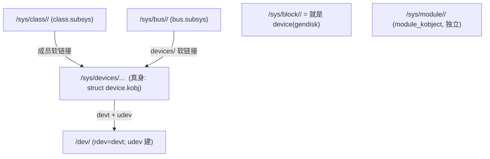

# 🌲 `/sys` 目录 ↔ 结构体字段 对照（**本机真实目录**）

> [!INFO] 方法 & 定位
> - **在真实目录上做笔记**：每一节 = **①完整结构体** → **②本机真实目录（命令输出）** → **③条目↔字段对照表**。用表格代替右侧注释，避免换行错位。
> - **机器**：本机（mainline 7.3.0-rc6，Intel + NVMe `nvme0n1` + r8169 网卡，ACPI 引导）。目录为实测，个别长目录用 `…` 截断。
> - 行号按**你当前已加注释的源码**引用。

---

## 🗺️ 0. 六大根目录 → 宿主结构体

| `/sys` 根 | 宿主结构体 | 本质 |
| --- | --- | --- |
| `/sys/devices/` | `struct device` | **真身**：真实设备树 |
| `/sys/bus/<name>/` | `struct bus_type`（+`subsys_private`） | **按连接**视图（`devices/`+`drivers/`） |
| `/sys/class/<name>/` | `struct class`（+`subsys_private`） | **按功能**视图（成员是软链接） |
| `/sys/module/<name>/` | `struct module`（+`module_kobject`） | 模块记录（**独立**） |
| `/sys/block/<name>/` | `struct gendisk`（+ 关联 `device`） | 块设备 |
| `/dev/<node>` | `struct cdev` / 块设备 | udev 建的**操作节点**（devtmpfs） |

---

## 🏠 1. `/sys/devices/` —— 真身

### 完整结构体：`struct device`

```c
/* include/linux/device.h:705 */
struct device {
	struct kobject kobj;                    // ← 本目录本身
	struct device		*parent;            // ← "device" 软链接（父设备）
	struct device_private	*p;
	const char		*init_name;
	const struct device_type *type;
	const struct bus_type	*bus;           // ← "subsystem" 软链接（走 bus）
	struct device_driver *driver;           // ← "driver" 软链接
	void		*platform_data;
	void		*driver_data;
	struct { const char *name; spinlock_t lock; } driver_override;  // ← "driver_override"
	struct mutex		mutex;
	struct dev_links_info	links;
	struct dev_pm_info	power;              // ← "power/" 目录（运行时 PM）
	struct dev_pm_domain	*pm_domain;         //   （电源域）
#ifdef CONFIG_ENERGY_MODEL
	struct em_perf_domain	*em_pd;
#endif
#ifdef CONFIG_PINCTRL
	struct dev_pin_info	*pins;
#endif
	struct dev_msi_info	msi;                 //   （MSI 消息中断信息）
#ifdef CONFIG_ARCH_HAS_DMA_OPS
	const struct dma_map_ops *dma_ops;
#endif
	u64		*dma_mask;
	u64		coherent_dma_mask;
	u64		bus_dma_limit;
	const struct bus_dma_region *dma_range_map;
	struct device_dma_parameters *dma_parms;
	struct list_head	dma_pools;
#ifdef CONFIG_DMA_DECLARE_COHERENT
	struct dma_coherent_mem	*dma_mem;
#endif
#ifdef CONFIG_DMA_CMA
	struct cma *cma_area;
#endif
#ifdef CONFIG_SWIOTLB
	struct io_tlb_mem *dma_io_tlb_mem;
#endif
	struct dev_archdata	archdata;
	struct device_node	*of_node;            // ← DT 节点（"of_node" 软链接，若有）
	struct fwnode_handle	*fwnode;             // ← "firmware_node" 软链接（统一固件节点）
#ifdef CONFIG_NUMA
	int		numa_node;                       // ← "numa_node" 文件
#endif
	dev_t			devt;                    // ← "dev" 文件（MAJOR:MINOR；无 devt 则无此文件）
	u32			id;
	spinlock_t		devres_lock;
	struct list_head	devres_head;
	const struct class	*class;               // ← "subsystem" 软链接（走 class）
	const struct attribute_group **groups;    // ← 设备专属属性文件
	void	(*release)(struct device *dev);
	struct iommu_group	*iommu_group;        // ← "iommu_group" 软链接
	struct dev_iommu	*iommu;              // ← "iommu" 软链接
	struct device_physical_location *physical_location;
	enum device_removable	removable;
	DECLARE_BITMAP(flags, DEV_FLAG_COUNT);
};
```

### 真实目录

```bash
$ ls /sys/devices
LNXSYSTM:00 breakpoint cpu_atom cpu_core cstate_core cstate_pkg faux i915 intel_bts intel_pt
isa kprobe msr pci0000:00 platform pnp0 power software system tracepoint
uncore_arb_0 … uncore_imc_free_running_1 uprobe virtual
```
- `pci0000:00/`（PCI 根域）、`platform/`（平台设备）、`virtual/`（虚拟设备）、`system/ software/ tracepoint/`（内核自建）。

### 实例 ①：有驱动绑定的 PCI 桥

```bash
$ ls -l /sys/devices/pci0000:00/0000:00:1c.0/
drwxr-xr-x  0000:00:1c.0:pcie001/  0000:00:1c.0:pcie010/   0000:37:00.0/
drwxr-xr-x  aer/  link/  msi_irqs/  pci_bus/  power/  wakeup/
-r--r--r--  class  device  vendor  resource  revision  irq  …（pci_dev 属性）
-rw-r--r--  config  enable  driver_override  msi_bus  numa_node  …
--w--w----  remove        --w-------  rescan  reset  reset_subordinate
lrwxrwxrwx  driver -> ../../../bus/pci/drivers/pcieport
lrwxrwxrwx  subsystem -> ../../../bus/pci
lrwxrwxrwx  firmware_node -> ../../LNXSYSTM:00/LNXSYBUS:00/PNP0A08:00/device:28
lrwxrwxrwx  iommu -> ../../virtual/iommu/dmar1
lrwxrwxrwx  iommu_group -> ../../../kernel/iommu_groups/13
-r--r--r--  modalias
```

| 条目 | 类型 | ← 字段 | 说明 |
| --- | --- | --- | --- |
| `driver` | 软链接 | `dev->driver` | → 绑定的驱动 `pcieport` |
| `subsystem` | 软链接 | `dev->bus` | → `/sys/bus/pci`（走 bus 时） |
| `firmware_node` | 软链接 | `dev->fwnode` | ACPI 固件节点 |
| `iommu` / `iommu_group` | 软链接 | `dev->iommu` / `dev->iommu_group` | IOMMU 运行时 / 组 |
| `modalias` | 文件 | uevent 的 `MODALIAS` | udev modprobe 用 |
| `irq` | 文件 | `dev->irq` | 中断号 |
| `power/` | 目录 | `dev->power` | 运行时 PM |
| `class` `vendor` `resource` `config` `revision` `enable` … | 文件 | `struct pci_dev` 专属 | 总线/驱动加的属性 |
| `0000:37:00.0/` | 目录 | 子 `struct device` | 下级 PCIe 端点 |
| `pci_bus/` | 目录 | 关联的 `struct pci_bus` | 该桥下的总线 |
| `msi_irqs/` `aer/` `link/` | 目录 | PCIe 专属 | MSI / AER / 链路 |
| `remove` `rescan` `reset` | 文件（可写） | PCI 专属 | 热移除 / 重扫 / 复位 |

> [!TIP] **此目录没有 `dev` 文件**
> `dev` 文件（内容 `MAJOR:MINOR`）只在 `devt != 0` 时出现。PCI 桥不建字符/块节点，所以没有；而下面的 input/event0 有。

### 实例 ②：input/event0（有 `dev` 文件）

```bash
$ ls -l /sys/class/input/event0/          # 软链接落到 /sys/devices/.../input/input0/event0
-r--r--r--  dev
lrwxrwxrwx  device -> ../../input0
drwxr-xr-x  power/
lrwxrwxrwx  subsystem -> ../../../../../../../class/input
-rw-r--r--  uevent
```

| 条目 | 类型 | ← 字段 | 说明 |
| --- | --- | --- | --- |
| `dev` | 文件 | `dev->devt` | "MAJOR:MINOR"（本例 `13:x`） |
| `device` | 软链接 | `dev->parent` | → 父输入设备 `input0` |
| `power/` | 目录 | `dev->power` | 运行时 PM |
| `subsystem` | 软链接 | `dev->class` | → `/sys/class/input`（走 class 时） |
| `uevent` | 文件 | `dev_attr_uevent` | 写它 = 发一次合成 uevent |

---

## 🚌 2. `/sys/bus/` —— 连接视图

### 完整结构体：`struct bus_type` + 私壳 `subsys_private`

```c
/* include/linux/device/bus.h:89 */
struct bus_type {
	const char		*name;                  // ← 目录名 /sys/bus/<name>
	const char		*dev_name;
	const struct attribute_group *const *bus_groups;   // ← bus 级属性
	const struct attribute_group *const *dev_groups;
	const struct attribute_group *const *drv_groups;
	int (*match)(struct device *dev, const struct device_driver *drv); // 撮合规则
	int (*uevent)(const struct device *dev, struct kobj_uevent_env *env);
	int (*probe)(struct device *dev);           // 配对成功后启用
	void (*sync_state)(struct device *dev);
	void (*remove)(struct device *dev);
	void (*shutdown)(struct device *dev);
	const struct cpumask *(*irq_get_affinity)(struct device *dev, unsigned int irq_vec); // 中断亲和性
	int (*online)(struct device *dev);
	int (*offline)(struct device *dev);         // 热移除前下线
	int (*suspend)(struct device *dev, pm_message_t state);
	int (*resume)(struct device *dev);
	int (*num_vf)(struct device *dev);
	int (*dma_configure)(struct device *dev);
	void (*dma_cleanup)(struct device *dev);
	const struct dev_pm_ops *pm;
	bool driver_override;
	bool need_parent_lock;
};
```

```c
/* bus_register 时包一层私壳（bus.c:956；class 与 bus 共用；drivers/base/base.h:43） */
struct subsys_private {
	struct kset subsys;              // ← /sys/bus/<name> 目录本身
	struct kset *devices_kset;       // ← devices/
	struct kset *drivers_kset;       // ← drivers/
	struct klist klist_devices;
	struct klist klist_drivers;
	struct blocking_notifier_head bus_notifier;
	struct list_head interfaces;
	struct mutex mutex;
	...
};
```

### 真实目录

```bash
$ ls /sys/bus
ac97 acpi auxiliary cec clockevents clocksource container cpu dax edac event_source faux gpio
hdaudio hid i2c isa machinecheck mdio_bus media mei memory memory_tiering mipi-dsi mmc nd node
nvmem parport pci pci-epf pci_express platform pnp rapidio regulator scsi sdio serial serial-base
serio snd_seq soc soundwire spi thunderbolt typec usb virtio vme wmi workqueue xen xen-backend

$ ls /sys/bus/pci
devices  drivers  drivers_autoprobe  drivers_probe  rescan  resource_alignment  slots  uevent

$ ls /sys/bus/pci/drivers | head -10
8250_mid agpgart-intel agpgart-via asiliantfb ata_generic ata_piix ehci-pci i801_smbus i915 igen6_edac
```

| 条目 | 类型 | ← 字段 | 说明 |
| --- | --- | --- | --- |
| `devices/` | 目录 | `subsys_private.devices_kset` | 成员设备（软链接，如 `0000:00:1c.0`） |
| `drivers/` | 目录 | `subsys_private.drivers_kset` | 已注册驱动（`pcieport` `nvme` `i915`…） |
| `uevent` | 文件 | kset 标准 | 触发 bus 级 uevent |
| `drivers_autoprobe` | 文件 | `drivers_autoprobe` 开关 | 是否自动 probe |
| `rescan` `drivers_probe` `resource_alignment` | 文件 | PCI 专属 | 重扫 / 手动 probe / 资源对齐 |

> 设备侧 `driver -> ../../../bus/pci/drivers/pcieport` 与这里 `drivers/pcieport/` **对称闭环**。
> 注意列表里 `cpu` `memory` `node` `gpio` `workqueue`… 是**伪总线**（无物理线路）——证明 bus 只是"设备+驱动的分组撮合机制"。

---

## 🏷️ 3. `/sys/class/` —— 功能视图

### 完整结构体：`struct class` + 私壳 `subsys_private`

```c
/* include/linux/device/class.h:55 */
struct class {
	const char		*name;                 // ← 目录名 /sys/class/<name>
	const struct attribute_group	*const *class_groups;  // ← 类级属性
	const struct attribute_group	*const *dev_groups;
	int (*dev_uevent)(const struct device *dev, struct kobj_uevent_env *env); // 追加 uevent 变量
	char *(*devnode)(const struct device *dev, umode_t *mode);                // /dev 节点名/权限
	void (*class_release)(const struct class *class);
	void (*dev_release)(struct device *dev);
	int (*shutdown_pre)(struct device *dev);
	const struct kobj_ns_type_operations *ns_type;
	const struct ns_common *(*namespace)(const struct device *dev);
	void (*get_ownership)(const struct device *dev, kuid_t *uid, kgid_t *gid);
	const struct dev_pm_ops *pm;
};
```
> class 注册时同样被包 `subsys_private`（`class.c:206`）：`subsys`→`/sys/class/<name>`，`klist_devices`→成员。

### 真实目录

```bash
$ ls /sys/class
accel ata_device ata_link ata_port backlight bdi block bluetooth bsg devcoredump devfreq dma drm … 
gpio graphics hidraw hwmon i2c-dev ieee80211 input iommu leds misc mmc_host mtd net nvme pci_bus 
phy power_supply pps pwm rc regulator rtc scsi_device scsi_disk sound spi_master thermal tpm tty typec … 

$ ls -l /sys/class/net
enp55s0 -> ../../devices/pci0000:00/0000:00:1c.0/0000:37:00.0/net/enp55s0   ← PCIe 网卡
lo      -> ../../devices/virtual/net/lo                                      ← 虚拟设备
wlo1    -> ../../devices/pci0000:00/0000:00:14.3/net/wlo1                    ← 无线网卡

$ ls -l /sys/class/block | head -3
loop0   -> ../../devices/virtual/block/loop0
loop1   -> ../../devices/virtual/block/loop1
nvme0n1 -> ../../devices/pci0000:00/…/nvme/nvme0/nvme0n1
```

| 条目 | 类型 | ← 字段 | 说明 |
| --- | --- | --- | --- |
| `<dev>`（如 `enp55s0` `loop0`） | 软链接 | `subsys_private.klist_devices` | 指向 `/sys/devices` 真身 |
| 类级属性文件 | 文件 | `class->class_groups` | 该类共用属性 |
| 目录本身 | 目录 | `subsys_private.subsys` | `struct class` 的名字 |

> **同一个 class 里物理来源迥异**：`lo`/`loop0` 是 virtual、`enp55s0`/`nvme0n1` 是 PCI——class 只看**功能**。

---

## 📦 4. `/sys/module/` —— 模块

### 结构体：`struct module`（与 `/sys/module` 相关字段）

```c
/* include/linux/module.h:388 */
struct module {
	enum module_state state;               // ← "initstate"
	struct list_head list;
	char name[MODULE_NAME_LEN];
#ifdef CONFIG_STACKTRACE_BUILD_ID
	unsigned char build_id[BUILD_ID_SIZE_MAX];
#endif
	/* Sysfs stuff. */
	struct module_kobject mkobj;           // ← /sys/module/<name> 这个 kobject
	struct module_attribute *modinfo_attrs;
	const char *version;                   // ← "version"（有 MODULE_VERSION 才有）
	const char *srcversion;                // ← "srcversion"
	const char *imported_namespaces;
	struct kobject *holders_dir;           // ← "holders/"
	const struct kernel_symbol *syms;
	const u32 *crcs;
	const u8 *flagstab;
	...
	struct kernel_param *kp;               // ← "parameters/"（受 param_lock）
	...
	struct module_memory mem[MOD_MEM_NUM_TYPES]; // ← "coresize" / "initsize"
	struct mod_arch_specific arch;
	unsigned long taints;                  // ← "taint"
	...
	struct module_sect_attrs *sect_attrs;  // ← "sections/"
	struct module_notes_attrs *notes_attrs;// ← "notes/"
	...
};

/* include/linux/module.h:46 */
struct module_kobject {
	struct kobject kobj;                   // ← /sys/module/<name>
	struct module *mod;
	struct kobject *drivers_dir;           // ← "drivers/"（注册了 driver 才有）
	struct module_param_attrs *mp;         // ← "parameters/"
	...
};
```

### 真实目录

```bash
$ ls /sys/module | head -8
8250  8250_base  8250_mid  8250_pci  ac97_bus  acpi  acpi_cpufreq  acpi_pad

$ ls /sys/module/kvm
coresize  holders  initsize  initstate  notes  parameters  refcnt  sections  srcversion  taint  uevent
```

| 条目 | 类型 | ← 字段 | 说明 |
| --- | --- | --- | --- |
| `holders/` | 目录 | `mod->holders_dir` | 依赖它的模块（软链接） |
| `parameters/` | 目录 | `mod->kp` / `mkobj.mp` | 模块参数（受 `param_lock`） |
| `sections/` | 目录 | `mod->sect_attrs` | 各 ELF 段地址 |
| `notes/` | 目录 | `mod->notes_attrs` | 含 `.note.gnu.build-id` |
| `refcnt` | 文件 | `module_refcount(mod)` | 引用计数 |
| `srcversion` | 文件 | `mod->srcversion` | 源码哈希 |
| `taint` | 文件 | `mod->taints` | 污染位 |
| `initstate` | 文件 | `mod->state` | live / coming / going |
| `coresize` / `initsize` | 文件 | `mod->mem[]` | 核心 / init 段大小 |
| `uevent` | 文件 | kobject 标准 | — |
| `drivers/` | 目录 | `mkobj.drivers_dir` | **kvm 无**（不注册 driver） |
| `version` | 文件 | `mod->version` | **kvm 无**（无 `MODULE_VERSION`） |

---

## 💽 5. `/sys/block/` —— 块设备

### 完整结构体：`struct gendisk`

```c
/* include/linux/blkdev.h:144 */
struct gendisk {
	int major;                               //   （主设备号，块核心自动分配）
	int first_minor;
	int minors;
	char disk_name[DISK_NAME_LEN];           // ← 目录名（部分）
	unsigned short events;
	unsigned short event_flags;
	struct xarray part_tbl;
	struct block_device *part0;              //   （含关联 device + 分区）
	const struct block_device_operations *fops;
	struct request_queue *queue;             //   （请求队列 → "queue/"）
	void *private_data;
	struct bio_set bio_split;
	int flags;
	unsigned long state;
	struct mutex open_mutex;
	unsigned open_partitions;
	struct backing_dev_info	*bdi;            // ← "bdi" 软链接
	struct kobject queue_kobj;               // ← "queue/" 目录
	struct kobject *slave_dir;               // ← "slaves/" 目录
	struct timer_rand_state *random;
	struct disk_events *ev;
#ifdef CONFIG_BLK_DEV_ZONED
	… （分区/zoned 相关）
#endif
	int node_id;
	struct badblocks *bb;
	u64 diskseq;                             // ← "diskseq"
	...
};
/* disk_to_dev(disk) = 关联的 struct device（class = &block_class, genhd.c:1488）→ 目录本体 */
```

### 真实目录

```bash
$ ls /sys/block
loop0 … loop28  nvme0n1  nvme1n1

$ ls -l /sys/block/nvme0n1/
lrwxrwxrwx  bdi -> ../../…/virtual/bdi/259:7
-r--r--r--  capability  csi  dev  discard_alignment  diskseq  eui  events  events_async
-rw-r--r--  events_poll_msecs  ext_range  hidden  inflight  metadata_bytes  nguid  nsid
-r--r--r--  numa_nodes  nuse  partscan  queue_depth  range  removable  ro  size  stat  uuid  wwid
-rw-r--r--  passthru_err_log_enabled
lrwxrwxrwx  device -> ../../nvme0
lrwxrwxrwx  subsystem -> ../../…/class/block
drwxr-xr-x  holders/  integrity/  mq/  power/  queue/  slaves/  trace/
drwxr-xr-x  nvme0n1p1/  nvme0n1p2/  nvme0n1p3/  nvme0n1p4/
-rw-r--r--  uevent
```

| 条目 | 类型 | ← 字段 | 说明 |
| --- | --- | --- | --- |
| `bdi` | 软链接 | `disk->bdi` | backing dev info |
| `queue/` | 目录 | `disk->queue_kobj` | 请求队列 |
| `mq/` | 目录 | 多队列 | 每 CPU 队列 |
| `holders/` | 目录 | `disk->part0->bd_holder_dir` | 持有者（谁打开） |
| `slaves/` | 目录 | `disk->slave_dir` | md/dm 从属 |
| `dev` | 文件 | 关联 device 的 `devt` | "259:7" |
| `device` | 软链接 | 关联 device 的 `parent` | → `../../nvme0` |
| `subsystem` | 软链接 | 关联 device 的 `class` | → `/sys/class/block` |
| `size` `ro` `removable` `stat` `inflight` `capability` … | 文件 | `block`/`gendisk` 属性 | 容量/只读/统计… |
| `nvme0n1pN/` | 目录 | 分区（独立 `struct device`） | 同 `block_class` |
| `csi` `eui` `nguid` `nsid` `nuse` `wwid` … | 文件 | NVMe 专属属性 | 命名空间信息 |

> `/sys/block/<name>` 本身是指向 `/sys/devices/...` 的**软链接**（块设备快捷入口）。

---

## 🔌 6. `/dev/` —— 操作节点

### 完整结构体：`struct cdev`

```c
/* include/linux/cdev.h:22 */
struct cdev {
	struct kobject kobj;                    // 挂进 cdev_map
	struct module *owner;                   // 进入 fops 前 try_module_get
	const struct file_operations *ops;      // ← 节点 open 后的 I/O 入口（fops）
	struct list_head list;                  // 打开的 inode 链
	dev_t dev;                              // ← rdev 起始（major:minor）
	unsigned int count;                     // 连续设备号个数
} __randomize_layout;
```

### 真实节点

```bash
$ ls /dev | head -12
acpi_thermal_rel autofs block btrfs-control bus char console core cpu cuse disk
$ ls -l /dev/null /dev/console /dev/gpiochip0 /dev/nvme0n1
crw-rw-rw-  1 root root      1, 3  /dev/null          ← 字符;1:3
crw-------  1 root tty       5, 1  /dev/console       ← 字符;5:1
crw-rw----+ 1 root plugdev 254, 0  /dev/gpiochip0     ← 字符;254:0 ('+' = ACL)
brw-rw----  1 root disk    259, 7  /dev/nvme0n1       ← 块;259:7
```

| 节点属性 | ← 来源 |
| --- | --- |
| 类型 `c` / `b` | 字符 → `cdev`；块 → `gendisk` |
| `major, minor` | `dev->devt`（与 `/sys/.../dev` 内容一致） |
| 名字 | `class.devnode`（`DEVNAME`） |
| 权限 / 属主 | `DEVMODE` / `get_ownership`（udev 按 uevent 设置） |

> 闭环：`/sys/.../dev`("259:7") == `/dev/nvme0n1` 的 `rdev` == `gendisk` 的 `devt`；字符设备同理 → `kobj_lookup(cdev_map)` → `cdev->ops`。

---

## 🧾 7. 属性是什么：kernfs 三节点 + 命名组

### 7.1 属性 = 名字 + 权限 + 一对函数（**不是变量**）

```c
struct attribute {                    // include/linux/sysfs.h:30
	const char	*name;
	umode_t		mode;                 // ← 0444 / 0644 / 0200
};
struct device_attribute {             // include/linux/device.h:106
	struct attribute	attr;
	ssize_t (*show)(struct device *, struct device_attribute *, char *buf);
	ssize_t (*store)(struct device *, struct device_attribute *, const char *, size_t);
};
```

**`cat` 一次 = 调一次 `show()`，`echo` 一次 = 调一次 `store()`。** 内核不暴露变量，只暴露函数。

### 7.2 五大类（看 `ls -l` 权限位就能分类）

| 类别 | 权限指纹 | 干什么 | 真实例子 |
| --- | --- | --- | --- |
| ① 身份/描述 | `-r--r--r--` | 静态标识，基本不变 | `vendor` `device` `revision` `label` `ngpio` `base` `address` `modalias` |
| ② 状态/统计 | `-r--r--r--` | 实时，每次读重新算 | `stat` `inflight` `runtime_status` `operstate` `carrier` `irq` |
| ③ 配置/参数 | `-rw-r--r--` | 可调 | `mtu` `control` `autosuspend_delay_ms` `enable` `driver_override` |
| ④ 动作/触发 | `--w-------` | **写了就触发一次**，无可读值 | `bind` `unbind` `rescan` `remove` `reset` `uevent` `export` |
| ⑤ 二进制大块 | 常为 `-r--r--r--` | 定长二进制（`bin_attribute`） | PCI `resource`、USB `descriptors` |

```bash
-r--r--r--   → 只读属性（①/②）
-rw-r--r--   → 可写属性（③）
--w-------   → 只写属性（④，写了就干一件事）
lrwxrwxrwx   → 软链接（不是属性）
drwxr-xr-x   → 子目录（不是属性）
```

三条铁律：**内容必为文本**（`sysfs_emit`）、**读一次调一次 show（不缓存）**、**一文件一值**。属性还能靠 `is_visible` 动态显隐。

### 7.3 kernfs 只有三种节点

```c
enum kernfs_node_type {              // include/linux/kernfs.h:100
	KERNFS_DIR	= 0x0001,     // 目录
	KERNFS_FILE	= 0x0002,     // 文件
	KERNFS_LINK	= 0x0004,     // 软链
};
struct kernfs_node {                 // kernfs.h:199
	struct kernfs_node __rcu *__parent;   // :211 父
	const char __rcu *name;               // :212 ★ 名字
	unsigned short flags;                 // :218 类型 = DIR/FILE/LINK
	umode_t mode;                         // :219 权限
	union {
		struct kernfs_elem_dir     dir;      // :222 目录：子节点容器(rb树+hash)
		struct kernfs_elem_symlink symlink;  // :223 软链：目标路径
		struct kernfs_elem_attr    attr;     // :224 文件：show/store 回调
	};
	void *priv;                            // :233 ★★ 指回内核对象（kobject→struct device）
};
```

| 节点 | union 成员 | 本质 |
| --- | --- | --- |
| **目录** | `dir` | **索引**：子节点的 rb 树 + 哈希，按名字查找 |
| **文件** | `attr` | **问句**：只有名字 + `show`/`store` 一对回调 |
| **软链** | `symlink` | **指针**：只有名字 + 目标路径 |

> [!IMPORTANT] **sysfs 里没有任何数据副本**
> 文件只是"问问题的门"。`cat /sys/class/net/enp55s0/address` → `kernfs_file_fops.read` → `attr.show()` → 读 `net_device->perm_addr` → `sysfs_emit` 成文本。**数据永远在内核结构体里**，靠 `priv`(`:233`) 指回去。这就是"记录层很薄"的最终形态：整个 sysfs 是一棵由"问句"组成的树。

### 7.4 命名组 = 子目录，无名组 = 直接铺

```c
/* fs/sysfs/group.c: internal_create_group() */
if (grp->name) {                                        // :151 ★ 有名字
	kn = kernfs_create_dir_ns(kobj->sd, grp->name, mode, …);   // :176 建子目录
} else {
	kn = kobj->sd;                                     // :185 ★ 没名字 → 铺在 kobject 自己目录
}
create_files(kn, kobj, uid, gid, grp, update);          // :189
```

| | 命名组 | 无名组 |
| --- | --- | --- |
| 真实例子 | `/sys/module/kvm/sections/`、`parameters/`、`/sys/block/nvme0n1/integrity/` | `gpiochip512` 下的 `base`/`label`/`ngpio` |
| 目录权限 | 恒 `drwxr-xr-x`（`S_IRWXU\|S_IRUGO\|S_IXUGO`，`:157`） | 无目录 |
| 能 `cat` 目录? | ❌ 不能（没有 show/store） | — |
| 整组显隐 | `is_visible`(`:152`) 返回 `SYSFS_GROUP_INVISIBLE` → **整组不建** | 逐个控制 |
| 卸载 | `sysfs_remove_group`(`:310`)：`remove_files` 后 `kernfs_remove(kn)` 删目录 | 直接 `remove_files` |

> [!WARNING] 命名组 ≠ 新 kobject
> 命名组只是**同一个 kobject 下的一个 kernfs 目录节点**（无 uevent、不可 cat）；而 `queue/`、`power/`、`mq/` 是**独立的 `struct kobject`**。长得一样，来头不同。

---

## 🕸️ 8. 视图关系



---

## 🔗 9. 相关笔记

- [[struct device 精读]] · [[struct bus_type 精读]] · [[struct class 与设备自动发现]]
- [[struct module 精读]] · [[file_operations 与字符设备结构精读]] · [[运行时电源管理 runtime PM]]
- [[kobject-sysfs-kernfs映射分层]] — 目录↔kobject 的地基

---

## 📚 10. 参考资料

1. **本机实测** — `/sys`、`/dev` 各目录 `ls`/`ls -l`（本仓库运行环境，mainline 7.3.0-rc6）。
2. **Linux Kernel 源码** — `include/linux/device.h`（`struct device` `:705`）、`device/bus.h`（`struct bus_type` `:89`）、`device/class.h`（`struct class` `:55`）、`drivers/base/base.h`（`subsys_private` `:43`）、`module.h`（`struct module` `:388`、`module_kobject` `:46`）、`blkdev.h`（`gendisk` `:144`）、`block/genhd.c`（`block_class` `:1488`）、`cdev.h`（`struct cdev` `:22`）、`drivers/base/core.c`（`uevent`、`device_add_class_symlinks`）.

（注：目录部分为本机实测；结构体字段以本仓库逐行核实为准。）
