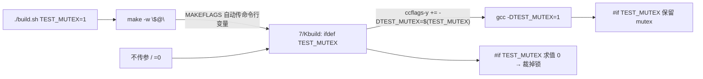

# 🔨 驱动实战 2：file_operations 补全 · 互斥锁消融实验 · sysfs 属性

> [!INFO] 笔记定位
> - **性质**：接 [[驱动实战：从裸模块到 platform_driver]] 的后续路线：`裸模块 -> 字符设备+/dev -> 多实例 -> platform_driver+假设备 -> 完整 file_operations -> 互斥锁消融 -> sysfs 属性`
> - **工程**：`~/project/mydriver/7/`（完整 file_operations + 锁消融）、`8/`（sysfs 属性）；源码副本按内容命名归档在 `源码/mydriver/`，每个源文件都已转成 `.md` 代码笔记（驱动层 → `7.完整file_operations->锁与并发/`，用户态 → `8.完整file_operations->应用层/`，其余同名对应；目录名以 `1.`~`9.` 前缀标注路线顺序）。
> - **最值钱的部分是 §5 踩坑集**（11 条，全是真机撞出来的）+ §2 的**消融实验方法论**。
> - 关联：[[file_operations 与字符设备结构精读]] · [[sysfs 目录↔结构体字段对照树]] · [[struct platform_driver 与 probe 时序]]

---

## 1. 完整 file_operations -> 补齐入口 + `container_of`/`private_data`

| 入口 | 关键动作 | 易错点 |
| --- | --- | --- |
| `.open` | `container_of(inode->i_cdev, struct priv, cdev)` → `filp->private_data = priv` | 不存 `private_data`，后面 read/write 拿到的就是野指针 |
| `.read` / `.write` | `priv = filp->private_data`；`copy_to_user`/`copy_from_user` | `len` 要截断；算长度别漏 `- *poff` |
| `.unlocked_ioctl` | `_IOC_TYPE(cmd)` 校验魔术数 → `switch (cmd)` | 魔术数必须与用户态共享头一致，否则返回 `-ENOTTY` |
| `.llseek` | **自己写 `filp->f_pos = newpos` 再 `return newpos`** | 见 §5-1、§5-2（今天最大的两个坑） |
| `.owner = THIS_MODULE` | VFS 在 `open` 时 `try_module_get` | 有 fd 打开时 `rmmod` 会报 `in use` |

> [!IMPORTANT] llseek 契约（今天最硬的一条）
> 内核 VFS **不会**把 `.llseek` 的返回值写回 `f_pos`，位置更新是**实现自己的责任**——内核自带的 `generic_file_llseek`/`default_llseek` 也都是在函数内部写 `file->f_pos`。

```c
static loff_t hello_llseek(struct file *pfile, loff_t off, int whence)
{
	struct priv *priv = pfile->private_data;
	loff_t newpos;

	switch (whence) {
	case SEEK_SET: newpos = off;                  break;
	case SEEK_CUR: newpos = pfile->f_pos + off;   break;
	case SEEK_END: newpos = priv->buf_len + off;  break;
	default:       return -EINVAL;
	}                                    /* ← switch 在这里结束 */
	if (newpos < 0)
		return -EINVAL;
	pfile->f_pos = newpos;               /* ★ 必须在 switch 外面 */
	return newpos;
}
```

## 2. 互斥锁消融 -> 用 A/B 构建证明锁的必要性

### 2.1 编译期开关链路



- `Kbuild`：`ifdef TEST_MUTEX` + `ccflags-y += -DTEST_MUTEX=$(TEST_MUTEX)`
- C 侧顶部兜底（内核编译带 `-Wundef`，未定义宏参与 `#if` 会告警）：

```c
#ifndef TEST_MUTEX
#define TEST_MUTEX 0
#endif
```

- `build.sh` 用 `"$@"` 透传；**`make VAR=1` 才是传变量，`make VAR` 会被当成目标名**

### 2.2 实验与数据

判据：写线程交替写 `AAAA…\n` / `BBBB…\n`（各 17 字节），读线程 `lseek(0)` 后整段读回，内容出现 A/B 混合即记为一次**撕裂**。20 核，每次跑 10 秒。

| 组别 | 构建 | 撕裂次数 |
| --- | --- | --- |
| B 组 | `TEST_MUTEX=0` | **1 → 12 → 307 → 114 → 131** |
| A 组 | `TEST_MUTEX=1` | **0** |

> [!IMPORTANT] 三条结论
> 1. **锁的必要性被实验证明**：无锁稳定撕裂，带锁稳定为 0。
> 2. **"没出错" ≠ "没问题"**：B 组第一轮只撞出 1 次，若那一轮恰好是 0，就会得出完全错误的结论。竞态测试必须靠**加大压力 + 对照组**，不能靠单次结果。
> 3. **窗口为什么这么小**：`copy_from_user` 的 17 字节是几条 `mov`，不是原子操作；命中率天然低（几十 / 百万量级）。真实驱动里坏掉的若是结构体/链表/引用计数，后果直接是 oops。

## 3. sysfs 属性 -> `DEVICE_ATTR_*` / 属性组 / 子目录 / 可见性

### 3.1 两个结构体的成员千万别混

| `struct attribute`（数组元素） | `struct attribute_group`（组） |
| --- | --- |
| `name`、`mode` | `name`（**子目录名**）、`attrs`、`bin_attrs`、`is_visible` |

```c
static ssize_t buf_len_show(struct device *dev, struct device_attribute *attr, char *buf);
static DEVICE_ATTR_RO(buf_len);        /* 0444，自动生成 buf_len_show */
static DEVICE_ATTR_WO(reset);          /* 0200，自动生成 reset_store */
```

- `show` 必须 `return sysfs_emit(buf, "...")`（**不要 sprintf**）；`store` 必须 `return count`（或负 errno）
- 解析用户输入用 `kstrtobool()` / `kstrtoint()`，别用废弃的 `simple_strtol`

### 3.2 组的 `name` → 子目录

```c
static struct attribute_group hello_ctrl_group = {
	.name  = "ctrl",           /* ★ 有 .name → /sys/class/xxx/yyy/ctrl/ */
	.attrs = hello_ctrl_attrs,
};
```

结果：`/sys/class/hello8/hello80/{debug/,ctrl/}`。卸载时 `device_remove_groups()` 会**连子目录一起拆**。

### 3.3 生命周期与可见性

- 顺序：`device_create()` **之后** `device_add_groups()`；拆除时 `device_remove_groups()` 在 `device_destroy()` **之前**
- 更省事的替代：`driver.driver.dev_groups`（跟着绑定自动建/删，但属性落在**平台设备**目录 `/sys/devices/platform/hello8.0/`，不是 class 目录）
- `.is_visible()`：按条件隐藏属性（可与编译开关联动），返回 0 = 隐藏
- `ATTRIBUTE_GROUPS()` 宏只能生成**一个平铺、无 is_visible** 的组；要子目录/可见性必须手写组结构

## 4. 设备模型实地观察（本机 `/sys` 对照）

| 观察 | 结论 |
| --- | --- |
| `/sys/class/hello8/hello80` | **是符号链接**（`readlink -f` → `/sys/devices/virtual/hello8/hello80`）；`/sys/class` 只是分类视图 |
| `uevent`、`dev`、`power/`、`subsystem` | 内核 device core **标配**；`power/` 正是 `.name="power"` 的属性组（PM 核心注册） |
| `device ->` | 只在设备**有 parent** 时创建；`device_create(cls, NULL, ...)` 传 NULL 就没有 |
| `hci0/rfkill0` vs `hello80/debug` | **都是目录，语义不同**：前者是**子设备**（含 `uevent`/`subsystem`/`power`），后者是**属性组子目录**（只有属性文件） |
| `/proc/device-tree` | x86 上没有（ACPI 平台无 DT），见 [[设备树（DT）勘察与 QEMU 实验方案]] |

判定口诀：**目录里有 `uevent` → 是设备；只有属性文件 → 是属性组。**

## 5. 踩坑集（今天 11 条，最值钱）

| # | 现象 | 根因 / 修法 |
| --- | --- | --- |
| 1 | `lseek()` 返回 0（"成功"）但位置没动，读线程第二次之后永远读到 0 | `.llseek` 里 `filp->f_pos = newpos;` 写进了 `default:` 分支、还排在 `return -EINVAL;` 之后 → **死代码**。移到 switch 外 |
| 2 | `lseek` 静默失败 | fops **不实现 `.llseek`** → 字符设备默认 `no_llseek` → 返回 `-ESPIPE`；测试程序还丢掉了返回值 → 表现为"读线程空转、撕裂恒为 0" |
| 3 | `error: redefinition of 'dev_attr_xxx'` | `DEVICE_ATTR_RO(x)` 会**定义变量**，同一文件写两遍即重复定义（改代码时旧行没删） |
| 4 | `DIR_ATTR=1` 时 `xxx_attrs` 未定义 + `groups` 重复定义 | `ATTRIBUTE_GROUPS()` 写在了 `#if/#endif` **外面**；两条分支各自手写 `groups[]` 才对 |
| 5 | `field name not in record` / 指针类型不兼容 | `.is_visible` 是**组的成员**，却写进了 `struct attribute *[]` 数组 |
| 6 | `gcc: error: =: No such file or directory` | Kbuild 里 `-DDIR_ATTR = $(DIR_ATTR)` **等号两边有空格**；`+=` 是纯文本拼接，必须 `-DDIR_ATTR=$(DIR_ATTR)` |
| 7 | `没有规则可制作目标“DIR_ATTR”` | 命令行写成 `./build.sh DIR_ATTR`（漏 `=1`）→ make 把它当目标名 |
| 8 | 目录里只剩 `.hello8.o.d`，没有 `.o` | **`.d` 在预处理阶段就写出，`.o` 要编译成功才有** → 有 `.d` 无 `.o` 就是编译失败 |
| 9 | `write: Bad file descriptor`；普通用户打不开 `/dev/xxx` | 设备节点默认 **0600 root:root**；且测试程序**没检查 `open` 返回值**，把 -1 传给 `write` → 报 EBADF（错误信息指错方向）。修：`chmod 666` / udev 规则 + 必查 open |
| 10 | `sudo echo x > /dev/xxx` 仍 permission denied | 重定向由**当前 shell**执行，`sudo` 管不到 → `sudo sh -c '...'` 或 `echo x \| sudo tee /dev/xxx` |
| 11 | 报错一大堆 `Makefile.build:289 / 错误 2` 看不出问题 | 那是 make 的**递归调用栈**；真正的错误要 `grep 'error:'`（`warning:` 不是失败原因） |

## 6. 复现清单

```bash
cd ~/project/mydriver
./build.sh TEST_MUTEX=1 && grep -o 'DTEST_MUTEX=[01]' 7/.hello7.o.cmd
sudo rmmod hello7 2>/dev/null; sudo insmod 7/hello7.ko && ./7/mutex   # 期望 0
./build.sh TEST_MUTEX=0 && sudo rmmod hello7 && sudo insmod 7/hello7.ko
./7/mutex                                                            # 期望 >0

# sysfs 属性
./build.sh DIR_ATTR=1 && sudo rmmod hello8; sudo insmod 8/hello8.ko
ls -R /sys/class/hello8/hello80/             # debug/ + ctrl/
echo "abc" | sudo tee /dev/hello80 >/dev/null
cat /sys/class/hello8/hello80/debug/content  # abc
```
