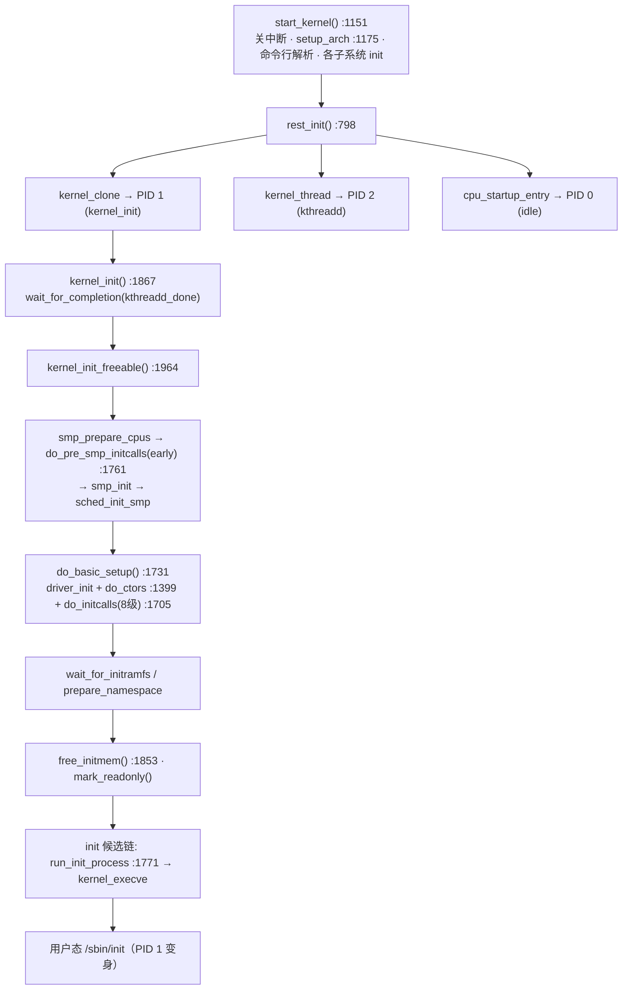
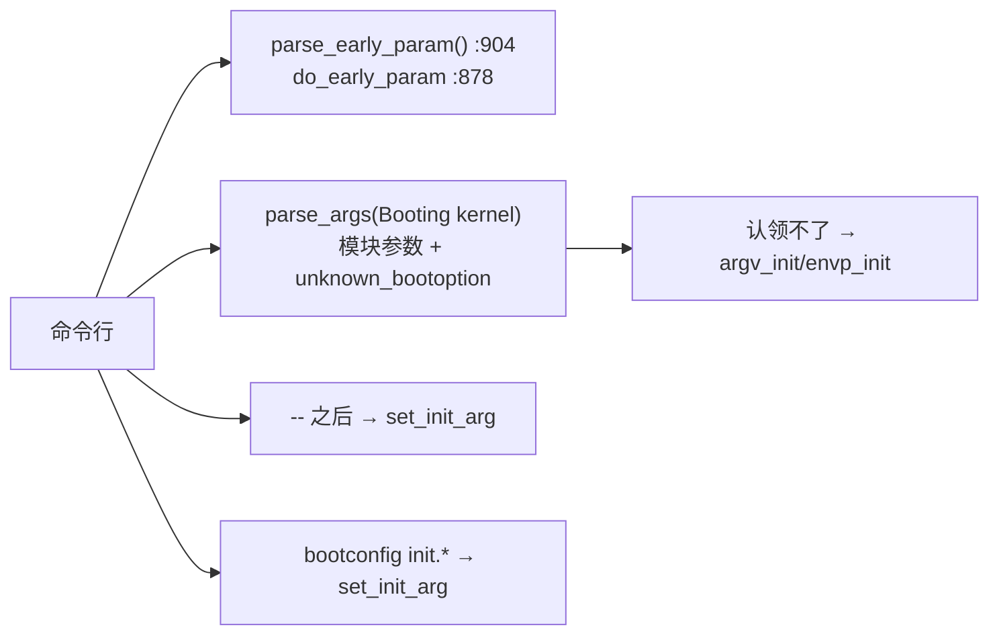
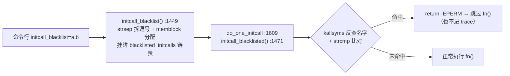

# 🚀 `init/main.c` 内核启动主线全景

> [!INFO] 笔记概览
> - **定位**：`init/main.c` 是内核从**裸机/汇编入口一路走到用户态 `/sbin/init`** 的总调度文件。它管三件事：① 把 bootloader 传来的命令行**解析并分流**；② 用 **initcall 八级机制**把子系统与驱动全部初始化；③ 通过 `rest_init` 完成 **PID 1 / PID 2 / PID 0** 三方交接，最终由 PID 1 `exec` 出用户态 init。
> - **内容范围**：命令行三件套 · initcall 八级体系（含 `do_one_initcall`/黑名单/`initcall_debug`）· `.ctors` 构造函数 · `rest_init` 交接与 `kernel_clone` vs `kernel_thread` · `free_initmem` 竞态 · `kernel_init`/`kernel_init_freeable` 全流程 · init 候选链与 `init=` 陷阱 · `rodata` 安全开关。
> - **推荐路径**：§1 总览图建立全局 → §2 命令行 → §3 initcall 八级（核心）→ §7 `rest_init` 交接 → §9 `kernel_init` 全流程 → §11 误区对照 → §13 Checklist 落地。
> - 本文所有结论均对照本仓库源码逐行核实，格式为 `文件:行号`。**本仓库 `init/main.c` 已被中文批注**（见 `:1406`、`:1431`、`:1632`、`:1704` 等处）。

相关笔记：[[KERNEL SET_UP]] · [[ARM Kernel head.S 内核启动 学习笔记]]

---

## 🧭 1. 主线总览（一张图）



> [!IMPORTANT] 一句话主线
> **`start_kernel` 关中断搭地基 + 解析命令行 → `rest_init` 造出 PID 1(init)/PID 2(kthreadd)/PID 0(idle) → PID 1 跑 `kernel_init_freeable`（SMP + early initcall + 八级 initcall + 挂根）→ 释放 init 内存、应用只读保护 → 最后由 PID 1 自己 `kernel_execve` 变成用户态 `/sbin/init`。**

---

## 📥 2. 命令行三件套：两条副本 + 五路分流

### 2.1 `setup_command_line()` :722 —— 拼出两份副本

| 副本 | 用途 | 可否被改 |
| --- | --- | --- |
| `saved_command_line` | **完整留档**（`/proc/cmdline` 来源、打印横幅） | 解析阶段只读参考 |
| `static_command_line` | **解析工作副本**，`parse_args` 就地糟蹋它 | 会被改成 `\0` |

- 注释 :608 明说：解析是**就地修改**，所以必须留一份完整副本。
- `extra_command_line`（bootconfig 渲染的 `kernel.*`）刻意放在最前，避免与原命令行里的 `--` 冲突（:634）。
- init 参数按 `" -- "[bootconfig init-param][cmdline init-param]` 顺序追加进 `saved_command_line`（:653、:660）。
- 分配用启动期 `memblock_alloc_or_panic`（正式分配器此时还没好）。

### 2.2 五路分流（§3 之外的参数解析）



- **`do_early_param` :878**：只挑 `.init.setup` 段里 `p->early` 的项（`early_param` 注册的，如 `debug`/`quiet`/`loglevel`/`rodata`），匹配即执行；**永远 `return 0`**（不独占消费，留给后续 `__setup`/模块参数再处理）。
- **`parse_early_param` :904**：用 `static int done` 守卫**只跑一次**（架构可能在 `setup_arch` 里先调过）；先 `strscpy` 拷到 `tmp_cmdline` 再解析（因 `parse_args` 就地改串）。
- **`print_unknown_bootoptions` :991**：命令行解析后，把内核没认领、透传给 init 的参数（`argv_init[1..]` + `envp_init[2..]`，跳过程序名和默认 `HOME`/`TERM`）拼成一条 `pr_notice`，打印那句 `Unknown kernel command line parameters ..., will be passed to user space.`（两遍法算长度 + memblock 分配 + 用完 `memblock_free`）。
- **`print_kernel_cmdline` :1093**：按 `CONFIG_CMDLINE_LOG_WRAP_IDEAL_LEN` 把 `saved_command_line` 折行打印，每行前缀 `Kernel command line: `，非末行加 ` \`（忽略引号，仅按空格折）。

> [!NOTE] 调用点（`start_kernel` 内）
> `setup_command_line` :1195 → `early_numa_node_init` :1199 → `print_kernel_cmdline` :1202 → `parse_early_param` :1204 → `parse_args` → `print_unknown_bootoptions` :1209。

---

## ⚙️ 3. initcall 机制：8 级执行体系（核心）

### 3.1 级别表（`initcall_level_names[]` :1673）

| 级 | 名字 | 典型内容 | 为什么在这个顺序 |
| --- | --- | --- | --- |
| 0 | `pure` | 纯内存初始化、无硬件依赖 | 最早，可并行 |
| 1 | `core` | 核心子系统 | 核心先就位 |
| 2 | `postcore` | core 之后的补充 | 依赖 core |
| 3 | `arch` | 架构相关设置 | 架构层 |
| 4 | `subsys` | 总线/子系统（PCI、USB…） | 设备要挂在总线上 |
| 5 | `fs` | 文件系统层 | 设备可能要用 fs |
| 6 | `device` | **绝大多数驱动** | 总线、fs 就绪才能探设备 |
| 7 | `late` | 可延后的驱动 | 最后跑 |

> [!IMPORTANT] `module_init` = `device_initcall` = 第 6 级
> 你写的 `module_init(my_driver_init)` 在内核里展开就是 `device_initcall`，落在 **level 6**。这就是"驱动在 initcall 阶段被自动探测"的原因。

### 3.2 `initcall_levels[]` :1660 与链接脚本

`initcall_levels[]` 存的是 `__initcallN_start` 这些**链接器符号**（每级指针数组的起始地址）：

```ld
/* include/asm-generic/vmlinux.lds.h:946 */
#define INIT_CALLS_LEVEL(level)                    \
        __initcall##level##_start = .;             \
        KEEP(*(.initcall##level##.init))           \
        KEEP(*(.initcall##level##s.init))
```

内存真实顺序（`vmlinux.lds.h:951-963`）：

```
__initcall_start → .initcallearly.init → 0 pure → 1 → 2 → 3 → 4 → 5 fs
  → .initcallrootfs.init → 6 device → 7 late → __initcall_end
```

- **`early_initcall` 不在 `initcall_levels[]`**：它在 `.initcallearly.init`，由 `do_pre_smp_initcalls` 单独跑（在 SMP 起来前）。
- **`rootfs_initcall` 也没单列**：夹在 fs(5) 与 device(6) 之间，随 level 5 的区间被遍历到。
- `KEEP(...)` 关键：防止这些"没人直接引用"的段被链接器优化掉。

### 3.3 `do_one_initcall()` :1603 —— 单个 initcall 的执行核心

```c
int __init_or_module do_one_initcall(initcall_t fn)
{
    int count = preempt_count();               // ① 记初始抢占计数
    ...
    if (initcall_blacklisted(fn))              // ② 黑名单 → 跳过
        return -EPERM;
    do_trace_initcall_start(fn);               // ③ trace 开始（printk/tracepoint）
    ret = fn();                                // ④ 真正执行 initcall！
    do_trace_initcall_finish(fn, ret);         // ⑤ trace 结束（打印耗时）
    ...
    if (preempt_count() != count) {            // ⑥ 抢占不平衡 → 强制恢复 + 警告
        sprintf(msgbuf, "preemption imbalance ");
        preempt_count_set(count);
    }
    if (irqs_disabled()) {                     // ⑦ 中断被意外关掉 → 强制开中断 + 警告
        strlcat(msgbuf, "disabled interrupts ", sizeof(msgbuf));
        local_irq_enable();
    }
    WARN(msgbuf[0], "initcall %pS returned with %s\n", fn, msgbuf);
    add_latent_entropy();                      // ⑧ 攒熵（配合加固特性）
    return ret;
}
```

> [!TIP] 两道防御检查是重点
> initcall 由无数驱动作者撰写，某驱动漏了 `preempt_enable()` 或忘了开中断，会拖垮整个启动。内核**选择自愈**（`preempt_count_set` / `local_irq_enable`）并用 `WARN`（`%pS` → kallsyms 报出函数名）暴露，而不是直接崩。

### 3.4 `do_initcall_level` :1690 / `do_initcalls` :1705

```c
static void __init do_initcall_level(int level, char *command_line) {
    parse_args(initcall_level_names[level],    // 只处理"本级"的模块参数
               command_line, __start___param, ...,
               level, level, NULL, ignore_unknown_bootoption);
    do_trace_initcall_level(initcall_level_names[level]);   // "entering level: X"
    for (fn = initcall_levels[level]; fn < initcall_levels[level+1]; fn++)
        do_one_initcall(initcall_from_entry(fn));
}

static void __init do_initcalls(void) {
    size_t len = saved_command_line_len + 1;
    char *command_line = kzalloc(len, GFP_KERNEL);   // 分配器已可用
    for (level = 0; level < ARRAY_SIZE(initcall_levels) - 1; level++) {
        strcpy(command_line, saved_command_line);    // 每级恢复副本（parse_args 就地改串）
        do_initcall_level(level, command_line);
    }
    kfree(command_line);
}
```

- 每级开头 `parse_args(..., level, level, ignore_unknown_bootoption :1684)`：`level, level` 限制**只处理本级的模块参数**，其余被 `ignore_unknown_bootoption`（永远 `return 0`）沉默吞掉——这样模块参数在其 initcall 跑之前刚好就绪。
- 循环 `level 0..7`（`ARRAY_SIZE-1 = 9-1 = 8`），区间端点用 `level` 与 `level+1`。

### 3.5 `do_pre_smp_initcalls()` :1761 —— early 级单独跑

```c
static void __init do_pre_smp_initcalls(void) {
    do_trace_initcall_level("early");                    // 字面量 "early"（不在 names[] 里）
    for (fn = __initcall_start; fn < __initcall0_start; fn++)
        do_one_initcall(initcall_from_entry(fn));
}
```

- 区间 `[__initcall_start, __initcall0_start)` = `.initcallearly.init` 段。
- **不调 `parse_args`**（与 8 级不同）；但复用同一个 `do_one_initcall`，故黑名单/trace/IRQ 自检对 early 同样生效。
- 独立成函数是因为**执行时机在 `smp_init()` 之前**（仅 boot CPU）。

### 3.6 `do_basic_setup()` :1731 —— "真正开始干活"

```c
static void __init do_basic_setup(void) {
    cpuset_init_smp();   // SMP 拓扑已知，敲定 cpuset
    ksysfs_init();       // /sys/kernel
    driver_init();       // 设备模型地基（driver/device 注册的前提）
    init_irq_proc();     // /proc/irq
    do_ctors();          // .ctors 构造函数
    do_initcalls();      // 八级 initcall
}
```

---

## 🏗️ 4. 构造函数 `.ctors`（`do_ctors()` :1399）

```c
static void __init do_ctors(void) {
#if defined(CONFIG_CONSTRUCTORS) && !defined(CONFIG_UML)
    ctor_fn_t *fn = (ctor_fn_t *) __ctors_start;
    for (; fn < (ctor_fn_t *) __ctors_end; fn++)
        (*fn)();
#endif
}
```

- 这就是 **GCC/Clang 自带的构造函数机制**（`__attribute__((constructor))` → `.ctors`/`.init_array`），Linux 借链接脚本把它们收进以 `__ctors_start`/`__ctors_end` 为边界的**专属段**（`vmlinux.lds.h:702` 的 `KERNEL_CTORS()`，`.ctors.*` 与 `.init_array*` **都 `KEEP`**）。
- **区别在"谁来调"**：普通 ELF 程序的构造函数由宿主 `ld.so`/`__libc_start_main` 在 `main()` 前自动跑；**内核没有 C 运行时加载器**（bootloader 直接加载、从 `head_*.S` 跳到 `start_kernel`），所以必须自己调 `do_ctors()`。这才是"Linux 改造"的真正含义——不是改机制，而是**手动掌控调用时机**。
- **`!CONFIG_UML`**：UML 是宿主上的普通 ELF，宿主 `ld.so` 已跑过构造函数，不能再跑第二遍（否则重复注册/泄漏/崩溃）。UML 仍保留 `CONFIG_CONSTRUCTORS` 只为**模块**。
- 与 initcall 是**两套**机制；构造函数在内核里**极少用**，主力初始化始终是 initcall。

---

## 🚫 5. initcall 黑名单（`initcall_blacklist=`）

**用法**：命令行 `initcall_blacklist=usb_init,my_driver_probe`（走普通 `__setup`，注册点 `:1515`）。链路三步：



- **登记** `initcall_blacklist` :1449：`strsep(&str, ",")` 切分，`memblock_alloc_or_panic` 分配节点与名字，`list_add` 入 `blacklisted_initcalls`；`__initdata_or_module`（编进内核当 initdata、编成模块则保留）。
- **比对** `initcall_blacklisted` :1471：`dereference_function_descriptor` 取真地址 → `sprint_symbol_no_offset`（**靠 kallsyms**）反查名字 → `strreplace(fn_name, ' ', '\0')` 把模块后缀 `"foo_init [mod]"` 截断成 `"foo_init"` → 遍历链表 `strcmp`。
- **前提 `CONFIG_KALLSYMS`**：关闭时退化（`:1500-1514`）——参数处理器只打 warning，`initcall_blacklisted` 永远 `false`。
- 黑名单检查在 `do_trace_initcall_start` **之前**，故被禁函数连日志都不出现。

---

## 🔍 6. `initcall_debug` 追踪（两套实现）

- `bool initcall_debug; core_param(...)` :946/947 —— 布尔开关，经 sysfs 暴露（`/sys/module/kernel/parameters/initcall_debug`）。
- 开启后 `start_kernel` 调 `initcall_debug_enable()`（:1088 附近 `if (initcall_debug)`）。

| | 开 `TRACEPOINTS_ENABLED` | 未开 |
| --- | --- | --- |
| `initcall_debug_enable` :1567 | `register_trace_initcall_*` 把 `*_cb` 注册进 tracepoint 框架 | 空内联桩 |
| `do_trace_initcall_*` | 宏 → `trace_initcall_*`（fire tracepoint） | inline 直调 `*_cb` :1582/1588/1594 |
| 最终执行体 | 都是同一组 `*_cb` :1532/1541/1551（printk） | 同左 |

回调输出（`%pS` 靠 kallsyms 印函数名）：

```
entering initcall level: pure
calling  my_pure_init @ 1
initcall my_pure_init returned 0 after 3 usecs
```

---

## 🔄 7. `rest_init()` :798：PID 1 / PID 2 / PID 0 三方交接

```c
static noinline void __ref __noreturn rest_init(void) {
    rcu_scheduler_starting();
    pid = kernel_clone(&init_args);      // ① PID 1 → kernel_init（先建，确保拿到 PID 1）
    ... 钉在引导 CPU (PF_NO_SETAFFINITY) ...
    pid = kernel_thread(kthreadd, ...);  // ② PID 2 → kthreadd
    kthreadd_task = find_task_by_pid_ns(pid, ...);
    system_state = SYSTEM_SCHEDULING;
    complete(&kthreadd_done);            // ③ 发信号：kthreadd 就位
    schedule_preempt_disabled();
    cpu_startup_entry(CPUHP_ONLINE);     // ④ 本线程 → PID 0 idle（永久循环）
}
```

### 7.1 `kernel_clone` vs `kernel_thread`（常见误解）

> [!IMPORTANT] 不是两套机制
> `kernel/fork.c:2820` 的 `kernel_thread` **就是 `kernel_clone` 的薄包装**——它构造 `kernel_clone_args` 后直接 `return kernel_clone(&args)`。唯一实质差别是它设了 **`.kthread = 1`**。

| | init（PID 1） | kthreadd（PID 2） |
| --- | --- | --- |
| 创建调用 | `kernel_clone`（**不设** `.kthread`） | `kernel_thread`（设 `.kthread=1`） |
| 归宿 | `kernel_execve` → **变用户进程** | **永留内核态**（kthread 之父） |

API 选择只是表面反映"kthreadd 是真 kthread、init 不是"。分水岭是**归宿**，不是底层机制。

### 7.2 `kthreadd_done` 握手（`static __initdata DECLARE_COMPLETION`）

> [!WARNING] 纠正一个易错理解
> 不是"PID 2 把 PID 1 锁住等全部干好再放开"。真相是：
> - 是 **PID 1 自己**在 `kernel_init` 开头 `wait_for_completion(&kthreadd_done)`（自愿阻塞）；
> - 是 **`rest_init`（PID 0）** 在**刚建好 kthreadd 后**就 `complete`（此时 kthreadd 一行活没干）；
> - PID 1 等的**只是"kthreadd 就位"这个前置条件**，放开后 **PID 1 自己去干所有重活**。
>
> 目的：PID 1 后面 `kernel_init_freeable` 里要 `kthread_create`，而生 kthread 的父进程 PID 2 必须先在。

---

## 🧹 8. `free_initmem()` :1853 与竞态

```c
void __weak free_initmem(void) { free_initmem_default(POISON_FREE_INITMEM); }
```

- 由 **PID 1 的 `kernel_init`** 在 `kernel_init_freeable` 之后调用 :1892（状态先切 `SYSTEM_FREEING_INITMEM`），把 `__init` 段内存还给系统。
- **为什么安全**：`rest_init` 里引导线程（PID 0）**早已进入 `cpu_idle`（非 init 代码）**——这正是 `rest_init` 头上注释 :670 警告的竞态（"否则 `free_initmem` 抽走 `start_kernel` 脚下代码而崩"），用 `noinline` + 非 `__init` 收尾保证。谁先到 `cpu_idle`、谁后 `free_initmem`，顺序刚好。

---

## 🌱 9. `kernel_init` / `kernel_init_freeable` 全流程

### 9.1 `kernel_init_freeable()` :1964 —— 启动总装车间

| 阶段 | 关键调用 | 说明 |
| --- | --- | --- |
| A 放开分配 | `gfp_allowed_mask = __GFP_BITS_MASK`、`set_mems_allowed`、`cad_pid` | 调度器就绪，允许可阻塞分配；Ctrl-Alt-Del 交给 PID 1 |
| B SMP 启动 | `smp_prepare_cpus` → `do_pre_smp_initcalls` :1982(**early**) → `smp_init`(唤醒副核) → `sched_init_smp` | 顺序：准备→early(单核)→唤醒 AP→多核拓扑 |
| C 晚期子系统 | `workqueue_init_topology`、`async_init`、`padata_init`、`page_alloc_init_late` | 必须等 SMP 起来才能做 |
| D 装驱动 | `do_basic_setup()` :1993 | driver_init + 八级 initcall |
| E 根文件系统 | `wait_for_initramfs`、`console_on_rootfs`、`init_eaccess(ramdisk_execute_command)`、`prepare_namespace`、`integrity_load_keys` | 判断走 initramfs `/init` 还是按 `root=` 挂真实根 |

根路径判断（:1859 起）：

```c
ramdisk_command_access = init_eaccess(ramdisk_execute_command);
if (ramdisk_command_access != 0) {          // initramfs /init 不可访问
    if (ramdisk_command_access_set) pr_warn("check access for rdinit=%s failed ...");
    ramdisk_execute_command = NULL;         // 清空 → 不走 initramfs /init
    prepare_namespace();                    // 按 root= 挂真实根
}
```

### 9.2 `kernel_init()` :1867 —— 收尾 + init 候选链

```c
kernel_init():
  wait_for_completion(&kthreadd_done);
  kernel_init_freeable();          // 上述全部
  async_synchronize_full();
  system_state = SYSTEM_FREEING_INITMEM;
  kprobe_free_init_mem(); ftrace_free_init_mem(); kgdb_free_init_mem(); exit_boot_config();
  free_initmem();                  // 释放 __init 段
  mark_readonly();                 // 应用 .text/.rodata 只读保护（兑现 rodata 开关）
  pti_finalize();                  // KPTI 收尾
  system_state = SYSTEM_RUNNING;
  numa_default_policy(); rcu_end_inkernel_boot(); do_sysctl_args();
  /* 候选链 */
```

**init 候选链（优先级从高到低）**：

| # | 来源 | 失败行为 |
| --- | --- | --- |
| 1 | `ramdisk_execute_command`（initramfs `/init`，`rdinit=`） | `pr_err` 并**继续往下** |
| 2 | `execute_command`（**`init=`**） | **直接 `panic`（无兜底！）** |
| 3 | `CONFIG_DEFAULT_INIT`（编译期默认） | `pr_err` 并继续 |
| 4 | `/sbin/init` → `/etc/init` → `/bin/init` → `/bin/sh` | 全失败才 `panic("No working init found")` |

> [!DANGER] `init=` 设错会直接 panic
> `:1923` 分支：`init=` 指定的路径若不存在/跑不起来，立即 `panic("Requested init %s failed")`，**不会退回 `/sbin/init`**。所以 `init=` 不能乱设（但 `init=/bin/bash` 是正当的救援用法）。只有**不写** `init=` 时才走四路径兜底。

### 9.3 `run_init_process()` :1771 / `try_to_run_init_process()` :1786

```c
static int run_init_process(const char *init_filename) {
    argv_init[0] = init_filename;        // 覆盖 argv[0] 为程序名
    pr_info("Run %s as init process\n", init_filename);
    ... debug dump argv/envp ...
    return kernel_execve(init_filename, argv_init, envp_init);   // 跨进用户态的门
}
```

- `kernel_execve`：把 PID 1 的内存映像整体换成该用户程序并跳进用户态入口。**成功则永不返回**（PID 1 已是 `/sbin/init`），失败返回负值。
- `try_to_run_init_process` :1786：对 `-ENOENT`（文件不存在，候选链正常）**静默**，其它错误（存在却跑不起来）`pr_err` 报警。

---

## 🔒 10. `rodata` 早期安全开关

```c
#if defined(CONFIG_STRICT_KERNEL_RWX) || defined(CONFIG_STRICT_MODULE_RWX)
bool rodata_enabled __ro_after_init = true;                 // 是否把 .text/.rodata 只读保护
static int __init set_debug_rodata(char *str) { ... }        // :1809，解析 rodata=on/off
early_param("rodata", set_debug_rodata);
#endif
```

- `__ro_after_init`：启动期可写（决定开关），启动后变只读（防篡改）。
- 必须是 **`early_param`**（而非 `core_param`）：内核在启动早期就应用 RO 保护，必须**在那之前**定好 `rodata_enabled`。
- 落地在 `kernel_init` 的 **`mark_readonly()`**（§9.2）——即"早决定的开关"与"晚应用的保护"两处呼应。

---

## 📖 11. 常见误区对照

| 常见口径 | 本树实际 | 证据 |
| --- | --- | --- |
| "PID 2 把 PID 1 锁住，等它把一切搞好再放 PID 1" | **反了**：PID 1 自愿等"kthreadd 就位"这个前置条件，放开后**自己**干所有重活；PID 2 只是被动孵化器 | `:798` rest_init / `wait_for_completion` |
| "init 用 clone 造用户进程、kthreadd 用 thread 造内核线程" | `kernel_thread` 就是 `kernel_clone` 的包装；区别只是 `.kthread=1` 与**归宿** | `kernel/fork.c:2820` |
| "`init=` 设错会退回 `/sbin/init`" | **不会**，`init=` 失败直接 `panic` | `:1923` |
| "4 个硬编码路径是唯一入口" | 是**终极兜底**；`rdinit=`/`init=`/`CONFIG_DEFAULT_INIT` 都优先 | `:1909`/`:1923`/`:1931`/`:1939` |
| "`do_ctors` 和 initcall 是一回事" | 两套机制；`.ctors` 极少用，主力是 initcall | `:1399` vs `:1705` |
| "内核构造函数靠 ELF 加载器自动跑" | 内核无 C 运行时加载器，必须自己 `do_ctors()` | `:1402` 注释 |

---

## 🔭 12. 可观测抓手

1. **`initcall_debug`**：命令行走 `initcall_debug` 或 `initcall_debug=1`，看 `calling/entered/returned after N usecs`（§6），秒级定位哪个驱动 init 慢/挂。
2. **`initcall_blacklist=`**：临时禁某个 initcall（§5），免重编译。
3. **串口日志顺序**即执行顺序：`Kernel command line: ...` → `Run /sbin/init as init process`（`:1772`）。
4. **`/proc/cmdline`** 来自 `saved_command_line`（§2.1）；`Unknown kernel command line parameters ...` 提示哪些透传了 init。
5. **`init=` 救援**：`init=/bin/bash` 掉进 root shell 修系统（记得 `mount -o remount,rw /`）。

---

## ✅ 13. 落地校验清单（Checklist）

> [!SUCCESS] 读通 `init/main.c` 主线前必过
> - [ ] **主线**：能按 §1 图说出 `start_kernel → rest_init → PID1/2/0 → kernel_init_freeable → do_basic_setup → kernel_execve` 的完整链路
> - [ ] **命令行**：说清 `saved_command_line` vs `static_command_line` 两条副本的作用，以及 early/模块/unknown/`--`/bootconfig 五路分流
> - [ ] **八级 initcall**：背出 pure→late 8 级、知道 `module_init`=`device_initcall`=level 6、early 级由 `do_pre_smp_initcalls` 单独在 SMP 前跑
> - [ ] **执行核心**：讲清 `do_one_initcall` 的黑名单 + trace + 抢占/IRQ 两道自愈检查
> - [ ] **黑名单**：说出 `initcall_blacklist` 登记 + `initcall_blacklisted` 靠 kallsyms 反查比对的完整链路与 KALLSYMS 依赖
> - [ ] **接通交接**：说清 `kernel_clone` vs `kernel_thread`（`.kthread=1`）、`kthreadd_done` 握手的真实方向
> - [ ] **free_initmem 竞态**：解释 `rest_init` 为何必须 `noinline`/非 `__init` 收尾
> - [ ] **init 候选链**：记住 `init=` 失败**直接 panic**，四路径只是兜底
> - [ ] **rodata**：解释为何是 `early_param` 且落地在 `mark_readonly()`

---

## 🔗 14. 相关笔记

- [[KERNEL SET_UP]] — `setup_arch()` 架构初始化（`start_kernel` 内 `:1175` 调用它）
- [[ARM Kernel head.S 内核启动 学习笔记]] — 汇编视角：`head_*.S` 如何搭临时映射后跳到 `start_kernel`
- [[ARM zImage head.S 启动 学习笔记]] — bootloader→内核入口的宏观前置
- [[kernel 中断系统（ARM32）学习笔记]] — `start_kernel` 第 2/3 部分的中断初始化

---

## 📚 参考资料

1. **Linux Kernel 源码（本仓库 7.3.0-rc6）** — `init/main.c`（命令行、initcall、`rest_init`、`kernel_init` 全线）.
2. **Linux Kernel 源码（本仓库）** — `include/asm-generic/vmlinux.lds.h`（`INIT_CALLS`/`INIT_CALLS_LEVEL`/`KERNEL_CTORS` 段布局）.
3. **Linux Kernel 源码（本仓库）** — `kernel/fork.c`（`kernel_thread` 包装 `kernel_clone`）、`kernel/kthread.c`（kthreadd）.
4. **Linux Kernel 源码（本仓库）** — `include/linux/init.h`（各级 initcall 宏定义与级别编号，须与 `initcall_level_names[]` 同步）.

（注：本文为源码精读笔记，事实来源以本仓库逐行核实为准，格式 `文件:行号` 高频内联。）
