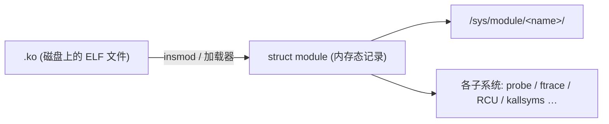

# 📦 `struct module` 精读：已加载模块的记录 / 句柄

> [!INFO] 笔记概览
> - **定位**：`struct module` 是内核为**已加载模块**建立的**内存态记录 / 句柄**。磁盘上的 `.ko` 才是"文件"，它是"加载后的对象"（类比：`.ko` ↔ 文件，`struct module` ↔ inode；或 `struct device` ↔ 设备模型，`struct module` ↔ 模块子系统）。`/sys/module/<name>/` 是它的用户态投影。
> - **一句话**：它**只记录、不干活**——记住各 ELF 资源表的地址/数量、维护状态与引用计数、挂上创建/退出钩子；真正做事的是各子系统（probe/tracepoint/RCU/kallsyms…）。
> - **内容范围**：五类字段全景 · 身份元数据 · 生命周期 · 状态 · 依赖引用 · ELF 资源表 · 符号导出与许可证 · 内存布局 · 栈回溯与调试 · sysfs 投影。
> - **引用格式**：`文件:行号`（本仓库 Linux 7.3.0-rc6）。

相关笔记：[[platform-resource-mfd 结构精读]] · [[kobject-sysfs-kernfs映射分层]]

---

## 🧭 1. 定位：模块的"登记层"

`struct module` 几乎不亲自做事，只是**登记 + 索引 + 生命周期钩子**（和 platform 之于外设完全同构）。字段可归为**五类**：

| 类别 | 代表字段 | 作用 |
| --- | --- | --- |
| ① **身份 / 元数据** | `name`/`version`/`srcversion`/`build_id`/`taints`/`imported_namespaces` | "我是谁、哪次构建编的" |
| ② **创建与退出** | `init`/`exit`/`ctors`/`mod_arch_specific` | 生命周期钩子 |
| ③ **状态** | `state`/`refcnt`/`taints`/`async_probe_requested`/`using_gplonly_symbols`/`sig_ok`/`klp` | 当前处于什么状态 |
| ④ **依赖与引用** | `source_list`/`target_list`/`refcnt`/`holders_dir` | 谁依赖我、我依赖谁 → 能否卸载 |
| ⑤ **ELF 资源表** | `syms`/`kp`/`extable`/`percpu`/`tracepoints_ptrs`/… | 模块内部资源的**句柄**，交各子系统用 |

另有 **⑥ sysfs 挂接**（`mkobj`/`holders_dir`/`drivers_dir`），让模块出现在 `/sys/module`。



---

## 🪪 2. 身份 / 元数据

| 字段 | 含义 | 来源 / sysfs |
| --- | --- | --- |
| `name[MODULE_NAME_LEN]` | 模块名 | `/sys/module/<name>` |
| `version` | 版本串 | `MODULE_VERSION` → `.../version` |
| `srcversion` | **源码**哈希 | `.../srcversion` |
| `build_id[20]` | **链接后二进制**的 GNU build ID（SHA-1，20 字节，非字符串） | 见 §10 |
| `taints` | 污染标志位（见 §5） | `.../taint` |
| `imported_namespaces` | 本模块**从哪些符号命名空间导入**（`MODULE_IMPORT_NS`） | — |

> [!NOTE] `srcversion` vs `build_id`
> `srcversion` 针对**源码**（哪份源码编的）；`build_id` 针对**链接后的二进制**（哪一次构建）。二者都用于消歧义，但层次不同。

---

## ⏱️ 3. 生命周期：创建与退出

```c
/* Startup function. */
int (*init)(void);      // module_init 声明的入口函数
...
void (*exit)(void);     // 卸载时的销毁函数（CONFIG_MODULE_UNLOAD）
```

- **`init`**：模块加载时调用；返回 `0` 成功、负 errno 失败。
- **永久模块**：若 `exit == NULL`，`init` 成功后模块被标"**永久**"（`[permanent]`），`rmmod` 会被拒绝。
- **init 段释放**：`init` 跑完后，`MOD_INIT_*` 段内存即被释放（`main.c` 里 `ftrace_free_mem(mod, mod->mem[MOD_INIT_TEXT].base, ...)`）。
- **`ctors`**：来自 `.ctors`（或 `.init_array`）段的构造器函数。

---

## 🚦 4. 状态

| 字段 | 含义 |
| --- | --- |
| `state` | 模块状态机（`COMING`/`LIVE`/`GOING`/`UNFORMED`） |
| `refcnt` | 引用计数（`module_refcount()` = `atomic_read(refcnt) - MODULE_REF_BASE`） |
| `taints` | 污染位（见 §5） |
| `async_probe_requested` | 是否请求**异步 probe**（加速启动） |
| `using_gplonly_symbols` | 本模块是否**用了 GPL-only 符号**（见 §7） |
| `sig_ok` | 签名是否校验通过（`CONFIG_MODULE_SIG`） |
| `klp` / `klp_alive` | 是否 livepatch 模块 |

### 4.1 `async_probe_requested`

驱动加载默认**同步 probe**（`device_add` 触发匹配后当场调 `probe()`，阻塞）。异步 probe 把探测丢进 workqueue 后台跑，**加快开机**。

- 设置：全局参数 `module.async_probe`（`main.c:3079`）→ 模块加载时默认继承（`main.c:3557`）；也可 `modprobe xxx async_probe=1` 按模块覆盖（`main.c:3383`）；或源码 `MODULE_INFO(async_probe,"Y")`。
- 与 `struct device_driver.probe_type`（`PROBE_PREFER_ASYNCHRONOUS`）是**同一加速思路的两层**（驱动级 / 模块级）。

---

## 🔗 5. 依赖与引用：`holders` / `refcnt`

```c
/* CONFIG_MODULE_UNLOAD */
struct list_head source_list;   // 谁依赖我（谁在用我导出的符号）
struct list_head target_list;   // 我依赖谁
atomic_t refcnt;
```

- `ref_module(a, b)`（模块 a 用 b 导出的符号）：b 的 `refcnt++`，并把 a 挂进 **b 的 `source_list`**（`main.c:697-700`：`use->source=a` 加进 `b->source_list`）。
- `holders_dir`（`sysfs.c:375`）建 `/sys/module/<name>/holders/`，遍历 `target_list` 为"依赖我的模块"建符号链接：

```
/sys/module/gpu_sched/holders/xe  ──symlink──►  /sys/module/xe
```

> [!IMPORTANT] `holders/` 的方向别读反
> `holders` 里出现 X，意思是 **X 依赖本模块**（X 拿着/用着本模块），不是反过来。`lsmod` 的第三列同理：

```
gpu_sched  69632  1  xe     ← "Used by: xe" ⇒ xe 依赖 gpu_sched
xe        4452352 0         ← 顶层驱动，无人依赖它
```

每个在被依赖模块 `holders/` 里的链接 ≡ 一条引用 ≡ `refcnt` 的一份 ⇒ **被依赖模块在依赖者卸载前卸不掉**（`rmmod` 报 in use）；卸载顺序自顶向下：先 `rmmod xe`，底层 helper 才能走。

---

## 🧾 6. ELF 资源表：`section_objs` 汇总

加载器在 `find_module_sections()`（`kernel/module/main.c:2670-2794`）里，把模块各 ELF 段用 `section_objs()` 取出、挂成 `struct module` 字段。**核心全局表 + 模块各带一份**是贯穿模式：

| `struct module` 字段 | ELF 段 | 谁用 |
| --- | --- | --- |
| `syms`/`crcs`/`flagstab` | `__ksymtab`/`__kcrctab`/`__kflagstab` | 其他模块（`EXPORT_SYMBOL`，见 §7） |
| `kp`/`num_kp` | `__param` | 模块参数（见 §7.3） |
| `extable`/`num_exentries` | `__ex_table` | 异常表：`get_user`/`copy_from_user` 缺页时查 fixup |
| `percpu`/`percpu_size` | `.data..percpu` | per-CPU 数据（SMP） |
| `noinstr_text_start`/`noinstr_text_size` | `.noinstr.text` | ftrace/kprobes 跳过插桩 + objtool 校验 |
| `tracepoints_ptrs`/`num_tracepoints` | `__tracepoints_ptrs` | tracepoint 子系统 |
| `srcu_struct_ptrs`/`num_srcu_structs` | `___srcu_struct_ptrs` | RCU/SRCU |
| `bpf_raw_events`/`num_bpf_raw_events` | `__bpf_raw_tp_map` | BPF raw tracepoint |
| `btf_data`/`btf_base_data` | `.BTF`/`.BTF.base` | BPF CO-RE 类型信息 |
| `jump_entries`/`num_jump_entries` | `__jump_table` | static key / 跳转标签 |
| `trace_events`/`trace_evals` | `_ftrace_events`/`_ftrace_eval_map` | trace event |
| `trace_bprintk_fmt_start` | `__trace_printk_fmt` | trace_printk 格式串 |
| `ftrace_callsites`/`num_ftrace_callsites` | `__mcount_loc` | ftrace 打桩点 |
| `kprobes_text_start`/`kprobe_blacklist` | `.kprobes.text`/`_kprobe_blacklist` | kprobes |
| `static_call_sites`/`num_static_call_sites` | `.static_call_sites` | static_call |
| `kunit_init_suites`/`kunit_suites` | `.kunit_*_test_suites` | KUnit 测试套件 |
| `printk_index_start` | `.printk_index` | printk 参数索引 |
| `ei_funcs`/`num_ei_funcs` | `_error_injection_whitelist` | 错误注入白名单 |
| `dyndbg_info` | `__dyndbg`/`__dyndbg_classes` | 动态调试描述符 |

> [!NOTE] "导出"分两种语义
> 严格讲真正"**导出给别的模块调用**"的只有 `__ksymtab`（§7）；其余是"**子系统登记表 / 核心运行时表**"——模块只是恰好含有这些段，由内核加载器/子系统**主动去认领**（`section_objs` 是 pull，不是 push）。

### 6.1 依赖它运作的子系统（片段）

- **tracepoint**：模块加载 → `tracepoint_module_coming()`（`kernel/tracepoint.c:604`）登记进 `tracepoint_module_list`；卸载 → `tracepoint_module_going()`（`:632`）注销并做静默检查；遍历入口 `for_each_tracepoint_range()`（`:721`）。
- **SRCU**：`srcu_module_coming()`（`kernel/rcu/srcutree.c:2115`）对每个实例 `alloc_percpu(struct srcu_data)`；`srcu_module_going()`（`:2132`）清理 + 确认无读者；由模块状态通知器在 `COMING`/`GOING` 触发（`:2152`）。
- **exception table**：`search_module_extables()`（`main.c:3863`）按地址在该模块 `extable` 里二分查找 fixup。
- **per-CPU**：`percpu_modalloc()`（`main.c:455`，`__alloc_reserved_percpu`）→ `percpu_modcopy()`（`main.c:489`，逐 CPU `memcpy`）→ `percpu_modfree()` → `free_percpu`（`main.c:479`）。

---

## 🔐 7. 符号导出与许可证

### 7.1 导出表结构

```c
/* kernel/module/internal.h:35 */
struct kernel_symbol {
#ifdef CONFIG_HAVE_ARCH_PREL32_RELOCATIONS
    int value_offset; int name_offset; int namespace_offset;
#else
    unsigned long value;   // 符号在内核里的地址
    const char *name;      // 符号名
#endif
};
```

`struct module` 里对应 `syms`（`struct kernel_symbol *`）/ `crcs`（`u32`，`CONFIG_MODVERSIONS` 的 ABI 校验）/ `flagstab`（`u8`，每个符号一个标志，如 `KSYM_FLAG_GPL_ONLY`）/ `num_syms`。

### 7.2 三条导出"协议"与 GPL 强校验

- `EXPORT_SYMBOL`（谁都能用）/ `EXPORT_SYMBOL_GPL`（仅 GPL 兼容模块）/ `EXPORT_SYMBOL_NS`（放进命名空间，使用者须 `MODULE_IMPORT_NS`）。
- **检查点**：模块 B 加载解析它用到的符号时，`find_symbol()`（`main.c:375`）：

```c
sym_flags = *(syms->flagstab + (sym - syms->start));
if (!fsa->gplok && (sym_flags & KSYM_FLAG_GPL_ONLY))
    return false;   // GPL-only 符号 + 导入模块非 GPL 兼容 → 找不到 → 加载失败
```

- `gplok` 从哪来（`main.c:1267`）：`.gplok = !(mod->taints & (1 << TAINT_PROPRIETARY_MODULE))`，而 `TAINT_PROPRIETARY_MODULE` 由模块自己声明的许可证决定（`module_license_taint_check` `main.c:1765` → `license_is_gpl_compatible`）。

### 7.3 许可证白名单（关键）

```c
/* include/linux/license.h:5 */
static inline int license_is_gpl_compatible(const char *license)
{
    return license && (
        strcmp(license, "GPL") == 0 ||
        strcmp(license, "GPL v2") == 0 ||
        strcmp(license, "GPL and additional rights") == 0 ||
        strcmp(license, "Dual BSD/GPL") == 0 ||
        strcmp(license, "Dual MIT/GPL") == 0 ||
        strcmp(license, "Dual MPL/GPL") == 0);
}
```

> [!WARNING] 只认这 6 个串
> - **MIT 只有写成 `"Dual MIT/GPL"` 才认**（纯 `"MIT"` 不在列表 → taint）。
> - **Apache 内核根本不认**（无 `"Apache"` 也无 `"Dual Apache/GPL"`；Apache 2.0 专利条款与 GPLv2 不兼容）。
> - 不在列表里（含未声明）→ 标 `TAINT_PROPRIETARY_MODULE`，`gplok=false`，**失去 `EXPORT_SYMBOL_GPL` 符号的使用资格**（若需要则加载失败）。

### 7.4 `using_gplonly_symbols`（反向记账）

符号成功解析后（`main.c:1282`）：`if (fsa.license == GPL_ONLY) mod->using_gplonly_symbols = true;` —— 记录"本模块用了 GPL-only 符号"。用于 `inherit_taint()`（`main.c:1245`）：**用了 GPL-only 符号的模块，禁止再去使用专有模块导出的符号**（否则加载失败），维护 GPL 边界。

### 7.5 模块参数 `kernel_param`（呼应 `kp`）

```c
/* include/linux/moduleparam.h:82 */
struct kernel_param {
    const char *name;
    struct module *mod;                  // 内置参数为 NULL
    const struct kernel_param_ops *ops;  // get/set
    const u16 perm;                      // sysfs 权限
    s8 level; u8 flags;
    union { void *arg; ... };            // 指向真实变量
};
```

> [!IMPORTANT] 为什么叫"内核"参数
> `struct kernel_param` + `kernel/params.c` 是**内核通用**的：既管模块参数，也管编进 vmlinux 的内置参数（内置 `kp->mod == NULL`，用全局锁）。`module_param()` 只是驱动侧声明宏。`perm==0` 的参数不出现在 `/sys`，只能 `modprobe xxx=值`。

**`param_lock`（`CONFIG_SYSFS`）**：保护参数这块"用户态(sysfs 读写)与模块代码共享"的内存与元数据。
- 每模块一把锁（`KPARAM_MUTEX(mod)`，`kernel/params.c:21`），内置参数用全局锁；`init_param_lock()` 在 `kernel/module/sysfs.c:436`。
- sysfs `param_attr_show`/`store`（`params.c:579`/`596`）持锁调 `ops->get/set`；并配合 sysfs kobject 引用计数，**防止访问途中模块被 rmmod 造成 UAF**。

---

## 🧱 8. 内存布局：`mem[]`

```c
struct module_memory mem[MOD_MEM_NUM_TYPES] __module_memory_align;
```

```c
/* include/linux/module.h:309 */
enum mod_mem_type {
    MOD_TEXT, MOD_DATA, MOD_RODATA,             // 常驻核心段
    MOD_INIT_TEXT, MOD_INIT_DATA, MOD_INIT_RODATA,  // 初始化段（init 后释放）
    MOD_MEM_NUM_TYPES,
};
/* module.h:347 */
struct module_memory {
    void *base; bool is_rox; unsigned int size;
#ifdef CONFIG_MODULES_TREE_LOOKUP
    struct mod_tree_node mtn;   // 地址→模块 的红黑树节点
#endif
};
```

把 ELF 按**权限**切成 6 类，分别设页保护落实 **W^X**（text 只读可执行 / rodata 只读 / data 可读写；init 段用后释放）。`is_rox` 标记 text 的"只读+可执行"；`within_module_mem_type()` / `__module_address()` 靠它判断地址归属（`search_module_extables` 的前提）。替代了老内核的 `core_layout`/`init_layout`。

---

## 🔬 9. 栈回溯与调试相关

| 字段 | 段 / 来源 | 作用 |
| --- | --- | --- |
| `build_id[20]` | `.note.gnu.build-id` | 离线解码栈回溯时**锁定精确那份 debuginfo** |
| `kallsyms`/`core_kallsyms` | `struct mod_kallsyms`（`module.h:364`） | 地址→符号名（`/proc/kallsyms`、`%pS`、栈回溯） |
| `sect_attrs` | `sysfs.c:65` | `/sys/module/<name>/sections/`（各 ELF 段地址） |
| `notes_attrs` | `sysfs.c:151` | `/sys/module/<name>/notes/`（含 build-id note） |
| `mod_arch_specific arch` | x86: `arch/x86/include/asm/module.h:15` | 架构私有（x86 存 **ORC 展开表**、中断重映射） |
| `kcfi_traps`/`kcfi_traps_end` | `__kcfi_traps`（`kernel/cfi.c:65`） | KCFI 陷阱点地址区间，供 CFI 失败处理程序识别 |

> [!NOTE] build_id 与栈回溯的完整链
> 地址落在模块 → `mem[]` 确认归属 → `kallsyms` 解成函数名 → `build_id`（经 `/notes` 暴露）锁定 debuginfo → 离线还原源码行。
> - **在线**解码用内核自带 `kallsyms`，不需要 build_id（镜像与符号天然一致）；
> - **离线**（在别的机器 `gdb`/`crash`/`perf` 还原）才必须靠 build_id 定位精确 debuginfo。
> - `struct mod_kallsyms.kallsyms` 是 `__rcu` 指针（`kallsyms.c:182/260`）：符号化可能与卸载并发，读者 `rcu_dereference()` 拿稳定视图。

---

## 🗄️ 10. sysfs 投影：`/sys/module/<name>/`

真机 `/sys/module/kvm/` 各项 ↔ 字段：

| 目录项 | 字段 | 说明 |
| --- | --- | --- |
| `holders/` | `holders_dir` | 谁依赖本模块（软链接） |
| `notes/` | `notes_attrs`(+`build_id`) | 含 `.note.gnu.build-id` |
| `parameters/` | `kp`/`num_kp` + `module_param_attrs` | 模块参数（受 `param_lock`） |
| `sections/` | `sect_attrs` | 各 ELF 段地址（**全部非空段**） |
| `refcnt` | `module_refcount()` | lsmod 第三列 |
| `taint` | `taints` | `(P)(O)(E)(F)(K)` |
| `coresize`/`initsize` | `mem[]` 核心/init 段大小 | |
| `initstate` | `state` | live/coming/going |
| `srcversion` | `srcversion` | |
| `uevent` | kobject 标准 | |
| `drivers/` | `mkobj.drivers_dir` | 仅当模块注册了 `device_driver` 才有（kvm 无 → 走 misc `/dev/kvm`） |
| `version` | `version` | 仅当 `MODULE_VERSION` 声明（kvm 无） |

> [!NOTE] `sections/` 是"段清单"，不是"已解析字段清单"
> `add_sect_attrs` 只遍历**所有非空段**建文件，出现 ≠ 被加载器解析成字段。例如 kvm `sections/` 里有 `__ksymtab_gpl`（旧工具链遗留；本树 `main.c:2679` 明确当 **obsolete 忽略**）、`__mcount_loc`/`__tracepoints*`/`__dyndbg` 等纯插桩段——它们只是原样暴露地址，供 ftrace/tracepoint/动态调试子系统自用。

---

## 🧩 11. `#ifdef` 门控的三种类型

你这一路会看到大量 `#ifdef`，可归三类：

| 类型 | 例子 | 门控条件 |
| --- | --- | --- |
| **功能裁剪** | `kp`、`extable`、`percpu`、`tracepoints_ptrs`、`mfd_cell` | `CONFIG_*` 功能开关 |
| **架构钩子** | `arch`（x86 ORC）、`pdev_archdata`、`device.archdata` | `CONFIG_ARCH_*` |
| **安全加固** | `kcfi_traps`（KCFI）、`__randomize_layout`（RANDSTRUCT） | 加固编译选项 |

> [!TIP] RANDSTRUCT 小注
> `__randomize_layout`（`compiler_types.h:468`）= 编译期把结构体成员顺序**洗牌**（每次构建不同），让漏洞利用者的"偏移表"失效；配套 `__designated_init` 强制指名初始化（`.field = value`），因顺序已不可依赖。纯编译期、运行时零开销。它**不改变字段逻辑内容，只改变内存字节排布**——所以按名字访问字段的代码完全无感。

---

## 🔗 13. 相关笔记

- [[platform-resource-mfd 结构精读]] — 设备模型记录层：`platform_device`/`resource`/`mfd_cell`
- [[kobject-sysfs-kernfs映射分层]] — `mkobj`/kobject/uevent 的地基
- [[init.main.c]] — 模块加载在启动流程中的位置

---

## 📚 14. 参考资料

1. **Linux Kernel 源码（本仓库 7.3.0-rc6）** — `include/linux/module.h`（`struct module` 字段 `:395-675`、`enum mod_mem_type` `:309`、`struct module_memory` `:347`、`struct mod_kallsyms` `:364`）.
2. **同上** — `kernel/module/main.c`（`find_module_sections` `:2670`、`ref_module` `:697`、`percpu_mod*` `:455/489/479`、`find_symbol` `:375`、`inherit_taint` `:1240`、`module_license_taint_check` `:1765`、`module_augment_kernel_taints` `:2581`）.
3. **同上** — `kernel/module/sysfs.c`（`add_sect_attrs` `:65`、`add_notes_attrs` `:151`、`init_param_lock` `:436`）、`kernel/module/kallsyms.c`（`:182/260`）、`kernel/module/internal.h`（`struct kernel_symbol` `:35`）.
4. **同上** — `kernel/params.c`（`KPARAM_MUTEX` `:21`）、`include/linux/moduleparam.h`（`struct kernel_param` `:82`）、`include/linux/license.h`（`:5`）.
5. **同上** — `kernel/tracepoint.c`（`:604/632/721`）、`kernel/rcu/srcutree.c`（`:2115/2132`）、`kernel/cfi.c`（`module_cfi_finalize` `:65`）、`arch/x86/include/asm/module.h`（`:15`）.

（注：本文为源码精读笔记，事实来源以本仓库逐行核实为准，格式 `文件:行号` 高频内联。）
